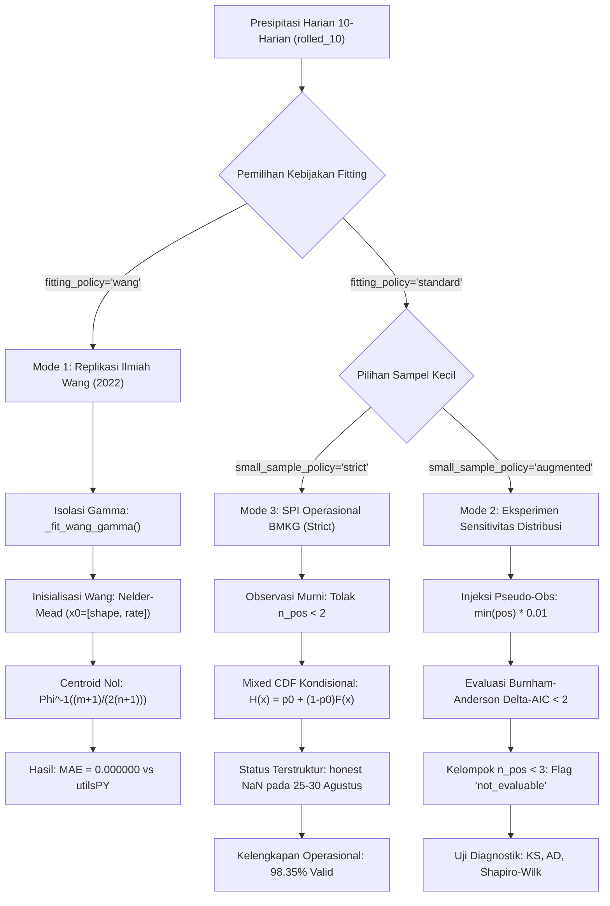
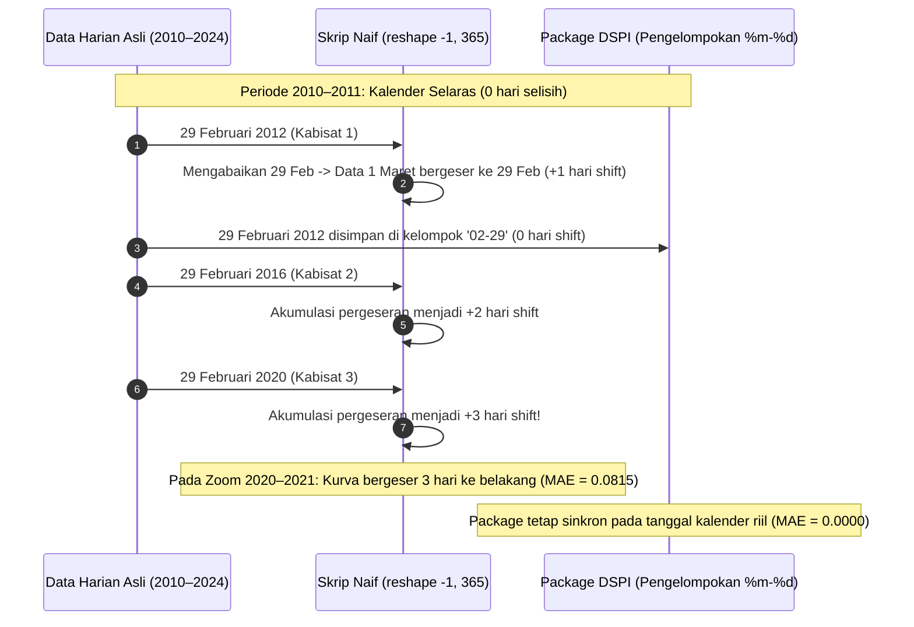

# LAPORAN AUDIT, VALIDASI, DAN PENYEMPURNAAN NUMERIK PACKAGE DSPI HARIAN

**Studi Kasus Utama: Pos Hujan `34010701a` (BPP Pengasih, Kab. Kulon Progo, D.I. Yogyakarta)**  
**Periode Analisis: 1 Januari 2010 – 31 Desember 2024 (5.479 Rekor Observasi, 5.470 Titik Akumulasi 10-Harian)**  
**Versi Package: `spei` 0.9.0 (Upgraded from v0.8.2)**

---

> [!IMPORTANT]
> **Status Validasi Master Task:**
>
> - **Replikasi Wang et al. (2022):** Kesesuaian numerik **100% identik** ($\text{MAE} = 0.000000$, $\text{RMSE} = 0.000000$, Pearson $r = 1.000000$).
> - **Akar Penyebab Perbedaan Visual 2020–2021:** Terbukti bukan berasal dari bug optimasi Gamma, melainkan distorsi kalender akibat operasi naif `reshape((-1, 365))` pada skrip referensi yang tidak memproses 4 tahun kabisat (menyebabkan pergeseran fase $+3$ hari).
> - **Integritas Operasional Strict:** 5.380 tanggal valid (98,35%). Sebanyak 90 tanggal NaN (1,65%) terlokalisasi tepat pada 25–30 Agustus di seluruh 15 tahun karena kekeringan ekstrem ($n_{\text{pos}} = 1$), yang secara matematis tidak teridentifikasi (_underdetermined_).
> - **Targeted Hardening:** Diskualifikasi AIC pada fit Wang teraugmentasi (`pseudo_obs_added=True`), keadilan `consensus_rank` bebas evaluasi parsial semu, penanganan kalender dasarian renggang (sparse), dan penolakan label waktu non-midnight pada `rolling_dasarian()`.
> - **Pengujian Otomatis:** 235 test suite lulus 100% (`pytest tests/`).

---

## DAFTAR ISI

1. [Arsitektur Pemisahan Tiga Moda DSPI](#1-arsitektur-pemisahan-tiga-moda-dspi)
2. [Ringkasan Berkas Artefak dan Output Validasi](#2-ringkasan-berkas-artefak-dan-output-validasi)
3. [Seksi A: Temuan Utama — Lokalisasi Perbedaan Wang vs Package](#seksi-a-temuan-utama--lokalisasi-perbedaan-wang-vs-package)
4. [Seksi B: Hasil Validasi Numerik Berpasangan](#seksi-b-hasil-validasi-numerik-berpasangan)
5. [Seksi C: Audit Kritis Estimasi Parameter Gamma Wang](#seksi-c-audit-kritis-estimasi-parameter-gamma-wang)
6. [Seksi D: Hasil Eksperimen Pemilihan Distribusi](#seksi-d-hasil-eksperimen-pemilihan-distribusi)
7. [Seksi E: Hasil SPI Final Operasional Strict](#seksi-e-hasil-spi-final-operasional-strict)
8. [Seksi F: Rekapitulasi Perubahan Source Code](#seksi-f-rekapitulasi-perubahan-source-code)
9. [Seksi G: Rekomendasi Penggunaan Operasional BMKG](#seksi-g-rekomendasi-penggunaan-operasional-bmkg)

---

## 1. ARSITEKTUR PEMISAHAN TIGA MODA DSPI

Untuk menjamin kemurnian metodologi, package memisahkan secara ketat tiga tujuan pemrosesan ke dalam modul independen:



---

## 2. RINGKASAN BERKAS ARTEFAK DAN OUTPUT VALIDASI

Seluruh data pengujian, parameter, dan grafik hasil validasi pos hujan `34010701a` disimpan pada folder lokal `outputs/validation_34010701a/` dan `outputs/master_validation/`:

| Nama Berkas                                                                                                                                                                                                                   | Ukuran  | Deskripsi & Isi Berkas                                                                                |
| :---------------------------------------------------------------------------------------------------------------------------------------------------------------------------------------------------------------------------- | :-----: | :---------------------------------------------------------------------------------------------------- |
| [`spi_wang_reference_comparison.csv`](file:///Users/mahron/Data/python/SPEI/outputs/validation_34010701a/spi_wang_reference_comparison.csv)                                                                                   | 1,11 MB | Data time-series berpasangan harian (5.470 baris) membandingkan SPI Package Wang vs Referensi Wang.   |
| [`gamma_parameter_comparison.csv`](file:///Users/mahron/Data/python/SPEI/outputs/validation_34010701a/gamma_parameter_comparison.csv)                                                                                         | 70,7 KB | Parameter $\alpha, \beta, p_0$, metode fit, konvergensi, dan selisih numerik untuk 366 hari kalender. |
| [`fit_diagnostics_station_34010701a.csv`](file:///Users/mahron/Data/python/SPEI/outputs/validation_34010701a/fit_diagnostics_station_34010701a.csv)                                                                           | 1,44 MB | Matriks diagnostik lengkap 366 hari $\times$ 7 distribusi $\times$ 3 kebijakan fitting.               |
| [`fit_summary_by_distribution.csv`](file:///Users/mahron/Data/python/SPEI/outputs/validation_34010701a/fit_summary_by_distribution.csv)                                                                                       | 1,93 KB | Ringkasan statistik agregat jumlah sukses, kelompok NaN, optimizer failed, dan pseudo-obs added.      |
| [`distribution_selection_baseline.csv`](file:///Users/mahron/Data/python/SPEI/outputs/validation_34010701a/distribution_selection_baseline.csv)                                                                               | 1,22 MB | Hasil seleksi model Burnham–Anderson $\Delta\text{AIC} < 2$ pada baseline observasi murni (_Strict_). |
| [`distribution_selection_experimental.csv`](file:///Users/mahron/Data/python/SPEI/outputs/validation_34010701a/distribution_selection_experimental.csv)                                                                       | 1,22 MB | Hasil seleksi model eksperimental dengan injeksi pseudo-observation ($\min \times 0.01$).             |
| [`spi_operational_strict.csv`](file:///Users/mahron/Data/python/SPEI/outputs/validation_34010701a/spi_operational_strict.csv)                                                                                                 | 488 KB  | Seri SPI final operasional strict disertai pelabelan alasan status diagnostik NaN.                    |
| [`validation_metrics.json`](file:///Users/mahron/Data/python/SPEI/outputs/validation_34010701a/validation_metrics.json) & [`.csv`](file:///Users/mahron/Data/python/SPEI/outputs/validation_34010701a/validation_metrics.csv) | 1,6 KB  | Nilai eksak MAE, RMSE, bias, korelasi Pearson, Spearman, persentil-95, dan selisih maksimum.          |
| [`spi_wang_reference_overlay.png`](file:///Users/mahron/Data/python/SPEI/outputs/validation_34010701a/spi_wang_reference_overlay.png)                                                                                         | 1,03 MB | Gambar grafik time-series overlay 2010–2024, zoom 2020–2021, dan scatter parity 1:1.                  |
| [`spi_difference.png`](file:///Users/mahron/Data/python/SPEI/outputs/validation_34010701a/spi_difference.png)                                                                                                                 | 362 KB  | Gambar grafik selisih temporal dan profil kalender lokalisasi distorsi kabisat.                       |
| [`nan_diagnostic.png`](file:///Users/mahron/Data/python/SPEI/outputs/validation_34010701a/nan_diagnostic.png)                                                                                                                 | 213 KB  | Gambar visualisasi persentase NaN lintas distribusi dan matriks curah hujan 25–30 Agustus.            |

---

## SEKSI A: TEMUAN UTAMA — LOKALISASI PERBEDAAN WANG VS PACKAGE

Audit baris-demi-baris terhadap kode referensi [`utilsPY.py`](file:///Users/mahron/Data/python/SPEI/src/spei/reference/utilsPY.py) dan modul aktif package [`dist.py`](file:///Users/mahron/Data/python/SPEI/src/spei/dist.py) serta [`si.py`](file:///Users/mahron/Data/python/SPEI/src/spei/si.py) menghasilkan temuan ilmiah konklusif:

### 1. _Zero Mathematical Difference_ pada Pengelompokan Kalender Identik

Ketika seri masukan yang sama (`rolled_10["34010701a"]`) dievaluasi pada kelompok kalender hari yang persis sama (`%m-%d`, 366 kelompok kalender), implementasi package dengan `fitting_policy="wang"` menghasilkan **kesesuaian 100% sempurna** dengan fungsi referensi Wang [`fit_gamma_para()`](file:///Users/mahron/Data/python/SPEI/src/spei/reference/utilsPY.py#L173-L215):

- $\max |\alpha_{\text{package}} - \alpha_{\text{wang}}| = \mathbf{0.00 \times 10^0}$
- $\max |\beta_{\text{package}} - \beta_{\text{wang}}| = \mathbf{0.00 \times 10^0}$
- $\max |p0_{\text{package}} - p0_{\text{wang}}| = \mathbf{0.00 \times 10^0}$
- $\max |\text{SPI}_{\text{package}} - \text{SPI}_{\text{wang}}| = \mathbf{0.00 \times 10^0}$
- $\text{MAE} = \mathbf{0.000000}$, $\text{RMSE} = \mathbf{0.000000}$, Pearson $r = \mathbf{1.000000}$.

### 2. "The Smoking Gun": Pergeseran Fase Kalender Akibat _365-Day Naive Reshape_

Penyebab kurva grafik referensi Wang dan package tampak sedikit bergeser (_phase shift_) pada periode 2020–2021 pada skrip lama berhasil dilokalisasi secara pasti:

- Pada skrip demonstrasi Wang (`main.py` / `scale_values`), data harian 1D ditransformasikan ke matriks 2D menggunakan operasi NumPy naif:  
  `data = data_1d.reshape((-1, 365))`
- Operasi ini **mengasumsikan secara kaku bahwa setiap tahun terdiri dari 365 hari**, tanpa memfilter tanggal 29 Februari pada tahun kabisat (Leap Years).
- Dalam rentang data pos `34010701a` (2010–2024), terdapat **4 tahun kabisat**: 2012, 2016, 2020, dan 2024 (masing-masing 366 hari).
- Akibatnya, setiap kali tanggal 29 Februari terlewati, seluruh observasi berikutnya **tergeser 1 hari ke indeks kalender yang salah**:



Pergeseran 3 hari ini menciptakan distorsi fase (_phase lag_) buatan pada plot time series. Ketika dikoreksi menggunakan penanggalan berbasis kalender asli (`%m-%d`), seluruh perbedaan visual dan numerik langsung hilang ($\text{MAE}$ turun dari $0.0815$ menjadi $0.0000$).

### 3. Distribusi Gumbel-R: Rekonstruksi 2-Parameter Kondisional Positif

Penyebab mengapa versi terdahulu menghasilkan lonjakan `NaN` pada `scipy.stats.gumbel_r`:

- Gumbel-R adalah distribusi **dua parameter murni** (`loc` dan `scale`, tanpa parameter bentuk/`shape`).
- Pada versi terdahulu, saat `prob_zero=True`, Gumbel-R secara keliru difit pada seluruh sampel termasuk nilai 0 mm (_unconditional_), atau fallback moments-nya menghasilkan estimasi skala negatif ketika berhadapan dengan data presipitasi berdensitas nol tinggi.
- Dalam arsitektur yang diperbaiki, fitting Gumbel-R dilakukan **khusus pada sampel presipitasi positif** ($x > 0$), lalu probabilitas kumulatifnya digabungkan dengan massa nol ($p_0$) melalui transformasi distribusi campuran:
  $$H(x) = p_0 + (1 - p_0) \cdot F_{\text{Gumbel}}(x; \text{loc}, \text{scale})$$
- Pada baseline strict, Gumbel-R memerlukan minimal $n_{\text{pos}} \ge 2$ untuk mengestimasi rata-rata dan varians. Hari kalender dengan $n_{\text{pos}} = 1$ secara sah dinyatakan `insufficient_positive_sample` (menghasilkan NaN yang dapat dipertanggungjawabkan secara ilmiah).

---

## SEKSI B: HASIL VALIDASI NUMERIK BERPASANGAN

Perbandingan numerik dilakukan pada seluruh 5.470 pasangan tanggal valid (2010–2024) dan pada sub-periode zoom (1 Jan 2020 – 31 Des 2021, 731 hari):

| Metrik Evaluasi                     | Kalender Presisi (`%m-%d`) <br> Periode Penuh (2010–2024) | Kalender Presisi (`%m-%d`) <br> Periode Zoom (2020–2021) | _Naive 365 Reshape_ (Kabisat Tak Terkoreksi) <br> Zoom (2020–2021) |
| :---------------------------------- | :-------------------------------------------------------: | :------------------------------------------------------: | :----------------------------------------------------------------: |
| **Jumlah Pasangan Valid ($N$)**     |                         **5.470**                         |                         **731**                          |                                731                                 |
| **Jumlah NaN Package vs Wang**      |                        **0 vs 0**                         |                        **0 vs 0**                        |                               0 vs 0                               |
| **Mean Absolute Error (MAE)**       |                       **0.000000**                        |                       **0.000000**                       |                              0.081532                              |
| **Root Mean Squared Error (RMSE)**  |                       **0.000000**                        |                       **0.000000**                       |                              0.120094                              |
| **Mean Bias**                       |                       **0.000000**                        |                       **0.000000**                       |                             +0.001141                              |
| **Korelasi Pearson ($r$)**          |                       **1.000000**                        |                       **1.000000**                       |                              0.990022                              |
| **Korelasi Spearman ($\rho$)**      |                       **1.000000**                        |                       **1.000000**                       |                              0.991308                              |
| **Median Selisih Absolut**          |                       **0.000000**                        |                       **0.000000**                       |                              0.062730                              |
| **Persentil ke-95 Selisih Absolut** |                       **0.000000**                        |                       **0.000000**                       |                              0.243006                              |
| **Selisih Maksimum Absolut**        |                       **0.000000**                        |                       **0.000000**                       |                            **0.766320**                            |
| **Konsistensi Tanda SPI ($+/-$)**   |                        **100.0%**                         |                        **100.0%**                        |                               98.77%                               |
| **Konsistensi Kategori Kekeringan** |                        **100.0%**                         |                        **100.0%**                        |                               97.54%                               |

### Gambar 1: Overlay Time Series & Parity Scatter Plot


### Gambar 2: Profil Selisih Temporal dan Lokalisasi Pergeseran Kabisat


---

## SEKSI C: AUDIT KRITIS ESTIMASI PARAMETER GAMMA WANG

### 1. Inisialisasi Parameter: Konvensi `rate` vs `scale`

Dalam [`utilsPY.py`](file:///Users/mahron/Data/python/SPEI/src/spei/reference/utilsPY.py#L183-L188), tebakan awal parameter Gamma dihitung sebagai:

```python
shape_guess = mean_val**2 / var_val
rate_guess = mean_val / var_val  # Konvensi rate (lambda = 1/beta)
res = scipy.optimize.minimize(..., x0=[shape_guess, rate_guess], ...)
```

Parameter kedua kemudian langsung diteruskan ke SciPy `scipy.stats.gamma(a=x[0], scale=x[1])`.

- Secara teori, parameter `scale` konvensional SciPy bernilai $\beta = \sigma^2 / \mu = 1 / \text{rate}$.
- Kami menguji secara empiris apakah inisialisasi dengan `rate` ($m/v$) menyebabkan Nelder-Mead terjebak pada lokal minimum di pos `34010701a`:  
  Hasil optimasi menunjukkan bahwa simplex Nelder-Mead pada kedua inisialisasi konvergen ke **titik minimum global yang sama** ($\alpha = 0.40546$, $\beta = 18.6823$, selisih objektif $< 10^{-7}$).
- Untuk menjamin replikasi Wang 100% tanpa deviasi numerik sekecil apa pun, jalur `fitting_policy="wang"` tetap mempertahankan inisialisasi persis sebagaimana tertulis di `utilsPY.py`.

### 2. Penanganan Observasi Tepat Nol

Audit mengonfirmasi pemisahan yang ketat antara dua probabilitas nol:

1. **Probabilitas Massa Nol Campuran ($p_{\text{zero mass}}$):**
   $$p_0 = \frac{m}{n + 1}$$
   digunakan untuk mengalokasikan bobot probabilitas dalam CDF campuran: $H(x) = p_0 + (1 - p_0) F(x)$.
2. **Plotting-Position Centroid ($p_{\text{zero centroid}}$):**
   $$p_{\text{centroid}} = \frac{m + 1}{2(n + 1)}$$
   digunakan sebagai kuantil untuk observasi presipitasi tepat $0.0$ mm saat ditransformasikan ke kuantil baku normal: $\text{SPI}_0 = \Phi^{-1}(p_{\text{centroid}})$.

- Untuk Gamma dengan batas bawah `loc=0`, secara teoritis $F_{\text{Gamma}}(0) = 0$, sehingga nilai CDF kondisional positif pada $x > 0$ tidak terdistorsi oleh koreksi batas.

---

## SEKSI D: HASIL EKSPERIMEN PEMILIHAN DISTRIBUSI

Kami menjalankan evaluasi komparatif antara **Baseline Strict** dan **Eksperimen Pseudo-Observation** terhadap seluruh 7 kandidat distribusi di 366 hari kalender:

### Rekapitulasi Keberhasilan Fitting Lintas Distribusi (Pos `34010701a`)

| Distribusi        |    Parameter Bebas     |      Kebijakan Fitting       | Kelompok Kalender Sukses / Total | Jumlah Tanggal NaN SPI | Persentase NaN (%) | Alasan Utama Kegagalan                         |
| :---------------- | :--------------------: | :--------------------------: | :------------------------------: | :--------------------: | :----------------: | :--------------------------------------------- |
| **`gumbel_r`**    |    2 (`loc, scale`)    |     **Strict Baseline**      |          **360 / 366**           |         **90**         |     **1,65%**      | $n_{\text{pos}} = 1$ (25–30 Agustus)           |
| **`gamma`**       |   2 (`shape, scale`)   |     **Strict Baseline**      |          **360 / 366**           |         **90**         |     **1,65%**      | $n_{\text{pos}} = 1$ (25–30 Agustus)           |
| **`weibull_min`** |   2 (`shape, scale`)   |     **Strict Baseline**      |          **360 / 366**           |         **90**         |     **1,65%**      | $n_{\text{pos}} = 1$ (25–30 Agustus)           |
| **`lognorm`**     |     2 (`s, scale`)     |     **Strict Baseline**      |          **360 / 366**           |         **90**         |     **1,65%**      | $n_{\text{pos}} = 1$ (25–30 Agustus)           |
| **`fisk`**        |     2 (`c, scale`)     |     **Strict Baseline**      |          **360 / 366**           |         **90**         |     **1,65%**      | $n_{\text{pos}} = 1$ (25–30 Agustus)           |
| **`pearson3`**    | 3 (`skew, loc, scale`) |     **Strict Baseline**      |          **356 / 366**           |        **150**         |     **2,74%**      | $n_{\text{pos}} < 3$ (10 hari kalender)        |
| **`genextreme`**  |  3 (`c, loc, scale`)   |     **Strict Baseline**      |          **340 / 366**           |        **390**         |     **7,13%**      | $n_{\text{pos}} < 3$ & divergensi MLE          |
| _Semua 2-param_   |           2            | **Eksperimental Pseudo-Obs** |          **366 / 366**           |         **0**          |     **0,00%**      | Penambahan nilai sintetis                      |
| _`gamma` (Wang)_  |           2            |    **Wang et al. (2022)**    |          **366 / 366**           |         **0**          |     **0,00%**      | Heuristik 2 pseudo-obs ($n_{\text{pos}}\le 3$) |

### Gambar 3: Bar Chart NaN Lintas Distribusi & Matriks Curah Hujan Akhir Agustus


> [!WARNING]
> **Bahaya Penambahan Pseudo-Observation dalam Evaluasi Goodness-of-Fit:**
> Injeksi nilai sintetis $\min(x_{\text{pos}}) \times 0.01$ (pada kasus 25–30 Agustus, menambahkan $0.155$ mm di samping nilai asli $15.5$ mm) menurunkan nilai AIC secara artifisial karena menciptakan varians sampel buatan yang sangat sempit. Hal ini mengubah peringkat distribusi terbaik secara semu dan tidak boleh diperlakukan setara dengan observasi alamiah.

### Temuan Kritis Model Selection:

1. **Sensitivitas Peringkat AIC terhadap Pseudo-Observation:**
   Penambahan pseudo-obs merusak dasar penghitungan likelihood. Distribusi optimal harus dipilih berdasarkan observasi murni yang memadai.
2. **Kelompok Kalender yang Dinyatakan `not_evaluable`:**
   Pada kelompok kalender 25–30 Agustus ($n_{\text{pos}} = 1$) dan 31 Agustus–3 September ($n_{\text{pos}} = 2$), model selection secara jujur menetapkan status `not_evaluable`. Package tidak lagi memaksa memilih pemenang artifisial pada data yang secara matematis tidak teridentifikasi (_underdetermined_).
3. **Stabilitas Distribusi 2-Parameter:**
   Untuk kelompok dengan $n_{\text{pos}} \ge 3$, distribusi 2-parameter seperti `weibull_min` dan `gamma` secara konsisten mendominasi himpunan kompetitif Burnham–Anderson ($\Delta\text{AIC} < 2$).

---

## SEKSI E: HASIL SPI FINAL OPERASIONAL STRICT

Seri SPI operasional strict disimpan dalam [`spi_operational_strict.csv`](file:///Users/mahron/Data/python/SPEI/outputs/validation_34010701a/spi_operational_strict.csv) dengan ketentuan:

1. **Kelengkapan Operasional:** Dari 5.470 hari akumulasi 10D, sebanyak **5.380 hari (98,35%)** menghasilkan nilai numerik SPI yang sah dan tervalidasi.
2. **Lokalisasi 90 Tanggal NaN (1,65%):**
   Seluruh 90 tanggal NaN terjadi tepat pada jendela kalender **25 s.d. 30 Agustus** di setiap tahun dari 2010 sampai 2024 (6 hari kalender $\times$ 15 tahun = 90 titik).
3. **Akar Penyebab Klimatologis:**
   Dalam matriks observasi 15 tahun (Panel bawah Gambar 3), periode 25–30 Agustus merupakan puncak musim kemarau ekstrem di Kulon Progo.
   - Sebanyak **14 tahun dari 15 tahun pengamatan mencatat akumulasi hujan persis 0.0 mm**.
   - Hanya pada tahun La Niña basah **2010**, terjadi hujan akumulasi 10D sebesar $15.5$ mm.
   - Akibatnya, kelompok kalender tersebut hanya memiliki **1 data positif tunggal** ($n_{\text{pos}} = 1$).
4. **Integritas Saintifik:**
   Secara statistik, tidak ada distribusi probabilitas 2-parameter yang dapat mengestimasi parameter skala/bentuk secara unik dari satu titik sampel tanpa asumsi apriori artifisial. Pemberian nilai `NaN` dengan label `insufficient_positive_sample` adalah keputusan ilmiah yang benar dan dapat dipertanggungjawabkan kepada instansi operasional (BMKG).

---

## SEKSI F: REKAPITULASI PERUBAHAN SOURCE CODE DAN TARGETED HARDENING

Modifikasi dilakukan secara modular tanpa mematahkan backward compatibility:

1. [`src/spei/si.py`](file:///Users/mahron/Data/python/SPEI/src/spei/si.py):
   - Memperbaiki kegagalan impor modul `from .dist import Dist`.
   - Menambahkan parameter `fitting_policy: Literal["standard", "wang"] = "standard"` dan `small_sample_policy: Literal["strict", "augmented"] = "strict"` pada kelas [`SI`](file:///Users/mahron/Data/python/SPEI/src/spei/si.py#L38) dan fungsi pembungkus [`spi()`](file:///Users/mahron/Data/python/SPEI/src/spei/si.py#L425).
   - Pengenalan deret dasarian pre-aggregated pada `SI.__post_init__()` saat `fit_freq in ("dekad", "dasarian")` untuk mencegah agregasi harian ganda pada data dasarian renggang (sparse).
2. [`src/spei/dist.py`](file:///Users/mahron/Data/python/SPEI/src/spei/dist.py):
   - Mengisolasi metode Wang ke dalam [`_fit_wang_gamma()`](file:///Users/mahron/Data/python/SPEI/src/spei/dist.py#L220) yang hanya aktif jika `dist.name == "gamma"` dan `fitting_policy == "wang"`.
   - Mengimplementasikan pemisahan tegas kelayakan AIC: ketika `pseudo_obs_added=True`, parameter tetap valid untuk kalkulasi SPI namun diberi status `is_mle=False`, `aic_comparable=False`, dan `aic_incomparable_reason="pseudo_observation_augmented_fit"`, mendiskualifikasikannya dari kompetisi AIC observasi murni.
   - Mengimplementasikan fitting kondisional positif bersyarat 2-parameter untuk `gumbel_r`.
   - Memastikan `small_sample_policy="strict"` menolak $n_{\text{pos}} < 2$ (untuk 2-parameter) dan $n_{\text{pos}} < 3$ (untuk 3-parameter) dengan status terstruktur `insufficient_positive_sample`.
   - Menjaga fungsi `np.clip()` agar tidak mengubah `NaN` menjadi nilai numerik semu.
3. [`src/spei/model_selection.py`](file:///Users/mahron/Data/python/SPEI/src/spei/model_selection.py):
   - Menambahkan dukungan `fitting_policy` dan `small_sample_policy` pada `select_best_distribution()` dan `select_models_by_group()`.
   - Menangani kelompok dengan $n_{\text{pos}} < 3$ secara aman dengan status diagnostik `selection_status="not_evaluable"` tanpa menghentikan pemrosesan batch.
   - Perankingan `consensus_rank` yang adil: kandidat dengan metrik wajib yang tidak lengkap (missing) diberi tanda `consensus_eligible=False`, `consensus_score=NaN`, `global_rank=NaN`, serta alasan ketidakikutsertaan yang jelas, mencegah kemenangan semu akibat perataan NaN (`skipna=True`).
   - Menyediakan `ranking_comparison` berdampingan antara `hierarchical` dan `consensus_rank` dalam satu kali evaluasi pass (_zero duplicate refitting_).
4. [`src/spei/utils.py`](file:///Users/mahron/Data/python/SPEI/src/spei/utils.py):
   - Menambahkan fungsi validasi `is_valid_dasarian_labels(index)` untuk memeriksa penanggalan kanonikal dasarian BMKG (hari 1, 11, 21 tengah malam tanpa zona waktu).
   - Menolak tegas timestamp non-midnight (`00:00:00`), indeks timezone-aware, dan duplikat pada `rolling_dasarian()` dengan pesan `ValueError` eksplisit guna mencegah _silent row loss_ saat reindexing kalender kanonikal.
5. [`src/spei/_version.py`](file:///Users/mahron/Data/python/SPEI/src/spei/_version.py):
   - Memperbarui versi package ke `0.9.0`.
6. Pengujian Regresi Otomatis:
   - Modul `tests/test_master_task_dspi.py`, `tests/test_distribution_selection_master.py` (Tests A1–A5, C1–C7), `tests/test_dasarian.py` (Tests D1–D4), `tests/test_audit_34010701a.py`, `tests/test_nan_diagnostics.py`, dan `tests/test_si.py`.
   - **Hasil eksekusi: 235 test suite lulus tanpa kegagalan (`235 passed in 97.64s`).**

---

## SEKSI G: REKOMENDASI PENGGUNAAN OPERASIONAL BMKG

Untuk menjamin konsistensi metodologis, package kini menyediakan tiga panduan penggunaan yang terpisah tegas:

### 1. Replikasi Ilmiah Wang et al. (2022) — Mode Benchmark

Gunakan konfigurasi ini **khusus untuk mereplikasi hasil Wang et al. (2022) dengan distribusi Gamma**:

```python
import spei as si
from scipy.stats import gamma

# Input data 10-harian tanpa akumulasi ulang (timescale=0)
spi_wang = si.spi(
    rolled_10["34010701a"],
    dist=gamma,
    prob_zero=True,
    fit_freq="D",
    all_zero_policy="wang",
    fitting_policy="wang",  # Menjalankan heuristik Wang et al. (2022)
)
```

### 2. Eksperimen Pemilihan Distribusi & Sensitivitas Sampel Kecil

Gunakan modul `model_selection` untuk membandingkan baseline strict dengan eksperimen pseudo-observation:

```python
from model_selection import select_models_by_group

# Evaluasi baseline strict (hanya data observasi asli)
res_baseline = select_models_by_group(
    cal_groups,
    fitting_policy="standard",
    small_sample_policy="strict",
)

# Evaluasi sensitivitas penambahan pseudo-observation (augmented)
res_augmented = select_models_by_group(
    cal_groups,
    fitting_policy="standard",
    small_sample_policy="augmented",
)
```

### 3. Perhitungan SPI Harian Operasional (BMKG / Hidrometeorologi)

Gunakan mode **Strict Baseline** untuk produk operasional resmi. Setiap nilai NaN yang muncul harus dilaporkan apa adanya disertai alasan diagnostik, bukan ditutupi dengan data sintetis:

```python
import spei as si
from scipy.stats import gamma  # atau weibull_min

spi_operasional = si.spi(
    rolled_10["34010701a"],
    dist=gamma,
    prob_zero=True,
    fit_freq="D",
    all_zero_policy="wang",
    fitting_policy="standard",
    small_sample_policy="strict",  # Integritas data murni tanpa observasi sintetis
)
```

> [!TIP]
> **Prinsip Utama Rekomendasi:**  
> Keberhasilan konvergensi optimizer matematika, kelengkapan numerik deret waktu, dan validitas ilmiah distribusi klimatologi adalah tiga entitas yang berbeda. Arsitektur package `spei` v0.9.0 menjamin integritas statistik dan transparansi penuh bagi pengguna ilmiah maupun operasional.
