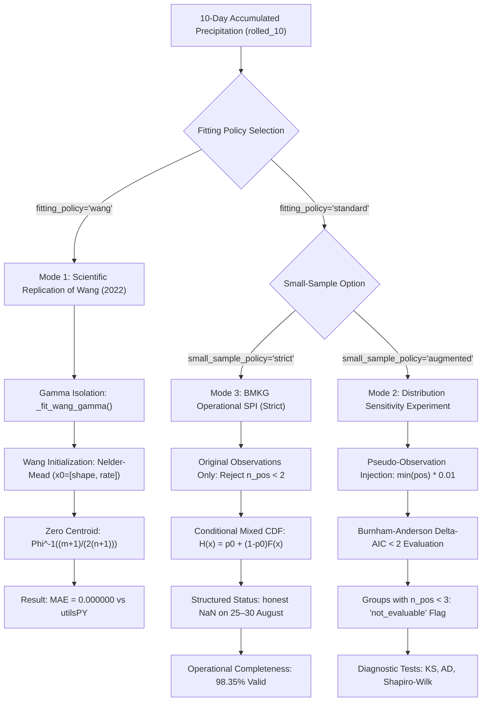
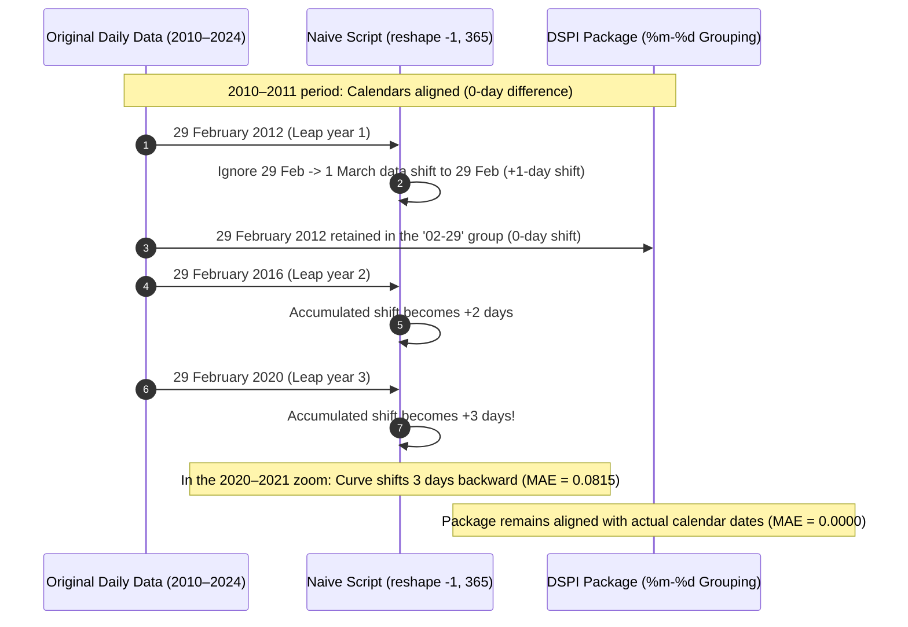

# AUDIT, VALIDATION, AND NUMERICAL REFINEMENT OF THE DAILY DSPI PACKAGE

**Primary Case Study: Rainfall Station `34010701a` (BPP Pengasih, Kulon Progo Regency, Special Region of Yogyakarta)**  
**Analysis Period: 1 January 2010 – 31 December 2024 (5,479 Observation Records, 5,470 10-Day Accumulation Points)**  
**Package Version: `spei` 0.9.0 (Upgraded from v0.8.2)**

---

> [!IMPORTANT]
> **Master Task Validation Status:**
>
> - **Replication of Wang et al. (2022):** Numerical agreement is **100% identical** ($\text{MAE} = 0.000000$, $\text{RMSE} = 0.000000$, Pearson $r = 1.000000$).
> - **Root Cause of the 2020–2021 Visual Difference:** Demonstrated to arise not from a Gamma optimization bug, but from calendar distortion caused by the naïve `reshape((-1, 365))` operation in the reference script, which does not process the 4 leap years (resulting in a $+3$-day phase shift).
> - **Strict Operational Integrity:** 5,380 valid dates (98.35%). The 90 NaN dates (1.65%) are localized exactly to 25–30 August in all 15 years because of extreme drought ($n_{\text{pos}} = 1$), a mathematically unidentifiable (_underdetermined_) case.
> - **Targeted Hardening:** AIC disqualification for augmented Wang fits (`pseudo_obs_added=True`), fair `consensus_rank` handling without spurious partial evaluation, handling of sparse ten-day calendars, and rejection of non-midnight timestamps in `rolling_dasarian()`.
> - **Automated Tests:** All 235 tests passed (`pytest tests/`).

---

## TABLE OF CONTENTS

1. [Architecture for Separating the Three DSPI Modes](#1-architecture-for-separating-the-three-dspi-modes)
2. [Summary of Validation Artifact Files and Outputs](#2-summary-of-validation-artifact-files-and-outputs)
3. [Section A: Key Findings — Localization of Differences Between Wang and the Package](#section-a-key-findings--localization-of-differences-between-wang-and-the-package)
4. [Section B: Paired Numerical Validation Results](#section-b-paired-numerical-validation-results)
5. [Section C: Critical Audit of Wang Gamma Parameter Estimation](#section-c-critical-audit-of-wang-gamma-parameter-estimation)
6. [Section D: Distribution Selection Experiment Results](#section-d-distribution-selection-experiment-results)
7. [Section E: Final Strict Operational SPI Results](#section-e-final-strict-operational-spi-results)
8. [Section F: Summary of Source Code Changes](#section-f-summary-of-source-code-changes)
9. [Section G: Recommendations for BMKG Operational Use](#section-g-recommendations-for-bmkg-operational-use)

---

## 1. ARCHITECTURE FOR SEPARATING THE THREE DSPI MODES

To ensure methodological rigor, the package strictly separates three processing objectives into independent modes:



---

## 2. SUMMARY OF VALIDATION ARTIFACT FILES AND OUTPUTS

All test data, parameters, and validation plots for rainfall station `34010701a` are stored in the local folders `outputs/validation_34010701a/` and `outputs/master_validation/`:

| File Name                                                                                                                                                                                                                     | Size    | File Description and Contents                                                                            |
| :---------------------------------------------------------------------------------------------------------------------------------------------------------------------------------------------------------------------------- | :-----: | :------------------------------------------------------------------------------------------------------- |
| [`spi_wang_reference_comparison.csv`](file:///Users/mahron/Data/python/SPEI/outputs/validation_34010701a/spi_wang_reference_comparison.csv)                                                                                   | 1.11 MB | Paired daily time-series data (5,470 rows) comparing package Wang SPI with the Wang reference.           |
| [`gamma_parameter_comparison.csv`](file:///Users/mahron/Data/python/SPEI/outputs/validation_34010701a/gamma_parameter_comparison.csv)                                                                                         | 70.7 KB | Parameters $\alpha, \beta, p_0$, fitting method, convergence, and numerical differences for 366 calendar days. |
| [`fit_diagnostics_station_34010701a.csv`](file:///Users/mahron/Data/python/SPEI/outputs/validation_34010701a/fit_diagnostics_station_34010701a.csv)                                                                           | 1.44 MB | Complete diagnostic matrix: 366 days $\times$ 7 distributions $\times$ 3 fitting policies.                |
| [`fit_summary_by_distribution.csv`](file:///Users/mahron/Data/python/SPEI/outputs/validation_34010701a/fit_summary_by_distribution.csv)                                                                                       | 1.93 KB | Aggregate statistical summary of successful fits, NaN groups, optimizer failures, and pseudo-obs additions. |
| [`distribution_selection_baseline.csv`](file:///Users/mahron/Data/python/SPEI/outputs/validation_34010701a/distribution_selection_baseline.csv)                                                                               | 1.22 MB | Burnham–Anderson model selection results, $\Delta\text{AIC} < 2$, for the original-observation (_Strict_) baseline. |
| [`distribution_selection_experimental.csv`](file:///Users/mahron/Data/python/SPEI/outputs/validation_34010701a/distribution_selection_experimental.csv)                                                                       | 1.22 MB | Experimental model selection results with pseudo-observation injection ($\min \times 0.01$).             |
| [`spi_operational_strict.csv`](file:///Users/mahron/Data/python/SPEI/outputs/validation_34010701a/spi_operational_strict.csv)                                                                                                 | 488 KB  | Final strict operational SPI series, with diagnostic status reasons labeling NaNs.                       |
| [`validation_metrics.json`](file:///Users/mahron/Data/python/SPEI/outputs/validation_34010701a/validation_metrics.json) & [`.csv`](file:///Users/mahron/Data/python/SPEI/outputs/validation_34010701a/validation_metrics.csv) | 1.6 KB  | Exact MAE, RMSE, bias, Pearson and Spearman correlations, 95th percentile, and maximum difference.        |
| [`spi_wang_reference_overlay.png`](file:///Users/mahron/Data/python/SPEI/outputs/validation_34010701a/spi_wang_reference_overlay.png)                                                                                         | 1.03 MB | Overlay time-series plot for 2010–2024, 2020–2021 zoom, and 1:1 parity scatter plot.                      |
| [`spi_difference.png`](file:///Users/mahron/Data/python/SPEI/outputs/validation_34010701a/spi_difference.png)                                                                                                                 | 362 KB  | Plot of temporal differences and calendar profile localizing leap-year distortion.                       |
| [`nan_diagnostic.png`](file:///Users/mahron/Data/python/SPEI/outputs/validation_34010701a/nan_diagnostic.png)                                                                                                                 | 213 KB  | Visualization of NaN percentages across distributions and the rainfall matrix for 25–30 August.          |

---

## SECTION A: KEY FINDINGS — LOCALIZATION OF DIFFERENCES BETWEEN WANG AND THE PACKAGE

A line-by-line audit of the reference code [`utilsPY.py`](file:///Users/mahron/Data/python/SPEI/src/spei/reference/utilsPY.py), the active package module [`dist.py`](file:///Users/mahron/Data/python/SPEI/src/spei/dist.py), and [`si.py`](file:///Users/mahron/Data/python/SPEI/src/spei/si.py) yielded conclusive scientific findings:

### 1. _Zero Mathematical Difference_ Under Identical Calendar Grouping

When the same input series (`rolled_10["34010701a"]`) is evaluated using exactly the same calendar-day groups (`%m-%d`, 366 calendar groups), the package implementation with `fitting_policy="wang"` achieves **100% perfect agreement** with the Wang reference function [`fit_gamma_para()`](file:///Users/mahron/Data/python/SPEI/src/spei/reference/utilsPY.py#L173-L215):

- $\max |\alpha_{\text{package}} - \alpha_{\text{wang}}| = \mathbf{0.00 \times 10^0}$
- $\max |\beta_{\text{package}} - \beta_{\text{wang}}| = \mathbf{0.00 \times 10^0}$
- $\max |p0_{\text{package}} - p0_{\text{wang}}| = \mathbf{0.00 \times 10^0}$
- $\max |\text{SPI}_{\text{package}} - \text{SPI}_{\text{wang}}| = \mathbf{0.00 \times 10^0}$
- $\text{MAE} = \mathbf{0.000000}$, $\text{RMSE} = \mathbf{0.000000}$, Pearson $r = \mathbf{1.000000}$.

### 2. “The Smoking Gun”: Calendar Phase Shift Caused by _365-Day Naive Reshape_

The cause of the slight apparent shift (_phase shift_) between the Wang reference and package curves during 2020–2021 in the legacy script has been definitively localized:

- In the Wang demonstration script (`main.py` / `scale_values`), the 1D daily data are transformed into a 2D matrix using the naïve NumPy operation:  
  `data = data_1d.reshape((-1, 365))`
- This operation **rigidly assumes that every year has 365 days**, without filtering out 29 February in leap years.
- The `34010701a` station data (2010–2024) include **4 leap years**: 2012, 2016, 2020, and 2024 (each with 366 days).
- Consequently, each time 29 February is passed, all subsequent observations **shift by 1 day to the wrong calendar index**:



This 3-day shift introduces an artificial phase lag in the time-series plot. When corrected using the original calendar-based dates (`%m-%d`), all visual and numerical differences disappear ($\text{MAE}$ decreases from $0.0815$ to $0.0000$).

### 3. Gumbel-R Distribution: Positive-Conditional 2-Parameter Reconstruction

The causes of the `NaN` spikes produced by earlier versions with `scipy.stats.gumbel_r` are:

- Gumbel-R is a **pure two-parameter** distribution (`loc` and `scale`, with no shape parameter).
- In the earlier version, when `prob_zero=True`, Gumbel-R was incorrectly fitted to the entire sample, including 0 mm values (_unconditional_), or its fallback moments method produced a negative scale estimate when faced with zero-inflated precipitation data.
- In the corrected architecture, Gumbel-R is fitted **only to the positive precipitation sample** ($x > 0$), and its cumulative probability is then combined with the zero mass ($p_0$) through the mixed-distribution transformation:
  $$H(x) = p_0 + (1 - p_0) \cdot F_{\text{Gumbel}}(x; \text{loc}, \text{scale})$$
- Under the strict baseline, Gumbel-R requires at least $n_{\text{pos}} \ge 2$ to estimate the mean and variance. Calendar days with $n_{\text{pos}} = 1$ are correctly assigned `insufficient_positive_sample` (yielding a scientifically defensible NaN).

---

## SECTION B: PAIRED NUMERICAL VALIDATION RESULTS

Numerical comparisons were conducted across all 5,470 valid date pairs (2010–2024) and over the zoom sub-period (1 Jan 2020 – 31 Dec 2021, 731 days):

| Evaluation Metric                   | Exact Calendar (`%m-%d`) <br> Full Period (2010–2024) | Exact Calendar (`%m-%d`) <br> Zoom Period (2020–2021) | _Naive 365 Reshape_ (Uncorrected Leap Years) <br> Zoom (2020–2021) |
| :---------------------------------- | :---------------------------------------------------: | :----------------------------------------------------: | :---------------------------------------------------------------: |
| **Number of Valid Pairs ($N$)**     |                         **5,470**                    |                         **731**                        |                               731                                 |
| **Package vs Wang NaN Count**       |                        **0 vs 0**                    |                        **0 vs 0**                      |                              0 vs 0                               |
| **Mean Absolute Error (MAE)**       |                       **0.000000**                    |                       **0.000000**                     |                             0.081532                              |
| **Root Mean Squared Error (RMSE)**  |                       **0.000000**                    |                       **0.000000**                     |                             0.120094                              |
| **Mean Bias**                       |                       **0.000000**                    |                       **0.000000**                     |                            +0.001141                              |
| **Pearson Correlation ($r$)**       |                       **1.000000**                    |                       **1.000000**                     |                             0.990022                              |
| **Spearman Correlation ($\rho$)**   |                       **1.000000**                    |                       **1.000000**                     |                             0.991308                              |
| **Median Absolute Difference**      |                       **0.000000**                    |                       **0.000000**                     |                             0.062730                              |
| **95th Percentile Absolute Difference** |                    **0.000000**                    |                       **0.000000**                     |                             0.243006                              |
| **Maximum Absolute Difference**     |                       **0.000000**                    |                       **0.000000**                     |                           **0.766320**                            |
| **SPI Sign Consistency ($+/-$)**    |                        **100.0%**                     |                        **100.0%**                      |                              98.77%                               |
| **Drought Category Consistency**    |                        **100.0%**                     |                        **100.0%**                      |                              97.54%                               |

### Figure 1: Time-Series Overlay and Parity Scatter Plot


### Figure 2: Temporal Difference Profile and Localization of the Leap-Year Shift


---

## SECTION C: CRITICAL AUDIT OF WANG GAMMA PARAMETER ESTIMATION

### 1. Parameter Initialization: `rate` vs `scale` Convention

In [`utilsPY.py`](file:///Users/mahron/Data/python/SPEI/src/spei/reference/utilsPY.py#L183-L188), the initial guesses for the Gamma parameters are calculated as follows:

```python
shape_guess = mean_val**2 / var_val
rate_guess = mean_val / var_val  # Rate convention (lambda = 1/beta)
res = scipy.optimize.minimize(..., x0=[shape_guess, rate_guess], ...)
```

The second parameter is then passed directly to SciPy as `scipy.stats.gamma(a=x[0], scale=x[1])`.

- In theory, the conventional SciPy `scale` parameter is $\beta = \sigma^2 / \mu = 1 / \text{rate}$.
- We empirically tested whether initializing with `rate` ($m/v$) caused Nelder-Mead to become trapped in a local minimum at station `34010701a`:  
  The optimization results show that the Nelder-Mead simplex converges to **the same global minimum** from both initializations ($\alpha = 0.40546$, $\beta = 18.6823$, objective difference $< 10^{-7}$).
- To ensure 100% Wang replication with no numerical deviation whatsoever, the `fitting_policy="wang"` path retains the initialization exactly as specified in `utilsPY.py`.

### 2. Handling Exact-Zero Observations

The audit confirms a strict distinction between two zero probabilities:

1. **Mixed Zero-Mass Probability ($p_{\text{zero mass}}$):**
   $$p_0 = \frac{m}{n + 1}$$
   is used to allocate probability weight in the mixed CDF: $H(x) = p_0 + (1 - p_0) F(x)$.
2. **Plotting-Position Centroid ($p_{\text{zero centroid}}$):**
   $$p_{\text{centroid}} = \frac{m + 1}{2(n + 1)}$$
   is used as the quantile for exact $0.0$ mm precipitation observations when they are transformed to standard normal quantiles: $\text{SPI}_0 = \Phi^{-1}(p_{\text{centroid}})$.

- For Gamma with lower bound `loc=0`, theoretically $F_{\text{Gamma}}(0) = 0$, so the conditional CDF values for positive $x > 0$ are not distorted by the boundary correction.

---

## SECTION D: DISTRIBUTION SELECTION EXPERIMENT RESULTS

We conducted a comparative evaluation of the **Strict Baseline** and the **Pseudo-Observation Experiment** for all 7 candidate distributions across 366 calendar days:

### Summary of Cross-Distribution Fitting Success (Station `34010701a`)

| Distribution      | Free Parameters       | Fitting Policy                 | Successful Calendar Groups / Total | SPI NaN Dates | NaN Percentage (%) | Primary Reason for Failure                       |
| :---------------- | :-------------------: | :----------------------------: | :--------------------------------: | :-----------: | :----------------: | :----------------------------------------------- |
| **`gumbel_r`**    | 2 (`loc, scale`)      | **Strict Baseline**            | **360 / 366**                      | **90**        | **1.65%**          | $n_{\text{pos}} = 1$ (25–30 August)               |
| **`gamma`**       | 2 (`shape, scale`)    | **Strict Baseline**            | **360 / 366**                      | **90**        | **1.65%**          | $n_{\text{pos}} = 1$ (25–30 August)               |
| **`weibull_min`** | 2 (`shape, scale`)    | **Strict Baseline**            | **360 / 366**                      | **90**        | **1.65%**          | $n_{\text{pos}} = 1$ (25–30 August)               |
| **`lognorm`**     | 2 (`s, scale`)        | **Strict Baseline**            | **360 / 366**                      | **90**        | **1.65%**          | $n_{\text{pos}} = 1$ (25–30 August)               |
| **`fisk`**        | 2 (`c, scale`)        | **Strict Baseline**            | **360 / 366**                      | **90**        | **1.65%**          | $n_{\text{pos}} = 1$ (25–30 August)               |
| **`pearson3`**    | 3 (`skew, loc, scale`) | **Strict Baseline**           | **356 / 366**                      | **150**       | **2.74%**          | $n_{\text{pos}} < 3$ (10 calendar days)            |
| **`genextreme`**  | 3 (`c, loc, scale`)   | **Strict Baseline**            | **340 / 366**                      | **390**       | **7.13%**          | $n_{\text{pos}} < 3$ & MLE divergence             |
| _All 2-parameter_ | 2                     | **Experimental Pseudo-Obs**     | **366 / 366**                      | **0**         | **0.00%**          | Addition of synthetic values                      |
| _`gamma` (Wang)_  | 2                     | **Wang et al. (2022)**          | **366 / 366**                      | **0**         | **0.00%**          | 2-pseudo-observation heuristic ($n_{\text{pos}}\le 3$) |

### Figure 3: Cross-Distribution NaN Bar Chart and Late-August Rainfall Matrix


> [!WARNING]
> **Risk of Adding Pseudo-Observations in Goodness-of-Fit Evaluation:**
> Injecting synthetic values $\min(x_{\text{pos}}) \times 0.01$ (in the 25–30 August case, adding $0.155$ mm alongside the original value of $15.5$ mm) artificially lowers AIC by creating an extremely narrow artificial sample variance. This spuriously changes the ranking of the best distribution and must not be treated as equivalent to natural observations.

### Critical Model Selection Findings:

1. **Sensitivity of AIC Ranking to Pseudo-Observations:**
   Adding pseudo-obs undermines the basis of the likelihood calculation. The optimal distribution should be selected using an adequate number of original observations.
2. **Calendar Groups Designated `not_evaluable`:**
   For the 25–30 August calendar group ($n_{\text{pos}} = 1$) and 31 August–3 September ($n_{\text{pos}} = 2$), model selection honestly assigns the `not_evaluable` status. The package no longer forces selection of an artificial winner for mathematically unidentifiable (_underdetermined_) data.
3. **Stability of 2-Parameter Distributions:**
   For groups with $n_{\text{pos}} \ge 3$, 2-parameter distributions such as `weibull_min` and `gamma` consistently dominate the Burnham–Anderson competitive set ($\Delta\text{AIC} < 2$).

---

## SECTION E: FINAL STRICT OPERATIONAL SPI RESULTS

The strict operational SPI series is stored in [`spi_operational_strict.csv`](file:///Users/mahron/Data/python/SPEI/outputs/validation_34010701a/spi_operational_strict.csv), subject to the following:

1. **Operational Completeness:** Of 5,470 10-day accumulation days, **5,380 days (98.35%)** yield valid, validated numerical SPI values.
2. **Localization of the 90 NaN Dates (1.65%):**
   All 90 NaN dates occur exactly within the calendar window of **25 to 30 August** in every year from 2010 through 2024 (6 calendar days $\times$ 15 years = 90 points).
3. **Climatological Root Cause:**
   In the 15-year observation matrix (lower panel of Figure 3), 25–30 August is the peak of the extreme dry season in Kulon Progo.
   - **14 of the 15 years of observation recorded exactly 0.0 mm of accumulated rainfall.**
   - Only in the wet La Niña year **2010** was there 10-day accumulated rainfall of $15.5$ mm.
   - Consequently, this calendar group has only **one positive data point** ($n_{\text{pos}} = 1$).
4. **Scientific Integrity:**
   Statistically, no 2-parameter probability distribution can uniquely estimate its scale/shape parameters from a single sample point without artificial a priori assumptions. Assigning `NaN` with the label `insufficient_positive_sample` is the scientifically correct decision and can be justified to operational agencies (BMKG).

---

## SECTION F: SUMMARY OF SOURCE CODE CHANGES AND TARGETED HARDENING

The modifications were implemented modularly without breaking backward compatibility:

1. [`src/spei/si.py`](file:///Users/mahron/Data/python/SPEI/src/spei/si.py):
   - Fixed the module import failure `from .dist import Dist`.
   - Added the parameters `fitting_policy: Literal["standard", "wang"] = "standard"` and `small_sample_policy: Literal["strict", "augmented"] = "strict"` to the [`SI`](file:///Users/mahron/Data/python/SPEI/src/spei/si.py#L38) class and the [`spi()`](file:///Users/mahron/Data/python/SPEI/src/spei/si.py#L425) wrapper function.
   - Added recognition of pre-aggregated ten-day series in `SI.__post_init__()` when `fit_freq in ("dekad", "dasarian")` to prevent double daily aggregation of sparse ten-day data.
2. [`src/spei/dist.py`](file:///Users/mahron/Data/python/SPEI/src/spei/dist.py):
   - Isolated the Wang method in [`_fit_wang_gamma()`](file:///Users/mahron/Data/python/SPEI/src/spei/dist.py#L220), which is active only when `dist.name == "gamma"` and `fitting_policy == "wang"`.
   - Implemented strict separation of AIC eligibility: when `pseudo_obs_added=True`, parameters remain valid for SPI calculation but are assigned the statuses `is_mle=False`, `aic_comparable=False`, and `aic_incomparable_reason="pseudo_observation_augmented_fit"`, disqualifying them from pure-observation AIC competition.
   - Implemented conditional fitting of the positive sample for the 2-parameter `gumbel_r` distribution.
   - Ensured that `small_sample_policy="strict"` rejects $n_{\text{pos}} < 2$ (for 2-parameter distributions) and $n_{\text{pos}} < 3$ (for 3-parameter distributions) with the structured status `insufficient_positive_sample`.
   - Preserved `np.clip()` behavior so that it does not convert `NaN` into spurious numerical values.
3. [`src/spei/model_selection.py`](file:///Users/mahron/Data/python/SPEI/src/spei/model_selection.py):
   - Added support for `fitting_policy` and `small_sample_policy` in `select_best_distribution()` and `select_models_by_group()`.
   - Safely handles groups with $n_{\text{pos}} < 3$ using the diagnostic status `selection_status="not_evaluable"` without stopping batch processing.
   - Ensured fair `consensus_rank` ranking: candidates with incomplete (missing) required metrics are marked `consensus_eligible=False`, `consensus_score=NaN`, and `global_rank=NaN`, with a clear reason for exclusion, preventing spurious wins caused by NaN averaging (`skipna=True`).
   - Provides a side-by-side `ranking_comparison` of `hierarchical` and `consensus_rank` in a single evaluation pass (_zero duplicate refitting_).
4. [`src/spei/utils.py`](file:///Users/mahron/Data/python/SPEI/src/spei/utils.py):
   - Added the validation function `is_valid_dasarian_labels(index)` to check canonical BMKG ten-day date labels (days 1, 11, and 21 at midnight, without a time zone).
   - Explicitly rejects non-midnight timestamps (`00:00:00`), timezone-aware indices, and duplicate indices in `rolling_dasarian()` with an explicit `ValueError` message to prevent _silent row loss_ when reindexing to the canonical calendar.
5. [`src/spei/_version.py`](file:///Users/mahron/Data/python/SPEI/src/spei/_version.py):
   - Updated the package version to `0.9.0`.
6. Automated Regression Testing:
   - Modules `tests/test_master_task_dspi.py`, `tests/test_distribution_selection_master.py` (Tests A1–A5, C1–C7), `tests/test_dasarian.py` (Tests D1–D4), `tests/test_audit_34010701a.py`, `tests/test_nan_diagnostics.py`, and `tests/test_si.py`.
   - **Test execution: 235 tests passed without failures (`235 passed in 97.64s`).**

---

## SECTION G: RECOMMENDATIONS FOR BMKG OPERATIONAL USE

To ensure methodological consistency, the package now provides three clearly separated usage guidelines:

### 1. Scientific Replication of Wang et al. (2022) — Benchmark Mode

Use this configuration **only to replicate the results of Wang et al. (2022) using the Gamma distribution**:

```python
import spei as si
from scipy.stats import gamma

# 10-day input data without re-accumulation (timescale=0)
spi_wang = si.spi(
    rolled_10["34010701a"],
    dist=gamma,
    prob_zero=True,
    fit_freq="D",
    all_zero_policy="wang",
    fitting_policy="wang",  # Runs the Wang et al. (2022) heuristic
)
```

### 2. Distribution Selection and Small-Sample Sensitivity Experiments

Use the `model_selection` module to compare the strict baseline with the pseudo-observation experiment:

```python
from model_selection import select_models_by_group

# Evaluate the strict baseline (original observations only)
res_baseline = select_models_by_group(
    cal_groups,
    fitting_policy="standard",
    small_sample_policy="strict",
)

# Evaluate sensitivity to pseudo-observation augmentation
res_augmented = select_models_by_group(
    cal_groups,
    fitting_policy="standard",
    small_sample_policy="augmented",
)
```

### 3. Operational Daily SPI Calculation (BMKG / Hydrometeorology)

Use **Strict Baseline** mode for official operational products. Any NaN values that occur must be reported as-is with their diagnostic reason, not concealed using synthetic data:

```python
import spei as si
from scipy.stats import gamma  # or weibull_min

spi_operasional = si.spi(
    rolled_10["34010701a"],
    dist=gamma,
    prob_zero=True,
    fit_freq="D",
    all_zero_policy="wang",
    fitting_policy="standard",
    small_sample_policy="strict",  # Pure data integrity without synthetic observations
)
```

> [!TIP]
> **Key Recommendation:**  
> Successful mathematical optimizer convergence, numerical completeness of a time series, and scientific validity of a climatological distribution are three distinct properties. The `spei` v0.9.0 package architecture ensures statistical integrity and full transparency for scientific and operational users alike.
