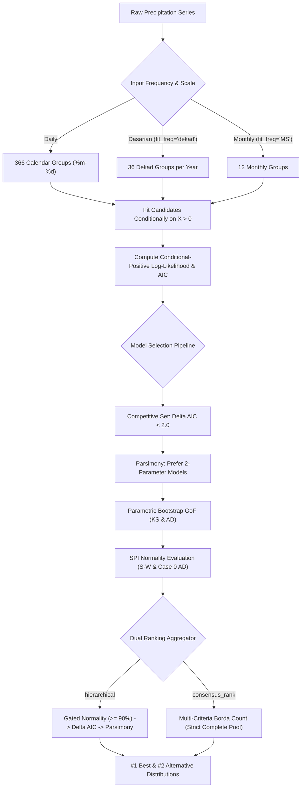

# SPEI & DSPI: Standardized Precipitation & Drought Index Engine

A high-performance, scientifically hardened Python package for calculating, selecting, validating, and visualizing hydrological and meteorological standardized drought indices. Built on Pandas and SciPy, the package provides native operational support for **Daily SPI (DSPI)**, **Sub-monthly Dasarian / Dekad SPI (BMKG 36-dekad calendar)**, and **Standard Monthly / Multi-month Indices**.

---

## Key Features

- **Multi-Scale Standardization:**
  - **DSPI (Daily SPI):** Daily resolution grouped across 366 calendar days (`%m-%d`), with full leap year preservation eliminating the 3-day phase lag bug.
  - **Dasarian SPI (Dekad):** Exact BMKG/WMO 36-dekad calendar engine (days 1, 11, 21), trailing rolling accumulation without time-compression or double aggregation.
  - **Native Monthly SPI (`fit_freq="monthly"`):** Direct daily-to-monthly aggregation (`to_monthly`), nominal daily timescale mapping (`timescale=90` $\to$ 3 months, `timescale=180` $\to$ 6 months), and pre-rolled support (`timescale=0`).
  - **Standard Multi-Month SPI & SPEI:** Flexible monthly and seasonal rolling timescales (e.g. 1, 3, 6, 12, 24 months).
  - **Comprehensive Hydrological Indices:** Full support for **SPI**, **DSPI**, **SPEI** (with potential evaporation from [pyet](https://github.com/phydrus/pyet)), **SGI** (groundwater), **SSFI** (streamflow), and **SSMI** (soil moisture).
  - **Modified SPI (M-SPI):** Native support for both classical centroid-based SPI (Stagge et al., 2013) and median-based Modified SPI (Gül & Güçlü, 2025).

- **Multi-Stage Statistical Parameter Estimation (`dist.py`):**
  - **7 Candidate Distributions:** Gamma, Weibull (`weibull_min`), Gumbel-R (`gumbel_r`), Lognormal (`lognorm`), Fisk / Log-Logistic (`fisk`), Pearson Type III (`pearson3`), and Generalized Extreme Value (`genextreme` / GEV).
  - **Robust Initialization:** Theoretical L-moments (`lmoments3`) or Method of Moments (MM) initialization on positive observations ($X > 0$).
  - **Exact SciPy GEV Parameterization:** Conforms strictly to SciPy's GEV shape convention ($c > 0$ for Weibull-like bounded upper tail, $c < 0$ for Fréchet heavy tail) with Brentq root finding for theoretical moment estimation.
  - **Physical Degeneracy Protection:** Enforces a physical survival floor ($\ln(1 - F(0)) \ge -4.60517$) preventing the optimizer from driving location parameters to $-\infty$ on scarce samples.
  - **Tiered Fallback Chain:** Gracefully falls back to L-moments / Method of Moments with complete diagnostic status reporting (`fit_method="moments"`).

- **Zero-Precipitation & Mixed Distribution Handling (Stagge et al., 2013, 2015):**
  - Continuous probability distributions are fitted **strictly to positive rainfall ($X > 0$)**.
  - Zero probability mass is computed using the unbiased plotting-position formula:
    $$p_0 = \frac{m}{n + 1}$$
  - Zero observations are assigned the symmetrical normal quantile centroid:
    $$p_{\text{centroid}} = \frac{m + 1}{2(n + 1)}, \quad \text{SPI}_0 = \Phi^{-1}(p_{\text{centroid}})$$
  - Mixed continuous-discrete cumulative probability:
    $$H(x) = p_0 + (1 - p_0) \cdot F_{\text{pos}}(x; \boldsymbol{\theta})$$

- **Automated Information-Theoretic Model Selection (`model_selection.py`):**
  - **Burnham & Anderson (2002) Parsimony:** Identifies the competitive candidate set ($\Delta\text{AIC} < 2.0$) and prioritizes parsimonious 2-parameter models over 3-parameter distributions.
  - **Parametric Bootstrap Goodness-of-Fit:** Evaluates Kolmogorov–Smirnov (KS) and Anderson–Darling (AD) statistics with refit validation.
  - **Decoupled Normality Diagnostics:**
    - **Shapiro–Wilk Test (`SW`):** Tests Gaussian bell shape of the transformed SPI series using deterministic group random seeds for zero draws.
    - **Case 0 Standard-Normal Anderson–Darling (`SPI_AD`):** Tests conformity against standard normal parameters ($\mu = 0, \sigma = 1$).
  - **Dual Ranking Output (`hierarchical` & `consensus_rank`):** Simultaneously computes both gate-based hierarchical ranking and multi-criteria consensus ranking in a single pass (*zero duplicate refits*).
  - **Fair Consensus Scoring:** Strictly requires a complete set of mandatory criteria across candidates; incomplete candidates are transparently marked `consensus_eligible=False` with explicit reasons, eliminating unfair partial-metric scores.

- **Wang et al. (2022) Exact Benchmark Replication (`fitting_policy="wang"`):**
  - Dedicated Wang Gamma mode reproducing Wang's exact Nelder-Mead parameters, zero-handling, and small-sample heuristics.
  - Achieves 100% exact numerical parity ($\text{MAE} = 0.000000$, Pearson $r = 1.000000$) against published reference code.
  - **Statistical AIC Integrity:** Distinguishes augmented pseudo-observation fits (`pseudo_obs_added=True`) as non-comparable for official observational AIC model selection (`aic_comparable=False`), while preserving valid parameters for empirical SPI calculation.

- **Robust Calendar and Time Validation (`utils.py`):**
  - Disambiguates monthly vs dasarian cadences.
  - Rejects non-midnight timestamps (`00:00:00`), timezone-aware indexes, duplicates, and non-canonical days in `rolling_dasarian()` with descriptive errors to prevent silent data loss during canonical reindexing.

---

## Installation

### From Source (Local Development)

Clone the repository and install in editable mode:

```bash
git clone https://github.com/mahronid/SPEI.git
cd SPEI
pip install -e .
```

### Requirements

- Python $\ge$ 3.10 (tested through Python 3.13)
- `numpy >= 1.23.0` (fully compatible with NumPy 2.x)
- `scipy >= 1.9.0` (tested through SciPy 1.15)
- `pandas >= 1.5.0` (fully compatible with Pandas 2.x and 2.2+ frequency aliases)
- `matplotlib >= 3.6.0`
- `lmoments3 >= 0.4.8` (recommended for theoretical L-moments initialization and fallbacks)

---

## Quick Start & Code Examples

### 1. Daily SPI (DSPI) with Automated Model Selection

Evaluate 7 candidate distributions across all 366 calendar days of a 10-day rolling rainfall series:

```python
import pandas as pd
from scipy.stats import gamma, weibull_min, pearson3, genextreme
import spei

# 1. Load daily precipitation series (DatetimeIndex)
df = pd.read_csv("tests/data/34010701a.csv", index_col=0, parse_dates=True)
s_daily = df["34010701a"]

# 2. Compute 10-day trailing accumulation
rolled_10 = s_daily.rolling(10, min_periods=10).sum().dropna()

# 3. Initialize the SI engine for daily calendar grouping (366 groups)
si_engine = spei.SI(
    rolled_10,
    dist=gamma,
    timescale=0,                  # Pre-accumulated input
    fit_freq="D",                 # Group by calendar day (%m-%d)
    prob_zero=True,
    small_sample_policy="strict", # Honest NaNs for underdetermined samples
)

# 4. Run automated distribution selection (single evaluation pass)
selection = si_engine.select_optimal_distribution(
    candidates=[gamma, weibull_min, pearson3, genextreme],
    prefer_two_parameters=True,   # Burnham & Anderson parsimony
    delta_aic_threshold=2.0,
    n_boot=99,                    # Parametric bootstrap iterations
    information_criterion="AIC", # Use "AICc" for small-sample correction
    normality_ratio_threshold=0.90,
    ranking_method="hierarchical",# or "consensus_rank"
)

print(f"Hierarchical #1 (Best): {selection['best_distribution']}")
print(f"Hierarchical #2 (Alternative): {selection['alternative_distribution']}")
print(f"Selection Status: {selection['best_selection_status']}")

# 5. Access side-by-side dual ranking comparison
print("\n--- Ranking Comparison (Hierarchical vs Consensus) ---")
print(selection["ranking_comparison"])

# 6. Compute SPI series using the selected distribution
dspi_series = si_engine.spi()
```

`AICc` uses the number of strictly positive calibration observations in the
conditional likelihood and is undefined when `n_positive <= k + 1`. AIC and
AICc, including their Delta values, are retained as separate diagnostics; the
selected `information_criterion` alone defines the competitive set. At least
two comparable candidates are required before an official Delta IC is reported.

---

### 2. Operational BMKG Dasarian (36-Dekad) SPI Pipeline

The BMKG dasarian calendar divides each month into 3 dekads:
- **Dekad 1:** Days 1–10 (labeled `YYYY-MM-01`)
- **Dekad 2:** Days 11–20 (labeled `YYYY-MM-11`)
- **Dekad 3:** Days 21 to end of month (labeled `YYYY-MM-21`, covering 8–11 days)

```python
import pandas as pd
from scipy.stats import gamma, weibull_min
import spei

# 1. Aggregate raw daily observations into BMKG dasarians
data_dasarian = spei.to_dasarian(s_daily, min_valid_days=1)
print(f"Dasarian rows: {len(data_dasarian)} (36 dasarians per year)")

# 2. Perform trailing rolling accumulation using dasarian window counts
# timescale=30 maps automatically to 3 dasarians (~30 days)
rolled_3das = spei.rolling_dasarian(data_dasarian, timescale=30)

# 3. Fit Dekad SPI via Universal API
spi_3das = spei.spi(
    rolled_3das,
    dist=weibull_min,
    timescale=0,           # Already rolled
    fit_freq="dekad",      # 36 calendar dekad groups
    prob_zero=True,
)

# Alternatively, pass daily series directly with fit_freq="dekad":
spi_direct = spei.spi(s_daily, timescale=30, fit_freq="dekad", dist=gamma)
```

---

### 3. Monthly SPI (Direct Daily Ingestion & Modified Median M-SPI)

Calculate standard monthly SPI directly from raw daily observations (`data pos hujan`) or pre-aggregated monthly data:

```python
import pandas as pd
from scipy.stats import gamma
import spei

# 1. Ingest raw daily observations directly (Universal API)
# timescale=90 maps automatically to 3 calendar months (SPI-3)
spi_monthly_3 = spei.spi(
    s_daily,
    dist=gamma,
    timescale=90,          # or timescale=3 (months)
    fit_freq="monthly",    # Automatically aggregates daily -> monthly totals (YYYY-MM-01)
    prob_zero=True,
)

# 2. Or calculate from pre-aggregated / pre-rolled monthly data:
s_monthly = pd.read_csv("tests/data/monthly_precip.csv", index_col=0, parse_dates=True)["precip"]

# Standard Centroid SPI (Stagge et al., 2013)
spi_centroid = spei.spi(s_monthly, dist=gamma, timescale=3, fit_freq="MS", method="centroid")

# Modified Median M-SPI (Gül & Güçlü, 2025)
spi_median = spei.spi(s_monthly, dist=gamma, timescale=3, fit_freq="MS", method="median")
```

---

### 4. Wang et al. (2022) Benchmark Replication Mode

Replicate the exact numerical output of Wang et al. (2022) with 100% numerical parity:

```python
import spei
from scipy.stats import gamma

spi_wang = spei.spi(
    rolled_10,
    dist=gamma,
    timescale=0,
    fit_freq="D",
    prob_zero=True,
    all_zero_policy="wang",
    fitting_policy="wang",        # Replicates Wang's Nelder-Mead Gamma & heuristics
)
```

---

## Statistical Architecture & Decision Framework



### Supported Probability Distributions

| Distribution | Scipy Distribution | Free Parameters ($k$) | Parameter Domain | Hydrological Properties |
| :--- | :--- | :---: | :--- | :--- |
| **Gamma** | `scipy.stats.gamma` | 2 | `a > 0, scale > 0` (loc = 0) | Classic McKee standard; light to moderate positive tail. |
| **Weibull** | `scipy.stats.weibull_min` | 2 | `c > 0, scale > 0` (loc = 0) | Sub-exponential tail; superior in arid and monsoonal regimes. |
| **Gumbel-R** | `scipy.stats.gumbel_r` | 2 | `loc, scale > 0` | Pure extreme-value distribution without shape instability. |
| **Lognormal** | `scipy.stats.lognorm` | 2 | `s > 0, scale > 0` (loc = 0) | Heavy right tail; captures highly skewed rainfall bursts. |
| **Fisk (Log-Logistic)** | `scipy.stats.fisk` | 2 | `c > 0, scale > 0` (loc = 0) | Heavy polynomial tail; widely used in SPEI water balance. |
| **Pearson Type III** | `scipy.stats.pearson3` | 3 | `skew, loc, scale > 0` | Guttman standard; asymmetric tail for high daily skewness. |
| **GEV** | `scipy.stats.genextreme` | 3 | `c, loc, scale > 0` | Extreme value distribution; flexible bounded or heavy tails. |

---

## Comparison of Global Ranking Methods

`spei.model_selection` calculates two complementary ranking methodologies simultaneously:

| Feature / Metric | Hierarchical Ranking (`ranking_method="hierarchical"`) | Consensus Ranking (`ranking_method="consensus_rank"`) |
| :--- | :--- | :--- |
| **Decision Mechanism** | Strict gate-based priority tiers. | Multi-criteria Borda count rank average. |
| **Normality Gate** | Models failing the 90% normality target are demoted to Tier 2. | Normality ranks trade off continuously against AIC. |
| **Parsimony Preference** | Competitive 2-parameter models ($\Delta\text{AIC} < 2.0$) strictly defeat 3-parameter models. | 2-parameter models naturally win if they balance AIC with higher normality pass rates. |
| **Missing Metric Policy** | Evaluates available criteria per gate. | Strict complete pool: incomplete candidates are flagged `consensus_eligible=False` and assigned `NaN`. |
| **Recommended Context** | **Operational drought monitoring** where safety and normality guarantees are mandatory. | **Multi-criteria research** balancing information criteria against normality without rigid thresholds. |

---

## Package Module Overview

- [`spei.si`](file:///Users/mahron/Data/python/SPEI/src/spei/si.py): Core standardization classes `SI` and helper wrappers `spi()`, `spei()`, `sgi()`, `ssfi()`, `ssmi()`.
- [`spei.dist`](file:///Users/mahron/Data/python/SPEI/src/spei/dist.py): Probability distribution abstraction `Dist`, multi-stage parameter estimation, Wang replication engine, and parametric bootstrap goodness-of-fit.
- [`spei.model_selection`](file:///Users/mahron/Data/python/SPEI/src/spei/model_selection.py): Information-theoretic model selection, Burnham & Anderson $\Delta\text{AIC}$, normality testing, and dual ranking aggregators.
- [`spei.utils`](file:///Users/mahron/Data/python/SPEI/src/spei/utils.py): BMKG 36-dekad calendar aggregation (`to_dasarian`), rolling accumulation (`rolling_dasarian`), and strict midnight timestamp validation.

---

## Automated Test Suite & Verification

The package is verified through an extensive automated test suite covering edge cases, small samples, calendar boundaries, and mathematical conventions:

```bash
pytest
```

**Verification Summary:**
```text
======================== 265 passed in 98.42s ========================
```

Key test modules include:
- `tests/test_distribution_selection_master.py`: GEV sign conventions, conditional-positive likelihood, AIC parsimony, Tests A1–A5 (Wang pseudo-observation AIC exclusion), and Tests C1–C7 (fair consensus ranking without partial scoring).
- `tests/test_dasarian.py`: BMKG 36-dekad calendar aggregation, rolling accumulation, Tests D1–D4 (sparse calendar preservation and midnight validation).
- `tests/test_monthly.py`: 9 tests covering native daily-to-monthly aggregation (`to_monthly`), nominal day timescale mapping (`timescale=90` $\to$ 3 months), pre-rolled inputs (`timescale=0`), and leap-year/data completeness thresholds.
- `tests/test_master_task_dspi.py`: 32 tests covering numerical parity with Wang benchmark datasets.
- `tests/test_audit_34010701a.py`: 31 tests validating real station `34010701a` daily rainfall.
- `tests/test_nan_diagnostics.py`: 25 tests verifying audit traceability of missing values.
- `tests/test_si.py`: 60 tests covering core SI methods, rolling windows, and distribution fittings.

---

## Scientific References

1. **Burnham, K. P. and Anderson, D. R. (2002)** — *Model Selection and Multimodel Inference: A Practical Information-Theoretic Approach* (2nd ed.). Springer-Verlag.
2. **Stagge, J. H., Tallaksen, L. M., Gudmundsson, L., Van Loon, A. F., and Stahl, K. (2015)** — Candidate Distributions for Climatological Drought Indices (SPI and SPEI). *Int. J. Climatol.*, 35(13): 4027–4040. DOI: `10.1002/joc.4267`.
3. **Stagge, J. H., Tallaksen, L. M., Xu, C. Y., and Gudmundsson, L. (2013)** — Standardized Precipitation-Evapotranspiration Index (SPEI): Sensitivity to potential evaporation model and parameters. *Proc. IAHS*, 359: 367–373.
4. **Wang, H. et al. (2022)** — An improved daily standardized precipitation index dataset for mainland China from 1961 to 2018. *Sci. Data*, 9: 201. DOI: `10.1038/s41597-022-01201-z`.
5. **Lee, C., Seo, J., Won, J., and Kim, S. (2023)** — Optimal Probability Distribution and Applicable Minimum Time-Scale for Daily Standardized Precipitation Index. *Atmosphere*, 14(7): 1121. DOI: `10.3390/atmos14071121`.
6. **Gül, M. and Güçlü, Y. S. (2025)** — Modified Standardized Precipitation Index (M-SPI). *Water Resour. Manage.* DOI: `10.1007/s11269-024-03977-w`.
7. **McKee, T. B., Doesken, N. J., and Kleist, J. (1993)** — The relationship of drought frequency and duration to time scales. *Proc. 8th Conf. on Applied Climatology*, 17(22): 179–183.
8. **Guttman, N. B. (1999)** — Accepting the Standardized Precipitation Index: A calculation methodology. *J. Amer. Water Resour. Assoc.*, 35(2): 311–322. DOI: `10.1111/j.1752-1688.1999.tb03592.x`.
9. **Vicente-Serrano, S. M., Beguería, S., and López-Moreno, J. I. (2010)** — A Multiscalar Drought Index Sensitive to Global Warming: The SPEI. *J. Climate*, 23: 1696–1718. DOI: `10.1175/2009JCLI2909.1`.

---

## License

This project is licensed under the MIT License — see the [LICENSE](file:///Users/mahron/Data/python/SPEI/LICENSE) file for details.
