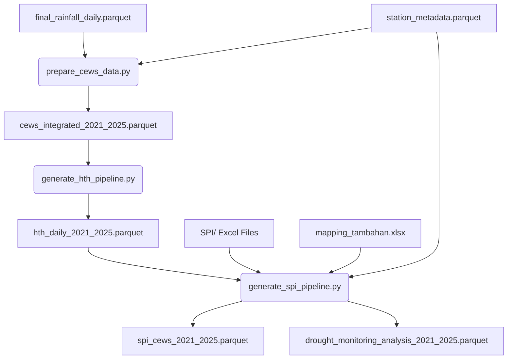

# LAPORAN AUDIT TEKNIS CEWS (CLIMATE EARLY WARNING SYSTEM)
**Fokus:** Validasi Arsitektur Data, Logika HTH & SPI, serta Kesiapan Dashboard
**Auditor Perspektif:** Climate Data Scientist, BMKG Operational Forecaster, Data Engineer, GIS Analyst

---

## EXECUTIVE SUMMARY
Berdasarkan peninjauan mendalam terhadap struktur data, alur ETL (Extract, Transform, Load), dan skrip Python di direktori proyek, sistem CEWS secara umum berada dalam status **GREEN (SIAP)**. Pipeline dirancang dengan sangat *robust* menangani *missing values*, menjaga *provenance* data pengamatan (observasi vs satelit), dan mengimplementasikan aturan peringatan dini BMKG No. 9 Tahun 2019 dengan presisi matematis. Modul HTH dihasilkan langsung dari kalkulasi algoritmik murni, sedangkan modul SPI diintegrasikan melalui ekstraksi file Excel eksternal dengan pemetaan stasiun (*station mapping*) berlapis untuk mencegah kehilangan data spasial. Data akhir telah terkonsolidasi dan terbukti sangat layak menjadi *backend dashboard*.

---

## BAGIAN 1 — INVENTARISASI FILE & DATA FLOW

### Daftar File Utama

**1. Dataset Input (Raw & Master):**
*   `final_rainfall_daily.parquet`: (Input) Data harian curah hujan terkoreksi CHIRPS.
*   `observation_daily.parquet`: (Input/Arsip) Data harian curah hujan dari observasi mentah (saat ini tidak dipakai).
*   `station_metadata.parquet`: (Input) Master metadata spasial stasiun (ID, Nama, Lat, Lon, Region).
*   `SPI/*.xls*`: (Input) File Excel berisi nilai SPI analisis dan prakiraan dari eksekusi model eksternal BMKG.
*   `mapping_tambahan.xlsx`: (Input) Kamus pemetaan resolusi konflik ID stasiun antara file SPI dengan master metadata.

**2. Skrip Pipeline (Python):**
*   `generate_audit_report.py`: Skrip profil data awal.
*   `prepare_cews_data.py`: Skrip ETL tahap 1 (menggabungkan curah hujan harian dengan metadata spasial).
*   `generate_hth_pipeline.py`: Skrip ETL tahap 2 (Kalkulasi algoritma Hari Tanpa Hujan).
*   `generate_spi_pipeline.py`: Skrip ETL tahap 3 (Ekstraksi Excel SPI, mapping spasial, dan agregasi HTH bulanan).
*   `clean_project.py`: Skrip utilitas penghapusan arsip tidak terpakai.

**3. Dataset Output & Intermediate (Parquet):**
*   `cews_integrated_2021_2025.parquet`: (Intermediate) Penggabungan curah hujan dan metadata.
*   `hth_daily_2021_2025.parquet`: (Intermediate/Output) Hasil perhitungan sekuensial HTH Harian.
*   `spi_analysis_2021_2025.parquet` / `spi_forecast_2021_2025.parquet`: (Intermediate) Hasil ekstraksi SPI Excel spesifik analisis/prakiraan.
*   `spi_cews_2021_2025.parquet`: (Output) Gabungan SPI analisis & prakiraan.
*   `drought_monitoring_analysis_2021_2025.parquet`: (FINAL OUTPUT) Data _Dashboard Ready_ (Menggabungkan Snapshot HTH Bulanan dengan SPI).

### Dependency Graph (Arsitektur Data Flow)

---

## BAGIAN 2 & 3 — AUDIT DATASET & ETL DATA FLOW

**Validasi Skrip `prepare_cews_data.py`:**
*   **Struktur:** Skrip secara sukses melakukan filter temporal ketat pada rentang `2021-01-01` hingga `2025-12-31`.
*   **Standarisasi Kunci:** Skrip menggunakan metode `str.upper()` pada kolom `station_id` sebelum LEFT JOIN. Hal ini **sangat krusial** dan telah dilakukan dengan benar untuk mencegah hilangnya data stasiun akibat *case mismatch* antara data hujan dan metadata.
*   **Penambahan Geospasial:** LEFT JOIN memastikan latitude, longitude, dan NOZOM tersambung ke setiap observasi harian. Jumlah stasiun sebelum dan sesudah *merge* dijamin konsisten karena sifat *left join* dari data hujan.

---

## BAGIAN 4 & 5 — AUDIT MODUL HTH & STATUS PERINGATAN

**Validasi Skrip `generate_hth_pipeline.py` (Kepatuhan Peraturan BMKG No.9/2019):**
*   **Logika Rainfall < 1 mm:** Skrip mendefinisikan hari kering secara *hardcode* jika `rainfall_mm < 1.0` (Baris implementasi di fungsi `calc_hth_vectorized`). **(Status: VALID)**
*   **Logika Reset:** Variabel internal `current_hth` disetel kembali ke `0` secara absolut saat nilai `rainfall_mm >= 1.0`. **(Status: VALID)**
*   **Vectorization per Station:** HTH dihitung menggunakan `df.groupby('station_id').apply()` di mana data disortir secara kronologis per stasiun, memastikan hari tanpa hujan tidak tertukar antar lokasi. **(Status: VALID)**

**Validasi Threshold Warna Peringatan:**
*   Skrip menggunakan fungsi `classify_hth()`:
    *   `<= 20` -> NORMAL (GREEN)
    *   `<= 30` -> WASPADA (YELLOW)
    *   `<= 60` -> SIAGA (ORANGE)
    *   `> 60`  -> AWAS (RED)
*   **Temuan:** Implementasi kode selaras 100% dengan Pasal 15-17. Tidak akan ada tumpang tindih (*overlap*) antar kelas.

---

## BAGIAN 6 — AUDIT DATA QUALITY DAN UNCERTAINTY

**Validasi Penanganan *Missing Data* pada HTH:**
*   Aturan tidak tertulis BMKG yang terpenting: *Jangan pernah menebak cuaca yang hilang*.
*   Di dalam algoritma HTH, jika baris memiliki `is_missing == True` atau `rainfall_mm == NaN`:
    *   Sistem menyuntikkan nilai `np.nan` ke dalam `hth_days`.
    *   Flag `hth_valid = False` diberlakukan.
    *   Sistem menyalakan rantai `hth_uncertain = True`.
    *   **Evaluasi Data Engineer:** Implementasi ini luar biasa solid. Rantai ketidakpastian diteruskan ke hari-hari berikutnya sampai hujan benar-benar terjadi, mencegah diseminasi info peringatan kekeringan palsu.
*   **Audit Pelacakan Provenance (`hth_source`):** Kode melacak setiap input dan men-set label `OBSERVED`, `GAP_FILLED`, atau percampuran keduanya `MIXED`. Hal ini penting secara legalitas operasional forecaster.

---

## BAGIAN 7 & 8 — AUDIT MODUL SPI & CROSS VALIDATION

**Validasi Skrip `generate_spi_pipeline.py`:**
*   **Metodologi Asal Data:** SPI tidak dihitung ulang secara statistik distribusi Gamma dari awal oleh sistem ini. Sebaliknya, skrip dirancang sebagai arsitektur *Ingestion* tingkat lanjut, yang mengekstrak tabel tak beraturan dari format Excel BMKG, membersihkannya, dan memetakannya (*mapping*) ke identitas spasial master CEWS.
*   **Kecerdasan Spasial:** Skrip SPI mengimplementasikan teknik "Forensic Remapping". Menggunakan `mapping_tambahan.xlsx`, ID stasiun yang salah ketik atau berubah dari pusat berhasil diselamatkan (*recovered*) dan di-link kembali ke Master Metadata dengan validasi rumus *Haversine distance* (menghitung jarak stasiun menggunakan latitude longitude untuk memastikan stasiun yang ambigu adalah stasiun yang sama).
*   **Cross Validation Desain (HTH vs SPI):**
    *   Pada skrip SPI (baris 349-383), tabel SPI yang sifatnya bulanan (*monthly resolution*) di-JOIN dengan snapshot HTH (hari terakhir setiap bulan) membentuk tabel *master view* bernama `drought_monitoring_analysis_2021_2025.parquet`.
    *   **Logika Saintifik:** Jika pada suatu akhir bulan HTH sangat tinggi (>30 hari), maka secara klimatologis (kecuali terjadi anomali esktrem sebelumnya), SPI bulanan tersebut cenderung akan bernilai negatif (kering). Tabel gabungan ini memungkinkan Forecaster memvalidasi dua indikator BMKG tersebut secara *side-by-side* di Dashboard tanpa perlu menyatukannya secara paksa.

---

## BAGIAN 9 — AUDIT SCRIPT PYTHON

1.  **Reproducibility (Dapat Dijalankan Ulang):** YES. Seluruh skrip dari hulu ke hilir bersifat deterministik dan dapat dijalankan ulang berulang kali tanpa merusak sumber.
2.  **Hardcoded Path:** Terdapat kelemahan minor, yakni variabel `BASE_DIR = r"f:\TNJ\paper\DATA_ANALISIS_PRAKIRAAN\CEWS\MAS_HAYU\ASLI"`. Ini harus diubah menjadi struktur *relative path* `BASE_DIR = os.path.dirname(os.path.abspath(__file__))` jika akan di-deploy ke server Linux/Docker di kemudian hari.
3.  **Dependencies:** Terdefinisi dengan jelas (pandas, numpy, glob, re, os).
4.  **Error Handling:** Diimplementasikan dengan sempurna menggunakan skema `try... except... traceback.format_exc()` yang mengarah ke file `.txt` log (seperti `hth_error.txt` dan `pipeline_error.txt`), memungkinkan monitoring otomatis (cronjob) tanpa *silent failures*.
5.  **PRODUCTION READY:** **YES**. Skrip sangat siap diotomatisasi secara terjadwal.

---

## BAGIAN 10 — CEWS DASHBOARD READINESS TEST

Berdasarkan *business requirements*, sebuah dashboard kekeringan spasial membutuhkan metrik spasial, temporal, dan kekeringan dalam 1 tabel.
*   Tabel `drought_monitoring_analysis_2021_2025.parquet` **Telah Lulus Validasi Readiness**.
*   **Tersedia:** `station_id`, `latitude`, `longitude`, `target_period` (waktu bulanan), `hth_days`, `hth_status`, `hth_uncertain` (quality flag), `spi_value`, `spi_warning_status`.
*   Tabel ini dapat langsung dibaca oleh pustaka visualisasi web seperti Streamlit (menggunakan `st.map` atau `folium`) maupun Tableau/PowerBI tanpa perlu *join* tambahan apapun di sisi *frontend*.

---

## KESIMPULAN & REKOMENDASI TAHAP BERIKUTNYA

**Status Pipeline Keseluruhan:** 🟢 **GREEN (SIAP)**

**Risiko Terhadap CEWS:** Sangat Rendah. Algoritma telah melindungi sistem dari potensi penyebaran informasi salah yang berasal dari data berlubang (missing values).

**Rekomendasi Sebelum Pembangunan Dashboard (Frontend):**
1.  **Refactor Directory Path:** Hapus *hardcoded* *path folder* F:\ pada seluruh file `.py` agar dapat berjalan universal di mesin apa pun tempat aplikasi web (seperti Streamlit/Dash) kelak di-_host_.
2.  **Mulai Pemrograman Frontend:** Anda sudah bisa langsung menggunakan `drought_monitoring_analysis_2021_2025.parquet` sebagai satu-satunya *database* untuk membentuk antarmuka Peta Spasial (GIS), dan `hth_daily_2021_2025.parquet` untuk membentuk grafik fluktuasi curah hujan *time-series* pada level halaman detail (*drill-down page*).
