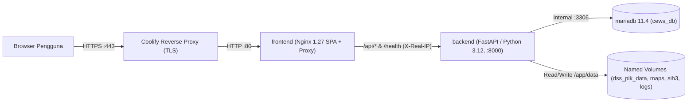

# PANDUAN INDUK PENGEMBANGAN, GITHUB, & AUTOMATIC DEPLOYMENT — DSS-PIK

**Sistem**: DSS-PIK (Decision Support System Peringatan Iklim Kepulauan Riau)  
**Institusi**: BMKG Stasiun Meteorologi Kelas II Raja Haji Fisabilillah Tanjungpinang  
**Repository GitHub**: https://github.com/vascosdrk/DSS-PIK (branch utama: `main`)  
**Production URL**: https://dss-pik.stamet-rhf.com/  
**Platform Deploy**: Coolify (`https://coolify.stamet-rhf.com/`) — Docker Compose (`/compose.coolify.yaml`)  
**Terakhir Diperbarui**: 2026-11-24

---

## 1. Ringkasan Sistem & Status Verifikasi Terkini

| Komponen / Alur | Status | Bukti Aktual |
|---|---|---|
| Workspace Lokal Windows Native (`ASLI2`) | **VERIFIED** | Python 3.12 `.venv`, MariaDB `11.4.10`, `DSS-PIK.bat`, `DSS-PIK-CONTROL.bat`, `/health` HTTP 200 |
| Repository GitHub `vascosdrk/DSS-PIK` (`main`) | **VERIFIED** | Sinkron penuh, secret scan lolos (`0` credential/SQL/Parquet) |
| Split 3-Container (`compose.yaml` & `compose.coolify.yaml`) | **VERIFIED** | `frontend` (Nginx 1.27) -> `backend` (FastAPI) -> `mariadb` (11.4), lulus 47/47 tes di staging |
| GitHub Webhook -> Coolify Auto-Deployment | **VERIFIED** | Dibuktikan pada commit `7180e8e`: push ke `main` memicu rebuild otomatis Coolify dan live JS berubah ke `index-LivYtUrH.js` dalam ~1 menit; `/health` HTTP 200 |
| Autentikasi Berbasis `.env` (`DSS_PIK_PASSWORD`) | **VERIFIED** | Hash `bcrypt` satu kali di memori saat startup + fallback legacy `DSS_PIK_PASSWORD_HASH` (6/6 tes lulus) |
| Nama Volume Aktual MariaDB & Dataset di Panel Coolify | **UNKNOWN** | Dikelola penuh oleh Admin Server (Bang Hilmi); tidak diakses dari laptop developer |
| Pengisian Dataset `/app/data` di Server Produksi | **PENDING** | Memerlukan konfirmasi Admin Server atas isi named volume `dss_pik_data` (`kepri_kabkot.geojson` & 34 Parquet) |

---

## 2. Arsitektur Tiga Lingkungan

1. **DEVELOPMENT (Laptop Windows)**: Native Windows (`http://127.0.0.1:8000`) menggunakan Python 3.12 `.venv`, Node.js 22 / npm, MariaDB 11.4 portable, dan launcher `DSS-PIK-CONTROL.bat`.
2. **STAGING (Docker WSL2 Lokal)**: Ubuntu 24.04 WSL2 dengan Docker Engine & Compose v2 (`compose.yaml`, port terisolasi `18000` / `28080`) untuk uji image, keamanan proxy, dan regresi sebelum rilis.
3. **PRODUCTION (Ubuntu Server BMKG via Coolify)**: Dikelola Bang Hilmi pada `https://dss-pik.stamet-rhf.com/` menggunakan `/compose.coolify.yaml` di branch `main`.

---

## 3. Local Development (Laptop Windows)

- **Workspace Aktif**: `F:\TNJ\paper\DSS_PIK_MIGRATION_EXPORT\ASLI2`
- **Virtual Environment**: `.venv\Scripts\python.exe` (dependensi terkunci di `requirements-lock.txt`)
- **MariaDB Lokal Portable**: `C:\Users\vasco\mariadb-11.4\bin\mariadbd.exe` (`my.ini`, port `3306`, database `cews_db_migration_test`)
- **One-Click Control Center**: Double-click `DSS-PIK-CONTROL.bat` (menu `[1] START`, `[2] STOP`, `[3] RESTART`, `[4] CHECK STATUS`, `[5] EXIT`) — otomatis menyalakan MariaDB tanpa duplikat dan memanggil `DSS-PIK.bat start --no-browser`.
- **Build Frontend (Wajib bila mengubah `frontend/src/`)**:
  ```powershell
  cd F:\TNJ\paper\DSS_PIK_MIGRATION_EXPORT\ASLI2
  cmd /c "npm --prefix frontend run build"
  ```
- **Verifikasi Lokal**:
  ```powershell
  Invoke-WebRequest -Uri "http://127.0.0.1:8000/health" -UseBasicParsing
  ```

---

## 4. GitHub Workflow (PowerShell via WSL2 Git)

Git CLI (`git 2.43.0`) dan GitHub CLI (`gh 2.45.0`, akun `vascosdrk`) berjalan di Ubuntu-24.04 WSL2.

```powershell
# Cek status, branch, dan sinkronisasi dengan GitHub
wsl -d Ubuntu-24.04 -- bash -c "cd /mnt/f/TNJ/paper/DSS_PIK_MIGRATION_EXPORT/ASLI2 && git status && git fetch origin && git log -3 --oneline"

# Tarik perubahan terbaru (jika ada) tanpa menimpa kerja lokal
wsl -d Ubuntu-24.04 -- bash -c "cd /mnt/f/TNJ/paper/DSS_PIK_MIGRATION_EXPORT/ASLI2 && git pull --ff-only origin main"

# Periksa diff sebelum commit
wsl -d Ubuntu-24.04 -- bash -c "cd /mnt/f/TNJ/paper/DSS_PIK_MIGRATION_EXPORT/ASLI2 && git diff --check && git diff --stat"

# Stage file spesifik, commit, dan push ke main (JANGAN pernah pakai --force)
wsl -d Ubuntu-24.04 -- bash -c "cd /mnt/f/TNJ/paper/DSS_PIK_MIGRATION_EXPORT/ASLI2 && git add <file_spesifik> && git commit -m 'feat(scope): deskripsi singkat' && git push origin main"
```

---

## 5. Automatic Deployment (GitHub -> Webhook -> Coolify)

- **Source**: `https://github.com/vascosdrk/DSS-PIK`, branch `main`, Docker Compose Location `/compose.coolify.yaml`.
- **Mekanisme**: Setiap `git push origin main` mengirim event `push` HTTPS (dengan SSL verification aktif & HMAC signature secret bersama — **secret tidak disimpan di repo**) ke Payload URL Coolify. Coolify menarik commit terbaru, membangun ulang `backend/Dockerfile` dan `frontend/Dockerfile`, lalu mengganti container lama (~1–3 menit downtime singkat).
- **Verifikasi Pasca-Push** *(ping webhook sukses saja belum membuktikan deploy berhasil)*:
  1. Cek **GitHub -> Settings -> Webhooks -> Recent Deliveries** -> pastikan delivery event `push` berstatus `200`.
  2. Cek Coolify Deployment Logs (oleh admin) atau pantau perubahan hash aset JS di `https://dss-pik.stamet-rhf.com/` dan `GET https://dss-pik.stamet-rhf.com/health` -> `HTTP 200 {"status":"ok","service":"cews-api","database":"connected"}`.

---

## 6. Production Architecture

### Diagram Alur Deployment (Developer -> Production)

```mermaid
flowchart LR
    DEV["Developer (Windows Laptop / ASLI2)"] -->|"1. Edit & Test Lokal"| GIT["Git Commit & Push"]
    GIT -->|"2. origin/main"| GH["GitHub (vascosdrk/DSS-PIK)"]
    GH -->|"3. HTTPS Push Webhook"| COOL["Coolify Server (stamet-rhf.com)"]
    COOL -->|"4. Build compose.coolify.yaml"| BUILD["Docker Build (frontend + backend)"]
    BUILD -->|"5. Recreate Containers"| PROD["Production (https://dss-pik.stamet-rhf.com)"]
```


### Diagram Alur Request Pengguna


- **Environment Variables Produksi** (diisi admin di Coolify, **bukan di Git**):
  - Wajib: `CEWS_DB_PASSWORD`, `MARIADB_ROOT_PASSWORD`, `DSS_PIK_SESSION_SECRET`, `DSS_PIK_USERNAME`, `DSS_PIK_PASSWORD` (atau legacy `DSS_PIK_PASSWORD_HASH`).
  - Opsional: `CEWS_DB_NAME` (`cews_db`), `CEWS_DB_USER` (`dsspik_app`), `DSS_PIK_LAN_ALLOWED`, `CEWS_TRUSTED_PROXY_CIDRS`.

---

## 7. Pengelolaan Database & Dataset Operasional

> **PRINSIP**: Perubahan kode (via GitHub) dan perubahan data operasional (SQL & `/app/data`) adalah **dua proses terpisah**. SQL dump dan file Parquet operasional **tidak boleh** dimasukkan ke repository GitHub. Transfer data dilakukan melalui media resmi terenkripsi / Google Drive internal yang disetujui kantor.

### A. Database (`MariaDB 11.4` — `cews_db`)
- **Persistent Volume**: `dss_pik_mariadb_data:/var/lib/mysql` (prefixed oleh Coolify; nama aktual di server dikonfirmasi admin).
- **Baseline Tabel Utama**: `stations` (`57`), `cews_rainfall_daily` (`287,189`), `cews_forecast_snapshot` (`3,244`), `cews_regional_warning_decisions` (`42`), `cews_regional_decision_audit_log` (`462`), dan view `v_cews_current_warning_map`.
- **Backup Aman (tanpa ekspos password di `ps`)**:
  ```bash
  docker exec <container_mariadb> bash -c 'MYSQL_PWD="$MARIADB_PASSWORD" mariadb-dump --single-transaction --routines --triggers -u"$MARIADB_USER" "$MARIADB_DATABASE"' | gzip > cews_db_$(date +%Y%m%d_%H%M%S).sql.gz
  ```
- **Restore Guarded (sebagai `root` agar `VIEW DEFINER` lulus)**:
  ```bash
  docker exec -i <container_mariadb> bash -c 'MYSQL_PWD="$MARIADB_ROOT_PASSWORD" mariadb -u root "$MARIADB_DATABASE"' < RESTRICTED_cews_db_release_20261123.sql
  ```

### B. Dataset Operasional (`/app/data`)
- **Volume**: `dss_pik_data:/app/data` (pada `compose.coolify.yaml`) atau bind mount `${DSS_PIK_DATA_DIR}:/app/data:ro` (pada `compose.yaml`).
- **Struktur Wajib**: `reference/boundaries/kepri_*.geojson`, `reference/stations/station_metadata.parquet`, `reference/PETA/*.shp`, `raw/spi/dasarian/SPI_all_30d.parquet` & `90d`, `raw/rainfall/`, `processed/`, `operational/maps/` (writable), `output/sih3/` (writable).
- **Permission Container**: Backend berjalan sebagai user non-root `dsspik` (**`UID 1000` / `GID 1000`**). Pastikan ownership data sesuai (`chown -R 1000:1000 /app/data`).

---

## 8. SOP Pengembangan Harian (14 Langkah)

1. Buka workspace `F:\TNJ\paper\DSS_PIK_MIGRATION_EXPORT\ASLI2`.
2. Jalankan DSS-PIK lokal via `DSS-PIK-CONTROL.bat` (`[1] START`) dan pastikan `http://127.0.0.1:8000/health` HTTP 200.
3. Cek sinkronisasi GitHub (`git fetch origin && git status`).
4. Buat perubahan fitur/perbaikan secara terarah.
5. Jalankan pengujian sesuai risiko (Level 1 Quick Check / Level 2 Targeted Test / Level 3 Full Regression).
6. Jika mengubah `frontend/src/`, jalankan `cmd /c "npm --prefix frontend run build"`.
7. Periksa `git diff --check` dan `git status` (pastikan tidak ada `.env`/secret/file tak terkait).
8. Stage file spesifik (`git add <file>`) dan commit dengan pesan konvensional (`feat(...)`, `fix(...)`, `style(...)`, `docs(...)`).
9. Push ke `origin/main` (`git push origin main`, tanpa `--force`).
10. Cek **GitHub -> Settings -> Webhooks -> Recent Deliveries** (pastikan status `200`).
11. Pantau Coolify Deployment Logs (atau tunggu ~1–3 menit).
12. Cocokkan commit / hash aset JS terbaru yang berjalan di produksi.
13. Buka `https://dss-pik.stamet-rhf.com/` (hard refresh `Ctrl+Shift+R`).
14. Verifikasi `/health` HTTP 200, login, peta, dan data 57 stasiun.

---

## 9. SOP Keamanan & Larangan Keras

- **DILARANG**: mengunggah `.env` aktif, password, `DSS_PIK_SESSION_SECRET`, `COOLIFY_TOKEN`, webhook secret, SSH private key, SQL dump produksi, atau Parquet operasional ke GitHub.
- **DILARANG**: `git push --force` pada branch `main`.
- **DILARANG**: `docker compose down -v` di server produksi (menghapus volume database secara permanen!).
- **DILARANG**: menghapus persistent volume atau restore SQL tanpa backup & verifikasi snapshot.

---

## 10. Tabel Troubleshooting

| Gejala | Kemungkinan Penyebab | Cara Pemeriksaan | Tindakan Perbaikan | Risiko |
|---|---|---|---|---|
| **Git push ditolak (`rejected`)** | Remote `main` punya commit lebih baru | `git fetch origin && git status` | `git pull --rebase origin main` lalu `git push origin main` | Rendah (hindari `--force`) |
| **Webhook tidak menerima event** | Webhook nonaktif / event salah | GitHub -> Webhooks -> Recent Deliveries | Aktifkan webhook & pilih `Just the push event` | Rendah |
| **Coolify tidak mulai deploy** | Webhook secret beda (401) / path compose salah | Cek status delivery (`401`/`500`) | Cocokkan Payload URL, Secret, & `/compose.coolify.yaml` bersama admin | Rendah |
| **Docker build gagal** | File hilang di repo (mis. `COPY` folder untracked) atau timeout PyPI | Cek Coolify Build Logs | Perbaiki Dockerfile / build context, commit & push ulang | Rendah |
| **Frontend tidak berubah pasca-deploy** | Cache browser atau Coolify belum selesai switch | Cek hash `/assets/index-*.js` di HTML produksi | Hard refresh `Ctrl+Shift+R`; tunggu build selesai | Rendah |
| **Backend HTTP 500 / 502** | Error runtime Python / container backend restart | `docker logs <backend>` di Coolify | Periksa traceback, perbaiki bug, push fix atau rollback | Sedang |
| **DB `connected` tapi dashboard kosong** | `/health` hanya `SELECT 1`; tabel DB belum di-restore | `SHOW TABLES;` di container `mariadb` | Lakukan guarded restore dari SQL snapshot resmi | Tinggi (cek DB kosong dulu!) |
| **Dataset `/app/data` tidak ditemukan** | Named volume `dss_pik_data` masih kosong | `ls /app/data/reference/boundaries/` | Admin menyalin `04_OPERATIONAL_DATA/data/` ke volume + `chown 1000:1000` | Sedang |
| **Peta GeoJSON gagal dimuat (404)** | `kepri_kabkot.geojson` tidak ada di `/app/data/reference/boundaries/` | `curl https://dss-pik.stamet-rhf.com/api/v1/geo/layers/kabkot` | Pastikan file GeoJSON ada di volume `dss_pik_data` | Rendah |
| **Dashboard menampilkan Data Parsial** | Sebagian Parquet / snapshot periode belum lengkap | Cek kesiapan periode & isi `/app/data/processed/` | Lengkapi dataset operasional & jalankan refresh evaluasi | Sedang |
| **Volume tidak persisten** | Volume terhapus (`down -v`) atau nama project berubah | `docker volume ls` di server | Pastikan volume lama ditautkan kembali; restore dari backup terbaru | Tinggi |
| **Login selalu gagal (401)** | `DSS_PIK_USERNAME` / `DSS_PIK_PASSWORD` salah atau `DSS_PIK_PASSWORD_HASH` tidak dikutip `'...'` | Cek Environment Variables Coolify | Setel ulang `DSS_PIK_USERNAME` & `DSS_PIK_PASSWORD` di Coolify | Rendah |
| **403 "Akses LAN dinonaktifkan"** | Startup script `lan_access_policy.json` di `compose.coolify.yaml` berubah | Cek bagian `entrypoint`/`command` backend | Kembalikan startup script sesuai `compose.coolify.yaml` | Rendah |

---

## 11. Backup & Rollback

> **PERINGATAN KRITIS**: Rollback kode/image aplikasi **TIDAK** otomatis mengembalikan isi database MariaDB ke kondisi sebelumnya.

- **Backup Sebelum Perubahan Berisiko**: Buat dump SQL (`mariadb-dump --single-transaction`) dan salinan direktori `/app/data` sebelum migrasi skema atau rilis besar; verifikasi ukuran & checksum SHA-256.
- **Identifikasi Commit Baik Terakhir**: `git log -n 10 --oneline` (contoh baseline terverifikasi: `7180e8e`).
- **Rollback Aplikasi (Aman Tanpa Force Push)**:
  ```bash
  git revert <commit_bermasalah>
  git push origin main
  ```
  *(Coolify otomatis membangun ulang commit hasil revert, atau admin dapat memilih redeploy commit sebelumnya langsung di panel Coolify.)*
- **Pemulihan Database / Dataset**: Hanya dilakukan oleh admin server dari backup terverifikasi apabila terjadi kerusakan data atau kegagalan migrasi skema.

---

## 12. Checklist Operasional

**Sebelum Push**:
- [ ] Perubahan teruji lokal (`http://127.0.0.1:8000`) dan build frontend lulus (jika UI berubah).
- [ ] `git diff --check` bersih; `git status` hanya mencakup file yang dimaksud.
- [ ] Zero `.env`, password, token, SQL, atau Parquet dalam staging.

**Setelah Deployment**:
- [ ] Webhook delivery `push` berstatus `200`.
- [ ] `GET https://dss-pik.stamet-rhf.com/health` -> `HTTP 200` (`"database":"connected"`).
- [ ] Perubahan tampil di browser (`Ctrl+Shift+R`), login berfungsi, peta & 57 stasiun tampil normal.

---

## 13. Riwayat Pembaruan Dokumen
- **2026-11-24**: Versi awal dokumen induk terpusat (berdasarkan arsitektur aktual Phase 8.4–8.7, `compose.coolify.yaml`, dan verifikasi live auto-deployment commit `7180e8e`).
