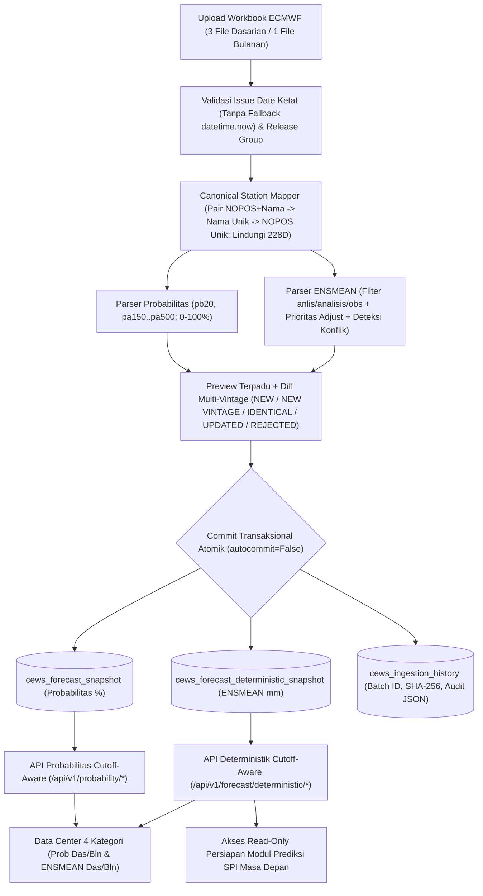
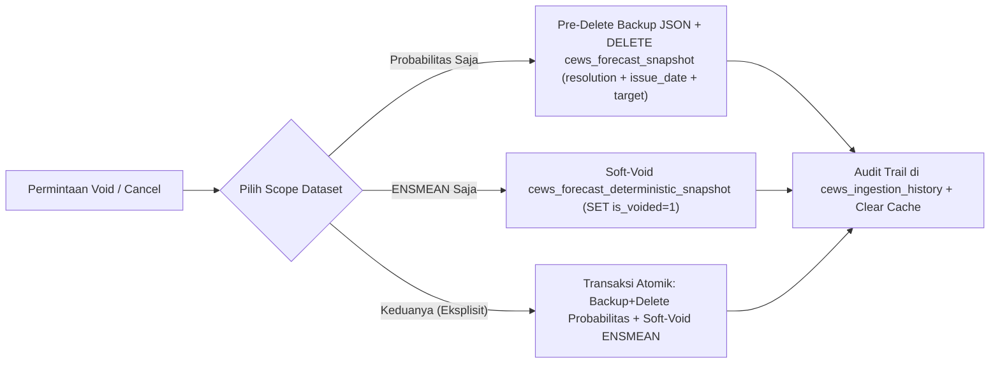
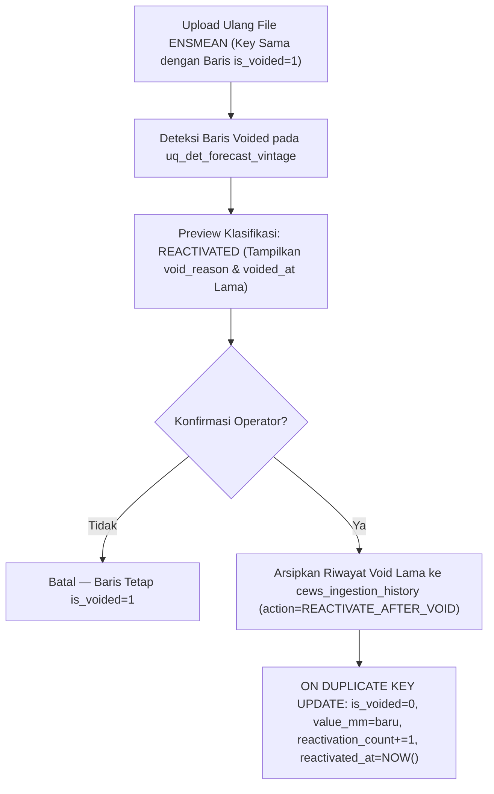
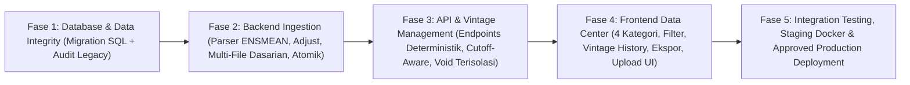

# DSS-PIK — Rencana Implementasi Final: ECMWF Multi-Vintage & ENSMEAN Integration

**Status Dokumen:** Spesifikasi & Rencana Implementasi Final — **Revisi v1.1 (Review & Hardening Pra-Fase 1)**  
**Tanggal Finalisasi:** 27 November 2026  
**Baseline Repository:** `https://github.com/vascosdrk/DSS-PIK` (`main`, commit `b7ffef5`)  
**Deployment Produksi:** Coolify (`compose.coolify.yaml`, branch `main`)  
**Dokumen Investigasi Terkait:** `ecmwf_multivintage_ensmean_audit_and_design.md` (hasil audit empiris terhadap 119 workbook dasarian, 23 workbook bulanan, source code backend/frontend, dan MariaDB lokal `cews_db_migration_test`)

---

## 1. Ringkasan Keputusan Final yang Telah Ditetapkan (`CONFIRMED`)

Seluruh poin di bawah merupakan ketentuan operasional final yang mengikat seluruh fase implementasi:

| No | Area | Ketentuan Final |
|---|---|---|
| 1 | **Prioritas Kolom `Adjust` ENSMEAN** | Header yang mengandung token `adjust` (*case-insensitive*, mis. `Nov Adjust`, `Agt (adjust)`, `Agt (adjust natuna)`) dikategorikan `ADJUSTED` dan diprioritaskan atas `REGULAR` untuk target yang sama. Keterangan tambahan seperti `natuna` **diabaikan** (tidak dipakai untuk pemetaan wilayah/stasiun). Header asli disimpan di `source_column`. Tidak pernah menggabungkan nilai `Regular` dan `Adjusted`. Jika > 1 kolom `Adjusted` muncul untuk target yang sama → tampilkan **CONFLICT** di preview dan blokir pemilihan acak. Aturan ini **hanya** berlaku pada `EnsMean`. |
| 2 | **Parser Bulanan Dinamis & Perbedaan Cakupan Sheet** | Tidak meng-hardcode 6 atau 7 bulan. Semua kolom target valid dalam workbook dibaca dinamis (3–7+ bulan) dengan normalisasi nama bulan & *year rollover* (`Des -> Jan`). Jika cakupan target antara sheet Probabilitas dan `EnsMean` berbeda: **(a)** tampilkan **warning** di preview, **(b)** **jangan** membuat record untuk periode yang tidak tersedia, **(c)** **jangan** mengisi nilai kosong dengan `0`, **(d)** **jangan** menolak seluruh workbook, dan **(e)** simpan seluruh data valid yang tersedia sesuai sheet masing-masing. |
| 3 | **Kolom Analisis Historis** | Kolom non-prakiraan berawalan/mengandung penanda analisis historis (`anlis`, `analisis`, `obs` berdasarkan header & konteks workbook) diabaikan otomatis dan ditampilkan di preview sebagai `IGNORED NON-FORECAST COLUMN`. |
| 4 | **Pemisahan Penyimpanan** | Probabilitas (%) tetap pada `cews_forecast_snapshot`; deterministik ENSMEAN (mm) disimpan pada tabel baru terpisah **`cews_forecast_deterministic_snapshot`**. Tidak pernah mencampur nilai `%` dan `mm`. |
| 5 | **Multi-Vintage Dasarian & Bulanan** | **Dasarian:** 1 penerbitan = 3 workbook diproses sebagai satu `release_group_id` dengan validasi wajib: *(1)* `issue_date` seluruh file sama, *(2)* target periode diidentifikasi dari header workbook (bukan suffix nama file), *(3)* tidak ada konflik target antarfile, *(4)* semua file harus lolos validasi sebelum commit, *(5)* jika 1 file gagal, **0 penyimpanan parsial** pada kedua tabel. Variasi workbook yang memuat > 1 target dasarian (12 file historis) tetap didukung penuh. **Bulanan:** 1 penerbitan = 1 workbook dinamis (Probabilitas + `EnsMean`). Vintage lama **tidak pernah ditimpa**; nilai berbeda antar-vintage berstatus **`NEW VINTAGE`** (bukan `UPDATED`). |
| 6 | **Isolasi Pembatalan / Void** | Pembatalan/void Probabilitas **tidak memengaruhi** ENSMEAN, dan pembatalan/void ENSMEAN **tidak memengaruhi** Probabilitas (kecuali operator secara eksplisit memilih membatalkan keduanya). Setiap pembatalan dibatasi ketat oleh `(forecast_resolution, issue_date, target_period, dataset, [station_id], [parameter])`. |
| 7 | **4 Kategori Data Center** | (1) Probabilitas Dasarian, (2) ENSMEAN Dasarian, (3) Probabilitas Bulanan, (4) ENSMEAN Bulanan — terpisah jelas secara visual (satuan `%` vs `mm`), masing-masing dilengkapi filter periode, vintage, wilayah, pencarian stasiun, info kelengkapan, riwayat penerbitan, dan ekspor. |
| 8 | **Ruang Lingkup Terlindung** | **Tidak mengubah:** perhitungan SPI existing, package `SPEI/`, data observasi CH (`cews_rainfall_daily`), pipeline ingestion CH, data probabilitas historis yang sudah tersimpan, dan konfigurasi Coolify. |

---

## 2. Verifikasi Ulang Discrepancy & Status Penyelesaian

| # | Discrepancy dari Audit Awal | Status Final | Resolusi yang Disepakati |
|---|---|---|---|
| D1 | Workbook bulanan bervariasi 3–7 bulan (`ver_2026.07.01` = 6 bln, `ver_2026.08.01` = 7 bln, `ver_2026.08.01` template = 7 prob vs 6 EnsMean). | **RESOLVED (`CONFIRMED`)** | Parser dinamis tanpa hardcode + warning di preview bila cakupan Probabilitas ≠ `EnsMean`. |
| D2 | Kolom `'anlis apr'`, `'anlis mei'` di `EnsMean` pada `ver_2026.06.01.xlsx`. | **RESOLVED (`CONFIRMED`)** | Klasifikasi otomatis sebagai `IGNORED NON-FORECAST COLUMN` di preview; tidak masuk proses *year rollover* maupun database. |
| D3 | Penafsiran `Agt (adjust natuna)` pada kolom `Adjust`. | **RESOLVED (`CONFIRMED`)** | Kata `natuna` diabaikan; semua header bertoken `adjust` diperlakukan setara sebagai `ADJUSTED`; > 1 kandidat `ADJUSTED` untuk target sama → **CONFLICT** di preview. |
| D4 | File contoh `KEPRI_pch_ecmwf_perpos_ver_2026.11.17_DAS 3 NOV.xlsx` belum tersedia di workspace lokal. | **OPEN — NON-BLOCKING (`UNKNOWN`)** | Rancangan telah divalidasi terhadap 119 workbook dasarian 2026 aktual (termasuk rangkaian 3 file `ver_2026.10.19`). Bila file `2026.11.17` tersedia saat Fase 5, akan dimasukkan ke uji penerimaan. |
| D5 | Anomali data legacy pada MariaDB lokal (`cews_forecast_snapshot`: baris `2026-01-das1` dan `SAFE_DEFAULT` menyimpan `prob_month_above300..500` dengan `forecast_resolution = 'DASARIAN'`). | **TRACKED (FASE 1)** | Diaudit tanpa mutasi destruktif pada Fase 1; query operasional tetap terisolasi dengan filter `forecast_resolution` dan daftar parameter per resolusi. |

---

## 3. Verifikasi Kompatibilitas Skema Database

### 3.1. Verifikasi Empiris Tipe, Collation & Kompatibilitas Tabel Existing (`VERIFIED`)
Hasil pemeriksaan `SHOW FULL COLUMNS` & `SHOW TABLE STATUS` pada MariaDB lokal (`cews_db_migration_test`):
- `stations.station_id`: **`VARCHAR(20) NOT NULL`**, Collation **`utf8mb4_unicode_ci`**, Engine **`InnoDB`** (table collation `utf8mb4_unicode_ci`).
- `cews_forecast_snapshot.station_id`: **`VARCHAR(20) NOT NULL`**, Collation **`utf8mb4_unicode_ci`**, Engine **`InnoDB`**.
- `cews_forecast_snapshot` constraints: `PRIMARY KEY (id)`, `UNIQUE KEY uq_forecast_evidence (station_id, target_year, target_month, target_dasarian, issue_date, forecast_parameter)`, `FK fk_fc_snapshot_station -> stations(station_id) ON UPDATE CASCADE`, `CHECK (probability_value BETWEEN 0.00 AND 100.00)`.

**Evaluasi Kompatibilitas:**
1. `cews_forecast_deterministic_snapshot.station_id` wajib menggunakan **`VARCHAR(20) NOT NULL`** dengan table charset **`utf8mb4`** dan collation **`utf8mb4_unicode_ci`** agar FK `fk_det_fc_station` 100% cocok dengan `stations.station_id` di MariaDB 10.x/11.x tanpa risiko *errno 150*.
2. `uq_forecast_evidence` **tidak bertabrakan** antara Dasarian (`target_dasarian IN (1,2,3)`) dan Bulanan (`target_dasarian = 0`) selama konvensi `target_dasarian = 0` untuk bulanan dijaga ketat. Pada Fase 1 ditambahkan **index pencarian** `(forecast_resolution, target_year, target_month, target_dasarian, issue_date)` serta kolom aditif nullable `ingestion_batch_id`, `release_group_id`, dan pelebaran `source_file VARCHAR(255)` (100% idempotent & *backward-compatible*, 0 penghapusan data).
3. `chk_fc_prob_val (0.00..100.00)` secara fisik melindungi `cews_forecast_snapshot` dari kontaminasi nilai curah hujan deterministik `ENSMEAN` (mm).

### 3.2. Skema Tabel Deterministik Baru `cews_forecast_deterministic_snapshot`
```sql
CREATE TABLE IF NOT EXISTS cews_forecast_deterministic_snapshot (
    id                  BIGINT UNSIGNED   NOT NULL AUTO_INCREMENT,
    station_id          VARCHAR(20)       NOT NULL,
    forecast_resolution VARCHAR(20)       NOT NULL,               -- 'DASARIAN' | 'BULANAN'
    issue_date          DATE              NOT NULL,
    target_year         SMALLINT UNSIGNED NOT NULL,
    target_month        TINYINT UNSIGNED  NOT NULL,
    target_dasarian     TINYINT UNSIGNED  NOT NULL DEFAULT 0,     -- 1..3 (DASARIAN), 0 (BULANAN)
    forecast_variable   VARCHAR(30)       NOT NULL DEFAULT 'ENSMEAN',
    value_mm            DECIMAL(8,2)      NOT NULL,               -- Curah hujan prakiraan (mm)
    unit                VARCHAR(10)       NOT NULL DEFAULT 'mm',
    adjustment_status   VARCHAR(20)       NOT NULL DEFAULT 'REGULAR', -- 'ADJUSTED' | 'REGULAR'
    source_file         VARCHAR(255)      NOT NULL,
    source_sheet        VARCHAR(64)       NOT NULL DEFAULT 'EnsMean',
    source_column       VARCHAR(100)      NOT NULL,               -- Nama kolom asli workbook
    release_group_id    VARCHAR(64)       NULL,                   -- Pengikat 3 file dasarian 1 penerbitan
    ingestion_batch_id  VARCHAR(64)       NULL,
    is_voided           TINYINT(1)        NOT NULL DEFAULT 0,
    void_reason         VARCHAR(255)      NULL,
    voided_by           VARCHAR(100)      NULL,
    voided_at           DATETIME          NULL,
    reactivation_count  SMALLINT UNSIGNED NOT NULL DEFAULT 0,     -- Jumlah reaktivasi setelah void
    reactivated_at      DATETIME          NULL,
    created_at          DATETIME          NOT NULL DEFAULT CURRENT_TIMESTAMP,
    updated_at          DATETIME          NOT NULL DEFAULT CURRENT_TIMESTAMP ON UPDATE CURRENT_TIMESTAMP,
    PRIMARY KEY (id),
    UNIQUE KEY uq_det_forecast_vintage (
        station_id, forecast_resolution, issue_date,
        target_year, target_month, target_dasarian, forecast_variable
    ),
    INDEX idx_det_res_target_issue (forecast_resolution, target_year, target_month, target_dasarian, issue_date),
    INDEX idx_det_vintage_batch (issue_date, release_group_id, ingestion_batch_id),
    INDEX idx_det_station_target (station_id, forecast_resolution, target_year, target_month, target_dasarian),
    INDEX idx_det_active_lookup (is_voided, forecast_resolution, target_year, target_month, target_dasarian, issue_date),
    CONSTRAINT fk_det_fc_station FOREIGN KEY (station_id) REFERENCES stations (station_id) ON UPDATE CASCADE,
    CONSTRAINT chk_det_val_nonneg CHECK (value_mm >= 0.00),
    CONSTRAINT chk_det_res_valid CHECK (forecast_resolution IN ('DASARIAN', 'BULANAN')),
    CONSTRAINT chk_det_adj_valid CHECK (adjustment_status IN ('REGULAR', 'ADJUSTED'))
) ENGINE=InnoDB DEFAULT CHARSET=utf8mb4 COLLATE=utf8mb4_unicode_ci;
```

### 3.3. Keputusan Teknis Konsistensi Void, Audit Trail & Reaktivasi Setelah Void

**Audit Keterkaitan Query Existing (`VERIFIED`):**
Terdapat **13 query `SELECT` aktif** di `backend/data_service.py` (5 query), `backend/ingestion_service.py` (4 query), dan `backend/period_service.py` (4 query, termasuk input Decision Engine PDKM/PDCHT di baris `787` & `812`) yang membaca `cews_forecast_snapshot` tanpa filter `is_voided = 0`. Menambahkan soft-void ke `cews_forecast_snapshot` tanpa memodifikasi seluruh konsumen berisiko membocorkan data yang telah di-void ke Decision Engine PDKM/PDCHT.

**Keputusan Arsitektur Paling Aman (Hibrida Terkendali):**
1. **`cews_forecast_snapshot` (Probabilitas Existing) → Audited Hard-Delete dengan Pre-Delete Snapshot Backup:**
   - Mempertahankan penghapusan baris aktif sehingga **0 risiko kebocoran** ke Decision Engine PDKM/PDCHT dan 13 query existing.
   - Sebelum `DELETE`, seluruh baris terdampak di-snapshot penuh (`station_id, forecast_resolution, issue_date, target_*, forecast_parameter, probability_value, source_file`) ke `cews_ingestion_history.batch_items_json` (`status = 'VOIDED'`).
   - Klausa `WHERE` wajib mencakup `forecast_resolution` pada `void_probability_record()` **dan** `cancel_ingestion_batch()`.
2. **`cews_forecast_deterministic_snapshot` (ENSMEAN Baru) → Soft-Void (`is_voided = 1`):**
   - Seluruh query deterministik dibangun dari awal dengan filter ketat `AND is_voided = 0`.
   - Void mengisi `is_voided = 1, void_reason, voided_by, voided_at` serta mencatat audit trail di `cews_ingestion_history`.
3. **Isolasi & Transaksi Atomik:**
   - Void Probabilitas **tidak menyentuh** `cews_forecast_deterministic_snapshot`; void ENSMEAN **tidak menyentuh** `cews_forecast_snapshot`.
   - Jika operator memilih **Void Gabungan (Combined Batch Void)**, kedua operasi dijalankan dalam **1 transaksi atomik (`autocommit=False`)** — gagal satu berarti rollback keduanya.
4. **Mekanisme Reaktivasi Aman Saat Upload Ulang Setelah Void (ENSMEAN):**
   - `uq_det_forecast_vintage` tetap menjaga 1 identitas rekaman per `(station_id, forecast_resolution, issue_date, target_*, forecast_variable)`.
   - Ketika file yang sama diunggah ulang setelah barisnya berstatus `is_voided = 1`:
     1. **Preview:** Baris diklasifikasikan sebagai **`REACTIVATED`** (menampilkan nilai baru + informasi `void_reason` & `voided_at` sebelumnya; memerlukan konfirmasi operator).
     2. **Preservasi Riwayat Pembatalan:** Sebelum mengaktifkan kembali baris, metadata void sebelumnya (`previous_void_reason`, `previous_voided_by`, `previous_voided_at`, `previous_value_mm`) diarsipkan ke `cews_ingestion_history.batch_items_json` (`action = 'REACTIVATE_AFTER_VOID'`).
     3. **Commit Atomik (Zero Duplicate Key):** `INSERT ... ON DUPLICATE KEY UPDATE value_mm = VALUES(value_mm), adjustment_status = VALUES(adjustment_status), source_column = VALUES(source_column), source_file = VALUES(source_file), ingestion_batch_id = VALUES(ingestion_batch_id), is_voided = 0, void_reason = NULL, voided_by = NULL, voided_at = NULL, reactivation_count = reactivation_count + 1, reactivated_at = CURRENT_TIMESTAMP`.
   - Pada `cews_forecast_snapshot`, upload ulang setelah audited hard-delete menyisipkan ulang baris secara bersih (`NEW` / `NEW VINTAGE`) sementara riwayat void sebelumnya tetap tersimpan permanen di `cews_ingestion_history`.

---

## 4. Diagram Arsitektur Final

### 4.1. Arsitektur End-to-End ECMWF Multi-Vintage & ENSMEAN


### 4.2. Alur Pembatalan / Void Terisolasi & Reaktivasi Setelah Void




### 4.3. Dependency Antar-Fase Implementasi


---

## 5. Rincian 5 Fase Implementasi & 10 Perbaikan Fundamental

| Fase | Lingkup Pekerjaan Utama | Perbaikan Fundamental yang Diselesaikan | Kriteria Keluar (*Exit Criteria*) |
|---|---|---|---|
| **Fase 1 — Database & Data Integrity** | 1. Buat migrasi SQL aditif `cews_forecast_deterministic_snapshot` dan index/kolom aditif `cews_forecast_snapshot`.<br>2. Buat script audit read-only untuk memeriksa rekaman legacy `cews_forecast_snapshot` (`2026-01-das1`, `SAFE_DEFAULT`) tanpa mutasi destruktif.<br>3. Verifikasi backup lokal sebelum menerapkan migrasi di `cews_db_migration_test`. | #5 (audit unique key & resolusi), #6 (audit rekaman legacy) | Migrasi berjalan idempotent (`CREATE TABLE IF NOT EXISTS`), data probabilitas lama 100% utuh, FK & CHECK constraint aktif. |
| **Fase 2 — Backend Ingestion** | 1. Buat `backend/ecmwf_forecast_service.py` (parser terpadu Probabilitas + ENSMEAN, prioritas `Adjust` sederhana, filter `IGNORED NON-FORECAST COLUMN`, deteksi konflik > 1 Adjust, normalisasi bulan & year rollover).<br>2. Dukungan multi-file dasarian (1–3 file = 1 `release_group_id`, validasi kesamaan `issue_date`, cegah target ganda).<br>3. Hapus fallback `datetime.now()` untuk `issue_date` (wajib metadata valid atau konfirmasi eksplisit).<br>4. Pemetaan stasiun terpadu `(NOPOS, nama)` (verifikasi `228D` → Duara & UPT Benih Pertanian).<br>5. Transaksi commit atomik ke 2 tabel + idempotency `IDENTICAL` + audit trail. | #1 (hapus fallback `datetime.now`), #2 (validasi vintage), #7 (pemetaan non-NOPOS tunggal), #8 (idempotency), #10 (konsistensi atomik 2 dataset) | Unit & integration test lulus untuk 119 file dasarian (sampel trio & multi-kolom) + 23 file bulanan (termasuk `ver_2026.06.01`, `ver_2026.07.01`, `ver_2026.10.01`). |
| **Fase 3 — API & Vintage Management** | 1. Tambah endpoint `/api/v1/forecast/deterministic/periods`, `/data`, `/vintages`, `/download`.<br>2. Gunakan `select_eligible_vintage()` (*cutoff-aware*, per `(resolution, target_period)`).<br>3. Perbaiki `cancel_ingestion_batch()` (tambahkan `forecast_resolution` di `WHERE` & pisahkan scope Probabilitas vs ENSMEAN).<br>4. Tambah endpoint `POST /api/v1/ingestion/deterministic/void` (soft-void terisolasi). | #3 (pembatalan presisi resolusi/vintage/target/dataset), #4 (isolasi void Probabilitas vs ENSMEAN), #9 (cutoff-aware historis) | Seluruh endpoint lulus uji API, cutoff-aware mencegah *future leakage*, dan void 1 dataset tidak menyentuh dataset/vintage lain. |
| **Fase 4 — Frontend Data Center** | 1. Implementasi 4 kategori Data Center: **Probabilitas Dasarian**, **ENSMEAN Dasarian**, **Probabilitas Bulanan**, **ENSMEAN Bulanan** (desain clean navy/white konsisten dengan `ProbabilityDataTable`).<br>2. Tabel ENSMEAN menampilkan satuan `mm`, badge `Adjusted`/`Regular`, `source_column`, filter periode/vintage/wilayah/cari pos, info kelengkapan, riwayat vintage, dan ekspor CSV/XLSX.<br>3. Perbarui `DataIngestionModal.jsx` untuk upload 3 file dasarian + preview terpisah Probabilitas, ENSMEAN, `IGNORED NON-FORECAST COLUMN`, dan warning beda cakupan bulan.<br>4. Perbarui `OperationalDataManager.jsx` untuk manajemen pembatalan/void terisolasi Probabilitas vs ENSMEAN. | Integrasi UI 4 kategori & transparansi audit preview | Vite production build bersih (0 error), responsif (1920/1366/1160/tablet/mobile), tidak mengubah halaman SPI maupun CH. |
| **Fase 5 — Integration Testing & Deployment** | 1. Regression suite penuh (`pytest`: test baru ECMWF/ENSMEAN + `test_period_aware_ingestion_hardening.py` + `test_spi_async_job_engine.py` + `test_rainfall_normalization_and_spi_validation.py`).<br>2. Validasi Docker Compose (`compose.yaml` & `compose.coolify.yaml`) + secret scan.<br>3. Pengujian staging lokal.<br>4. Commit & push ke `origin/main` setelah persetujuan eksplisit + verifikasi Coolify & migrasi aditif di produksi. | Validasi menyeluruh & keamanan rilis | 100% test PASS, 0 regresi SPI/CH/Probabilitas lama, rollback teruji. |

---

## 6. Daftar File Source Code yang Akan Terdampak

### File Baru
1. `database/migrations/20261127_add_forecast_deterministic_snapshot.sql`
2. `backend/ecmwf_forecast_service.py`
3. `frontend/src/components/DeterministicForecastTable.jsx` & `frontend/src/components/DeterministicForecastTable.css` *(atau modul terintegrasi di dalam tab Prakiraan ECMWF tanpa mencampur tabel `%` dan `mm`)*
4. `tests/integration/test_ecmwf_multivintage_ensmean.py`
5. `tests/unit/test_ecmwf_ensmean_adjust_parser.py`

### File Modifikasi
1. `backend/ingestion_service.py` — integrasi commit/preview/cancel/void terpadu & perbaikan `forecast_resolution` pada `cancel_ingestion_batch()`, penghapusan fallback `datetime.now()`.
2. `backend/data_service.py` — fungsi query, riwayat vintage, dan ekspor CSV/XLSX untuk `cews_forecast_deterministic_snapshot`.
3. `backend/main.py` — dukungan multi-file preview untuk probabilitas dasarian + endpoint `/api/v1/forecast/deterministic/*` & `/api/v1/ingestion/deterministic/void`.
4. `backend/schemas.py` — Pydantic response/request models untuk deterministik & void.
5. `frontend/src/config.js` — konstanta endpoint baru `DETERMINISTIC_*`.
6. `frontend/src/components/DataCenter.jsx` — switcher 4 kategori (Probabilitas vs ENSMEAN, Dasarian vs Bulanan) atau sub-navigasi terstruktur.
7. `frontend/src/components/DataIngestionModal.jsx` — dukungan upload 1–3 file dasarian + preview terpisah Probabilitas, ENSMEAN, `IGNORED NON-FORECAST COLUMN`, dan warning cakupan bulan.
8. `frontend/src/components/OperationalDataManager.jsx` — opsi void/pembatalan terisolasi untuk dataset `ENSMEAN`.
9. `docs/ingestion/RAINFALL_INPUT_MODULE.md` / `docs/deployment/DSS_PIK_DEVELOPMENT_AND_DEPLOYMENT_GUIDE.md` — pembaruan dokumentasi operasional pasca-implementasi.

---

## 7. Daftar Migration SQL yang Nantinya Diperlukan

1. **`database/migrations/20261127_add_forecast_deterministic_snapshot.sql`** *(Aditif & Idempotent)*:
   - `CREATE TABLE IF NOT EXISTS cews_forecast_deterministic_snapshot (...)` (skema penuh pada Bagian 3.2).
2. **`database/migrations/20261127_harden_forecast_snapshot_indexes.sql`** *(Aditif & Non-Destruktif)*:
   - `ALTER TABLE cews_forecast_snapshot MODIFY COLUMN source_file VARCHAR(255) NOT NULL;`
   - `ALTER TABLE cews_forecast_snapshot ADD COLUMN IF NOT EXISTS release_group_id VARCHAR(64) NULL;`
   - `ALTER TABLE cews_forecast_snapshot ADD COLUMN IF NOT EXISTS ingestion_batch_id VARCHAR(64) NULL;`
   - `CREATE INDEX IF NOT EXISTS idx_fc_res_target_issue ON cews_forecast_snapshot (forecast_resolution, target_year, target_month, target_dasarian, issue_date);`
   - *Catatan:* Tidak mengubah `UNIQUE KEY uq_forecast_evidence` dan tidak menyentuh/menghapus 1 baris pun data historis.

---

## 8. Strategi Pengujian & Rollback

### 8.1. Strategi Pengujian
- **Level 1 (Unit):**
  - Parser header `EnsMean`: `Adjust` vs `Regular`, pengabaian token tambahan (`natuna`), konflik > 1 `Adjust` diblokir, filter `anlis`/`analisis`/`obs` (`IGNORED NON-FORECAST COLUMN`), *year rollover* `Des -> Jan`, pemetaan `228D`, penolakan file tanpa `issue_date`.
  - Validasi 3 file dasarian: `issue_date` berbeda → ditolak; konflik target antarfile → ditolak; 1 file gagal validasi → 0 commit parsial; workbook multi-target dasarian tetap didukung.
  - Perbedaan cakupan sheet Probabilitas vs `EnsMean`: menghasilkan warning, 0 record fiktif, 0 pengisian nol, seluruh data valid tersimpan.
- **Level 2 (Integration — MariaDB Lokal `cews_db_migration_test`):**
  - Upload trio 3 file dasarian (`ver_2026.10.19`) → verifikasi 1 `release_group_id`, 2 tabel terisi atomik, 52 stasiun/file.
  - Upload bulanan (`ver_2026.06.01`, `ver_2026.07.01`, `ver_2026.08.01`, `ver_2026.10.01`) → verifikasi 3–7 bulan dinamis, 3 kolom `Adjust` pada `2026.10.01`, 2 kolom `anlis` diabaikan pada `2026.06.01`.
  - Multi-vintage & idempotency: upload vintage kedua → `NEW VINTAGE` (vintage pertama utuh); upload ulang file sama → 100% `IDENTICAL`.
  - Isolasi void & reaktivasi: void ENSMEAN tidak menyentuh `cews_forecast_snapshot` (dan sebaliknya); void gabungan berjalan atomik; upload ulang setelah void ENSMEAN mengklasifikasikan `REACTIVATED`, mengarsipkan riwayat void lama ke `cews_ingestion_history`, menaikkan `reactivation_count`, dan menghasilkan **0 duplicate key**.
  - Cutoff-aware: `evaluation_cutoff_date` tidak pernah membocorkan vintage masa depan.
- **Level 3 (Full Regression & Build):** `pytest` penuh (termasuk `test_period_aware_ingestion_hardening.py`, `test_spi_async_job_engine.py`, `test_rainfall_normalization_and_spi_validation.py`), `npm --prefix frontend run build`, dan validasi `compose.yaml` + `compose.coolify.yaml`.

### 8.2. Strategi Rollback (Non-Destruktif)
- **Database (Prinsip Zero Data Loss):**
  - Seluruh migrasi bersifat **100% aditif dan idempotent** (`CREATE TABLE IF NOT EXISTS`, `ADD COLUMN IF NOT EXISTS`, `CREATE INDEX IF NOT EXISTS`).
  - **Dilarang menjalankan `DROP TABLE` pada rollback operasional** jika `cews_forecast_deterministic_snapshot` sudah berisi data operasional baru — rollback aplikasi cukup menghentikan penulisan/pembacaan endpoint baru dengan kembali ke image Docker sebelumnya (`b7ffef5`), sementara tabel & data tetap aman utuh di volume MariaDB.
  - Backup `mysqldump` wajib dibuat sebelum menerapkan migrasi di lingkungan staging maupun produksi.
- **Aplikasi & Coolify:** Rollback ke commit/image Docker terverifikasi sebelumnya (`b7ffef5`) melalui Coolify UI tanpa menghapus volume MariaDB maupun volume Parquet (dilarang keras `docker compose down -v`).

---

## 9. Risiko Terhadap Data Probabilitas Existing & Deployment Coolify

| Risiko | Dampak | Mitigasi |
|---|---|---|
| **1. Kontaminasi / Overwrite Data Probabilitas Historis** | Hilangnya snapshot probabilitas lama atau berubahnya hasil Decision Engine PDKM/PDCHT. | Tabel deterministik terpisah total; tidak ada `DELETE`/`UPDATE` massal pada `cews_forecast_snapshot`; `UNIQUE KEY` tetap mempertahankan seluruh vintage lama. |
| **2. Rekaman Legacy `cews_forecast_snapshot` Beda Resolusi (`2026-01-das1`, `SAFE_DEFAULT`)** | Potensi kebingungan saat query lintas resolusi. | Query selalu memfilter `forecast_resolution` + parameter spesifik resolusi; audit legacy didokumentasikan terpisah tanpa penghapusan sepihak. |
| **3. Kegagalan Parsial Commit 2 Dataset** | Probabilitas tersimpan tetapi ENSMEAN gagal (atau sebaliknya). | Satu koneksi transaksi MariaDB (`autocommit=False`) membungkus commit ke `cews_forecast_snapshot`, `cews_forecast_deterministic_snapshot`, dan `cews_ingestion_history` dengan `rollback()` penuh bila terjadi error. |
| **4. Migrasi Belum Jalan di MariaDB Produksi Saat Coolify Auto-Deploy** | Endpoint deterministik bisa mengembalikan error `Table doesn't exist` jika container baru naik sebelum migrasi dijalankan. | Tambahkan `ensure_deterministic_forecast_table()` (idempotent `CREATE TABLE IF NOT EXISTS`) pada startup/service backend (pola sama dengan `ensure_spi_jobs_table()` di `spi_job_service.py`) selain menyediakan file migrasi SQL resmi. |
| **5. Stale Cache Browser Pasca-Deploy Coolify** | Frontend lama tidak menampilkan tab ENSMEAN. | Header `Cache-Control: no-cache, no-store, must-revalidate` sudah aktif di `frontend/nginx.conf` sejak commit `f0e6338`. |
| **6. File `mapping_tambahan.xlsx` di Container Docker Produksi** | Jika file referensi tidak tersedia di image/volume, pemetaan `228D` dapat gagal. | Verifikasi `data/reference/stations/mapping_tambahan.xlsx` ter-mount di volume/image produksi dan tetap didukung fallback `cews_rainfall_station_aliases` di MariaDB. |

---

## 10. Dokumentasi Realisasi Implementasi Fase 2 (Backend Ingestion — `PASS`)

### 10.1. Struktur Parser & Pemetaan Sheet (`backend/ecmwf_forecast_service.py`)
- **`parse_ecmwf_workbook_unified()`**: Membaca sheet Probabilitas operasional (`pb20, pa150, pa200, pa300` untuk Dasarian; `pa300, pa400, pa500` untuk Bulanan) **dan** sheet `EnsMean` secara simultan dalam satu sesi staging.
- **`extract_verified_issue_date()`**: Mengekstrak `issue_date` dari metadata workbook (`Sheet1`, `TabelPCH`, `TabelPSH`) dan nama berkas (`ver_YYYY.MM.DD`). Konflik metadata atau ketiadaan tanggal langsung memicu `ValueError` (**fallback `datetime.now()` dihapus total**).
- **`parse_period_token()` & `resolve_ensmean_columns()`**:
  - Kolom analisis/historis (`anlis`, `analisis`, `obs`, dll.) diklasifikasikan otomatis sebagai `IGNORED NON-FORECAST COLUMN` dan dicatat di preview.
  - Token `adjust` (*case-insensitive*) menandai kolom `ADJUSTED` dan diprioritaskan atas `REGULAR` untuk target periode yang sama; keterangan tambahan seperti `natuna` diabaikan untuk logika wilayah; nama header asli disimpan utuh di `source_column`.
  - Jika ditemukan `> 1` kandidat `ADJUSTED` untuk target periode yang sama → tercatat di `conflicts` dan memblokir commit.
  - Regex dasarian menjaga angka Romawi (`III|II|I`) bersifat *case-sensitive* agar huruf kecil `'i'` di akhir `Mei`/`Juni`/`Juli` tidak ikut terpotong (memperbaiki kasus `MeiI`, `MeiII`, `JuniI`).
  - Perbedaan cakupan periode antara Probabilitas dan `EnsMean` menghasilkan *warning* di preview tanpa membuat record fiktif, tanpa mengisi nol, dan tanpa menolak workbook.

### 10.2. Validasi 3-File Dasarian, Pemetaan Stasiun & Transaksi Atomik
- **`parse_ecmwf_dasarian_release()`**: Memproses 1–3 file dasarian dengan satu `release_group_id` (`ECMWF_DAS_<issue_date>`), memvalidasi kesamaan `issue_date`, mendeteksi konflik target periode antarfile, tetap mendukung file multi-target dasarian, dan menolak seluruh batch bila ada 1 file gagal.
- **`map_ecmwf_sheet_stations()`**: Pemetaan per sheet secara independen dengan prioritas `(NOPOS, normalized_name)` → nama unik → `NOPOS` tunggal (hanya jika tidak muncul ganda di sheet), sehingga kode ganda `228D` terpetakan bersih ke `Duara` dan `UPT Benih Pertanian` (`52/52` pos manual master, `0` duplikasi).
- **`commit_ecmwf_unified_session()`**: Menggunakan `conn.autocommit(False)` + `conn.begin()` dalam **satu koneksi PyMySQL** untuk menyimpan `cews_forecast_snapshot`, `cews_forecast_deterministic_snapshot`, dan `cews_ingestion_history` secara atomik (terbukti 0 partial commit saat kegagalan terjadi di tahap Probabilitas maupun ENSMEAN). Mendukung `NEW`, `NEW VINTAGE`, `IDENTICAL` (skip/idempotent), `UPDATED`, dan `REACTIVATED` (reaktivasi pasca-void dengan pengarsipan riwayat void lama ke `batch_items_json` & `reactivation_count += 1`).

### 10.3. Integrasi Backend & Hasil Pengujian Fase 2
- `backend/ingestion_service.py`: `parse_probability_excel()` dan blok commit probabilitas pada `commit_ingestion_session()` kini mendelegasikan penuh ke `backend/ecmwf_forecast_service.py`.
- `backend/main.py`: `/api/v1/ingestion/preview` kini mendukung upload multi-file dasarian melalui `parse_ecmwf_dasarian_release()`.
- **Pre-Check Fase 1 (`PASS`):** `target_dasarian` terverifikasi `TINYINT(3) UNSIGNED NOT NULL DEFAULT 0`; backup UTF-8 (`41.796.388 bytes`) berhasil di-restore ke DB sementara lokal (`3.244` baris, `sum_prob = 78.616,71`, 100% identik) lalu DB sementara dihapus bersih.
- **Automated Tests (`PASS`):** **48 passed, 0 failed** (`7` unit test parser/Adjust + `3` integration test multi-vintage/atomik/reaktivasi + `6` test Fase 1 + `23` test hardening ingestion + `9` test normalisasi CH/SPI).
- **Compatibility Sweep 142 Workbook Historis (`PASS`):** `119/119` workbook dasarian (`0` fail) dan `23/23` workbook bulanan (`0` fail) berhasil diparsing secara read-only tanpa mengubah database.

---

## 11. Dokumentasi Realisasi Implementasi Fase 3 (API & Vintage Management — `PASS`)

### 11.1. Daftar Endpoint API ENSMEAN (`backend/main.py` → `backend/ecmwf_forecast_service.py`)
Seluruh endpoint dilindungi middleware autentikasi `/api/v1/*` yang sama dengan API Probabilitas existing:

| Method | Endpoint | Fungsi Utama |
|---|---|---|
| `GET` | `/api/v1/forecast/deterministic/periods` | Daftar periode target tersedia (`dasarian` & `bulanan`) beserta jumlah vintage aktif (`is_voided = 0`) dan jumlah pos. |
| `GET` | `/api/v1/forecast/deterministic/data` | Data ENSMEAN (mm) per 57 pos master (5 ARG `value_mm = null`); mendukung `period_id`, `resolution`, `issue_date`, `cutoff_date`, `station_id`, `kabupaten`, pagination, dan metrik `completeness`. |
| `GET` | `/api/v1/forecast/deterministic/vintages` | Daftar vintage tersedia dengan filter `resolution`, `period_id`, `cutoff_date`, dan `include_voided`. |
| `GET` | `/api/v1/forecast/deterministic/vintages/{issue_date}` | Detail 1 vintage (daftar target periode, `adjustment_status`, `source_column`, `source_file`, statistik min/max/avg mm). |
| `GET` | `/api/v1/forecast/deterministic/completeness` | Metrik kelengkapan pos manual (52 pos) secara global dan per kabupaten/kota, termasuk daftar pos yang belum tersedia. |
| `GET` | `/api/v1/forecast/deterministic/history` | Riwayat ingestion, soft-void (`ENSMEAN_VOID`), dan reaktivasi (`ENSMEAN_REACTIVATE`) dari `cews_ingestion_history`. |
| `GET` | `/api/v1/forecast/deterministic/download` | Ekspor data ENSMEAN terfilter dalam format **CSV** (`utf-8-sig`) atau **XLSX** (`openpyxl`) dengan kolom lengkap (`value_mm`, `unit`, `adjustment_status`, `source_column`, `source_file`). |
| `POST` | `/api/v1/ingestion/deterministic/void` | Soft-void terisolasi (`is_voided = 1`) berdasarkan `issue_date`, `forecast_resolution`, opsional `target_period`/`station_id`/`batch_id`; **tidak menyentuh `cews_forecast_snapshot`**. |
| `POST` | `/api/v1/ingestion/deterministic/reactivate` | Reaktivasi aman baris yang di-void (`is_voided = 0`, `reactivation_count += 1`) sambil mengarsipkan riwayat void lama ke `cews_ingestion_history`. |

### 11.2. Hardening Multi-Vintage, Cutoff, Partial Release & Pembatalan
- **Cutoff-Aware Selection (`_select_cutoff_aware_vintage`)**: Memilih `MAX(issue_date) WHERE issue_date <= cutoff_date AND is_voided = 0`; jika tidak ada vintage yang lolos cutoff, mengembalikan `None` (tanpa fallback tanggal sistem).
- **Larangan Partial Release Dasarian**: Preview menerima 1–3 file, tetapi `commit_ecmwf_unified_session()` menolak commit batch penerbitan dasarian (`is_dasarian_release_batch = True`) apabila jumlah file tidak tepat `3`.
- **Audit & Perbaikan `cancel_ingestion_batch()` (`backend/ingestion_service.py`)**: Klausa `DELETE FROM cews_forecast_snapshot` kini selalu memfilter `AND forecast_resolution = %s`, menggunakan transaksi eksplisit PyMySQL (`conn.autocommit(False); conn.begin()`), dan hanya menyentuh item `PROBABILITAS` (terisolasi penuh dari `cews_forecast_deterministic_snapshot`).

---

## 12. Realisasi Fase 4 — Frontend Data Center & Local Running (2026-11-27)

### 12.1. Integrasi 4 Kategori Data Center ECMWF
- **`frontend/src/config.js`**: Ditambahkan seluruh 9 endpoint deterministik ENSMEAN Fase 3 (`DETERMINISTIC_PERIODS`, `DETERMINISTIC_DATA`, `DETERMINISTIC_VINTAGES`, `DETERMINISTIC_VINTAGE_DETAIL`, `DETERMINISTIC_COMPLETENESS`, `DETERMINISTIC_HISTORY`, `DETERMINISTIC_DOWNLOAD`, `INGESTION_DETERMINISTIC_VOID`, `INGESTION_DETERMINISTIC_REACTIVATE`).
- **`frontend/src/components/DataCenter.jsx`**: Sub-tab **Data Probabilitas & ENSMEAN** dilengkapi bar pemilih 4 kategori:
  1. **Probabilitas Dasarian (`%`)**
  2. **ENSMEAN Dasarian (`mm`)**
  3. **Probabilitas Bulanan (`%`)**
  4. **ENSMEAN Bulanan (`mm`)**
- **`frontend/src/components/ProbabilityDataTable.jsx` & `ProbabilityDataTable.css`**: Desain terbaru (`prob-v2-*`) dipertahankan utuh tanpa regresi; ditambahkan prop opsional `externalResolutionMode` dan `onResolutionChange` untuk sinkronisasi dengan switcher 4 kategori.
- **`frontend/src/components/DeterministicForecastTable.jsx`**: Komponen baru untuk ENSMEAN (`DASARIAN` & `BULANAN`) yang menggunakan sistem gaya `prob-v2-*`, menampilkan satuan `mm`, badge `ADJUSTED`/`REGULAR`, `source_column`, filter periode target, vintage/issue date, cutoff evaluasi opsional, wilayah kabupaten/kota, pencarian stasiun, indikator kelengkapan pos manual, ekspor CSV & XLSX terautentikasi, serta *empty state* operasional yang bersih saat belum ada data ENSMEAN lokal.

### 12.2. Upload Terpadu & Soft-Void/Reaktivasi ENSMEAN Terisolasi
- **`frontend/src/components/DataIngestionModal.jsx`**: Mendukung pratinjau terpadu Probabilitas & ENSMEAN (termasuk multi-file dasarian 1–3 workbook sebagai 1 `release_group_id`), menampilkan panel ringkasan ECMWF (`issue_date`, resolusi, jumlah berkas, ringkasan ENSMEAN, kolom `ADJUSTED` yang diprioritaskan, `IGNORED NON-FORECAST COLUMN`, konflik `Adjust`, peringatan beda cakupan sheet), tab pratinjau diff `Probabilitas` vs `ENSMEAN mm`, serta menonaktifkan tombol commit apabila terdapat konflik `Adjust` atau penerbitan dasarian tidak terdiri dari tepat 3 workbook valid.
- **`frontend/src/components/OperationalDataManager.jsx`**: Menambahkan filter dataset `Deterministik (mm)` dan Sub-Form 5 **Soft-Void & Reaktivasi Data Deterministik ECMWF (Terisolasi)** lengkap dengan konfirmasi eksplisit, riwayat ingestion/void/reaktivasi (`/api/v1/forecast/deterministic/history`), serta tabel **Daftar Vintage Prakiraan Deterministik (mm)** pada Tab 4 tanpa menyentuh kontrol atau data Probabilitas.

### 12.3. Penyempurnaan Hierarki 2-Tingkat & Terminologi Antarmuka (2026-11-27)
- **Terminologi UI**: Seluruh label, judul, deskripsi, tombol, empty state, notifikasi, dan modal yang terlihat oleh operator kini hanya menggunakan **Probabilitas (%)** dan **Deterministik (mm)** (istilah `ENSMEAN` dihilangkan dari seluruh teks UI tanpa mengubah nama tabel DB, API, maupun identifier internal backend).
- **Hierarki 2-Tingkat (`DataCenter.jsx`)**: Menggantikan 4 tombol kategori dengan header terpadu **Data Probabilitas & Deterministik** dan kontrol 2 tingkat: **Tingkat 1 — Resolusi Prakiraan (`Dasarian` | `Bulanan`)** dan **Tingkat 2 — Jenis Data (`Probabilitas %` | `Deterministik mm`)**. Kontrol resolusi ganda di dalam `ProbabilityDataTable` dan `DeterministicForecastTable` dihilangkan saat mode embedded aktif.
- **Alur Input Tunggal per Resolusi**: Satu tombol **Input / Pembaruan Data** mengikuti resolusi aktif (`Dasarian` = 3 workbook, `Bulanan` = 1 workbook) untuk memproses Probabilitas (%) dan Deterministik (mm) secara atomik dari berkas sumber yang sama.
