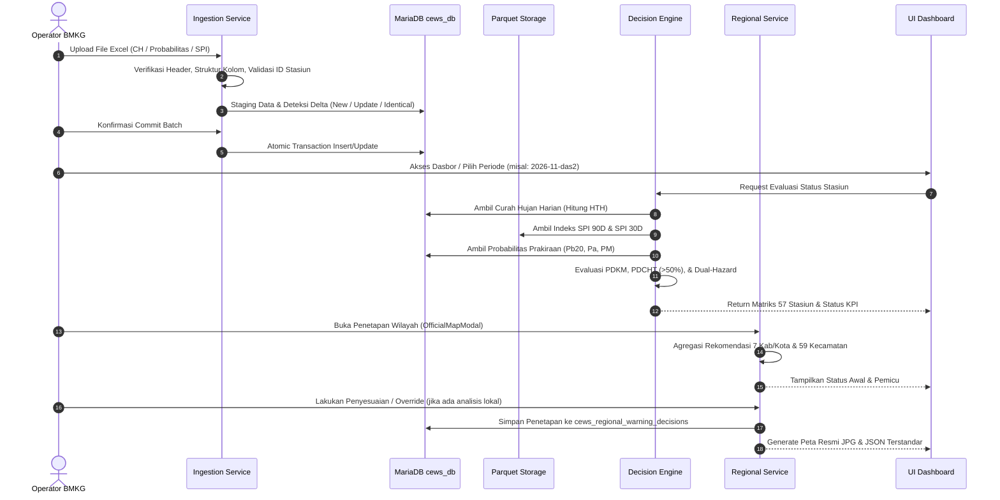

# ARCHITECTURE & DATA FLOW — DSS-PIK BMKG KEPULAUAN RIAU
**Arsitektur Sistem, Desain Basis Data, Alur Pemrosesan, dan Integrasi Jaringan**  
**Institusi**: BMKG Stasiun Meteorologi Kelas II Raja Haji Fisabilillah Tanjungpinang  
**Status**: `VERIFIED CURRENT` (November 2026)

---

## 1. DIAGRAM ARSITEKTUR SISTEM LENGKAP

Sistem DSS-PIK dibangun dengan arsitektur berlapis (*layered architecture*) yang mengedepankan isolasi logika bisnis, ketahanan data operasional, dan kemudahan akses di jaringan lokal:

```mermaid
flowchart TD
    subgraph KLIEN["1. LAPISAN PRESENTASI (Frontend SPA)"]
        UI_DASH["Dasbor Peringatan Dini & KPI"]
        UI_GIS["WebGIS Leaflet 57 Stasiun"]
        UI_DEC["Official Map Modal (59 Kecamatan)"]
        UI_DC["Data Center & SPI Generator"]
        UI_AUTH["Halaman Login Resmi BMKG"]
    end

    subgraph API["2. LAPISAN LOGIKA & LAYANAN (FastAPI Backend)"]
        RT_MAIN["API Router & State (backend/main.py)"]
        RT_AUTH["Auth & Session Guard (backend/auth.py)"]
        ENG_DEC["Decision Engine (backend/decision_engine.py)"]
        ENG_REG["Regional Warning Aggregator (regional_warning_service.py)"]
        ENG_MAP["Official Map Renderer (map_generator.py)"]
        ENG_ING["Ingestion Pipeline (ingestion_service.py)"]
        ENG_SPI["SPI Worker (spi_calculation_service.py)"]
        CONF["Single Source of Truth (backend/config.py)"]
    end

    subgraph DATA["3. LAPISAN PENYIMPANAN DATA (Data Storage)"]
        subgraph RDBMS["MariaDB (cews_db)"]
            T_ST["stations (57 Pos)"]
            T_RF["cews_rainfall_daily (287k Baris)"]
            T_FS["cews_forecast_snapshot"]
            T_PS["cews_period_snapshot"]
            T_RD["cews_regional_warning_decisions"]
            T_ING["cews_ingestion_history"]
        end
        subgraph PARQUET["Canonical Parquet Storage"]
            PQ_SPI90["data/raw/spi/dasarian/SPI_all_90d.parquet"]
            PQ_SPI30["data/raw/spi/dasarian/SPI_all_30d.parquet"]
            PQ_REF["data/reference/spi_distributions/"]
        end
    end

    subgraph OUTPUT["4. KELUARAN SISTEM (Official Artifacts)"]
        OUT_MAP["Peta Resmi BMKG JPG (1653x1170 px)"]
        OUT_JSON["Standardized Decision JSON (SIH3/WordPress)"]
        OUT_XLSX["Ekspor Excel Template BMKG"]
    end

    UI_DASH -->|HTTP REST| RT_MAIN
    UI_GIS -->|HTTP REST| RT_MAIN
    UI_DEC -->|HTTP REST| RT_MAIN
    UI_DC -->|HTTP REST| RT_MAIN
    UI_AUTH -->|HTTP Auth| RT_AUTH

    RT_MAIN --> ENG_DEC
    RT_MAIN --> ENG_REG
    RT_MAIN --> ENG_MAP
    RT_MAIN --> ENG_ING
    RT_MAIN --> ENG_SPI
    RT_MAIN --> CONF

    ENG_ING -->|Atomic Commit| T_RF
    ENG_ING -->|Staging Audit| T_ING
    ENG_SPI -->|Fit Distribution| PQ_SPI90
    ENG_SPI -->|Fit Distribution| PQ_SPI30
    ENG_DEC -->|Read Observation| T_RF
    ENG_DEC -->|Read SPI 90D| PQ_SPI90
    ENG_DEC -->|Read Probability| T_FS
    ENG_REG -->|Save/Audit Decision| T_RD

    ENG_MAP -->|Render A4 Landscape| OUT_MAP
    ENG_REG -->|Validate 18-pt QC| OUT_JSON
    RT_MAIN -->|Export Styled| OUT_XLSX
```



---

## 2. STRUKTUR BASIS DATA RELASIONAL (MARIADB `cews_db`)

MariaDB versi `13.0.2-MariaDB` beroperasi pada port lokal `3306`. Berikut adalah inventarisasi tabel aktif:

### A. Tabel Utama
1. **`stations` (57 baris)**:
   - Kolom: `station_id`, `station_name`, `kabupaten`, `province`, `region`, `latitude`, `longitude`, `elevation_m`, `nozom_prov`, `created_at`, `updated_at`.
   - Menampung master 57 pos pengamatan di 7 kabupaten/kota Kepri.
2. **`cews_rainfall_daily` (287.189 baris)**:
   - Kolom: `id`, `station_id`, `observation_date`, `rainfall_mm`, `obs_status` (`OBSERVED_VALID`, `OBSERVED_ZERO`, `TTU`, `MISSING`), `created_at`, `updated_at`.
   - Menyimpan seluruh rekaman pengamatan curah hujan harian dari tahun 2021 hingga sekarang.
3. **`cews_forecast_snapshot` (3.244 baris)**:
   - Kolom: `id`, `period_id`, `station_id`, `issue_date`, `target_year`, `target_month`, `target_dasarian`, parameter peluang (`pb20`, `pa150`, `pa200`, `pa300`, `pm300`, `pm400`, `pm500`), dan nilai probabilitas.
4. **`cews_period_snapshot` (570 baris)**:
   - Kolom: `id`, `period_id`, `station_id`, `station_name`, `kabupaten`, parameter observasi, status HTH, status PDKM, status PDCHT, status evaluasi stasiun, dan narasi evaluasi.
   - Menyimpan cache hasil evaluasi stasiun per periode dasarian (10 dasarian historis x 57 stasiun).
5. **`cews_regional_warning_decisions` (42 baris)**:
   - Kolom: `id`, `period_id`, `region_code`, `sih3_polygon_key`, `region_name`, `hazard_code`, `recommended_level`, `final_level`, `decision_mode`, `operator_override`, `override_reason`, `analysis_notes`, `narrative`, `workflow_status`, `decided_by`, `decided_at`.
   - Menyimpan keputusan resmi operator untuk 7 Kabupaten/Kota (tersedia riwayat untuk 3 periode dasarian).
6. **`cews_regional_decision_audit_log` (392 baris)**:
   - Mencatat seluruh riwayat interaksi, perubahan level, dan alasan override operator untuk keperluan audit forensik klimatologis.
7. **`cews_ingestion_history` (15 baris)**:
   - Kolom: `id`, `batch_id`, `data_type`, `file_name`, `file_sha256`, `total_records`, `new_records`, `updated_records`, `status`, `operator`, `created_at`.
   - Menyimpan manifest setiap batch upload data operasional.
8. **`staging_rainfall_import` (4.275 baris)**:
   - Tabel staging sementara sebelum commit data curah hujan dieksekusi.

---

## 3. DATA FLOW: INPUT HINGGA EVALUASI PERINGATAN DINI



---

## 4. INTEGRASI GENERATOR PETA & EKSPOR JSON

### A. Generator Peta Resmi BMKG (`backend/map_generator.py`)
- Peta grafis berukuran **1653 x 1170 piksel** (format A4 landscape standar penerbitan BMKG).
- Menggunakan masker raster poligon batas shapefile administratif dari 59 kecamatan untuk menjamin tidak ada pergeseran batas wilayah.
- Dilengkapi dua kotak *inset map*: **Kepulauan Anambas** di kiri atas dan **Kabupaten Natuna** di kanan atas dengan koordinat yang dikalibrasi presisi.
- Warna status mengikuti standar palet BMKG:
  - `AWAS`: Merah (#E11D48 / #BE123C)
  - `SIAGA`: Oranye (#F97316 / #C2410C)
  - `WASPADA`: Kuning (#EAB308 / #A16207)
  - `AMAN`: Hijau (#10B981 / #047857)
  - `INSUFFICIENT_DATA`: Abu-abu (#94A3B8 / #475569)

### B. Kontrak JSON Terstandar (`backend/regional_warning_service.py`)
JSON publikasi utama distandarisasi untuk memenuhi integrasi SIH3 dan portal eksternal:
1. **Top-Level Root (Tepat 10 Kunci)**:
   - `schema_version` ("1.0.0"), `system` ("DSS-PIK"), `institution` (nama resmi Kelas II), `publication`, `source`, `generated_at`, `period`, `province`, `kecamatan`, `regions`.
2. **Kecamatan Block (59 Entitas)**:
   - Berisi status bahaya terperinci, rekomendasi, penilaian bahaya (`hazard_assessments`), keputusan akhir (`final_decision`), dan indikator `inherited_from_parent`.
3. **Regions Block (7 Entitas)**:
   - Berisi status wilayah kabupaten/kota, cakupan pos pengamatan (`station_coverage` dan `data_coverage`), rekomendasi, serta keputusan operator.
4. **Integrasi WordPress**:
   - File JSON yang diekspor dapat langsung dikonsumsi oleh REST endpoint atau parser WordPress. Catatan teknis: `triggered_conditions` kini disajikan sebagai *array of structured objects* (bukan string array), sehingga pembaca WordPress disarankan merujuk pada atribut `.description`.

---

## 5. TOPOLOGI PENYEBARAN JARINGAN LOKAL (SHARED LAN SERVER)

```
[ WI-FI / SWITCH KANTOR BMKG (192.168.1.0/24) ]
                   │
                   ├── [ KOMPUTER A — SERVER UTAMA ] (IP LAN Terdeteksi Dinamis)
                   │   ├── Backend FastAPI (0.0.0.0:8000) + LAN Guard Middleware
                   │   ├── MariaDB cews_db (127.0.0.1:3306 — Lokal Only)
                   │   ├── Frontend Production Dist (Static Files)
                   │   └── Single Unified Launcher: DSS-PIK.bat (+ scripts/dss_pik_firewall.ps1)
                   │
                   ├── [ KOMPUTER B — WORKSTATION OPERATOR 1 ]
                   │   └── Browser: http://192.168.1.72:8000/
                   │
                   └── [ KOMPUTER C — WORKSTATION OPERATOR 2 ]
                       └── Browser: http://192.168.1.72:8000/
```

- Seluruh data operasional terpusat di Komputer A.
- Komputer B dan C tidak memerlukan instalasi Python, Node.js, maupun MariaDB; cukup menggunakan browser modern (Chrome, Edge, Firefox).
- Sesi login operator disinkronkan secara aman antar perangkat melalui HTTP Bearer token dan HttpOnly cookie.

---
*Dokumen arsitektur ini mencerminkan topologi aktual sistem per November 2026.*


---

## Phase 8.0 Addendum — Containerized Architecture & Data Persistence (2026-11-22)

- **Application Container (`dss-pik`)**: Multi-stage Docker image (`node:22-alpine` frontend build -> `python:3.12-slim` non-root runtime) serving FastAPI + React/Vite SPA on port `8000` (`CEWS_SERVE_FRONTEND=true`).
- **Database Container (`mariadb:11.4`)**: Separate container on internal Docker bridge network (`CEWS_DB_HOST=mariadb:3306`, not exposed to host/LAN).
- **Data Persistence**: Canonical datasets (`data/raw`, `data/reference`, `data/historical`) mounted read-only (`:ro`); operational outputs/logs and MariaDB data stored in persistent named volumes. Never use `docker compose down -v` in routine maintenance.

- **Docker Local-Only Mode (Phase 8.2.2)**: When `CEWS_DOCKER_LOCAL_ONLY=true`, `backend/lan_firewall_service.py` dynamically detects the single exact Docker bridge gateway from `/proc/net/route` and allows only that IP while host port publishing remains bound to `127.0.0.1:18000:8000` and `lan_enabled` remains `false`.

- **Production Compose (`compose.production.yaml`, Phase 8.3)**: Dedicated `dss-pik-prod` stack with `dss-pik:1.0.0`, `CEWS_DOCKER_LOCAL_ONLY=false`, loopback default `127.0.0.1:8000:8000` behind reverse proxy, internal-only MariaDB `11.4`, and persistent named volumes.
