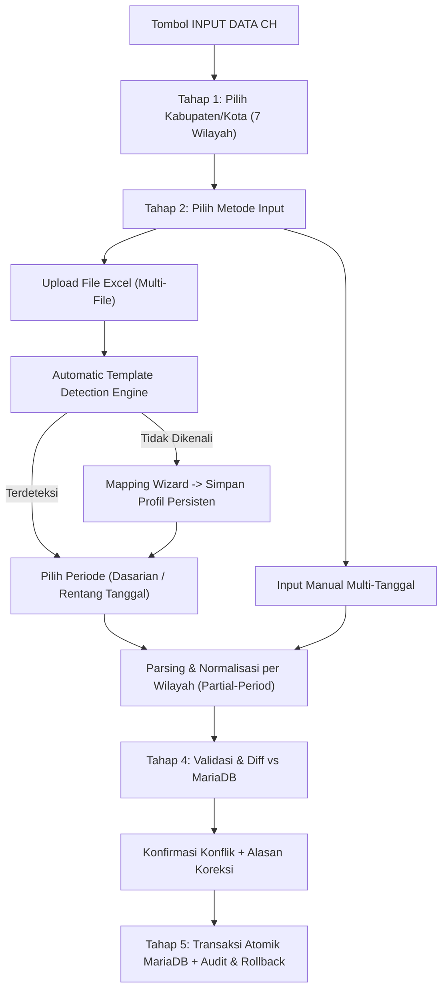

# DSS-PIK — Modul Input Data Curah Hujan (V2)

**Status**: Aktif di Lingkungan Pengembangan Lokal (`backend/rainfall_ingestion_v2.py` & `frontend/src/components/RainfallInputModal.jsx`)  
**Versi Parser**: `1.2.0` + Rainfall V2 Multi-Format Engine  
**Database Lokal**: MariaDB 11.4.10 (`cews_db_migration_test`)

---

## 1. Arsitektur Input Baru

Modul Input Data Curah Hujan V2 memisahkan secara bersih antara **deteksi struktur workbook**, **normalisasi meteorologi per wilayah**, **pemetaan stasiun**, dan **komitmen transaksional atomik MariaDB**, sambil mempertahankan 100% kompatibilitas dengan template lama (Batam, Bintan XLSM, Tanjungpinang, dan Multi-Sheet).



---

## 2. Matriks Dukungan Wilayah & Template

| Wilayah | Kode API | Template Mentah (Raw) | Template Lama (Legacy) |
|---|---|---|---|
| Kabupaten Karimun | `KARIMUN` | Ya (`RAW_KARIMUN`) | Ya (`LEGACY_MULTI_SHEET`) |
| Kabupaten Lingga (Dabo Singkep) | `LINGGA` | Ya (`RAW_LINGGA`) | Ya (`LEGACY_MULTI_SHEET`) |
| Kabupaten Natuna | `NATUNA` | Ya (`RAW_NATUNA`) | Ya (`LEGACY_MULTI_SHEET`) |
| Kabupaten Kepulauan Anambas | `ANAMBAS` | Ya (`RAW_ANAMBAS`) | Ya (`LEGACY_MULTI_SHEET`) |
| Kota Batam | `BATAM` | Tidak | Ya (`LEGACY_MULTI_SHEET`) |
| Kabupaten Bintan | `BINTAN` | Tidak | Ya (`LEGACY_BINTAN_XLSM`, `LEGACY_MULTI_SHEET`) |
| Kota Tanjungpinang | `TANJUNGPINANG` | Tidak | Ya (`LEGACY_MULTI_SHEET`) |

---

## 3. Automatic Template Detection Engine

Deteksi dilakukan berdasarkan **struktur workbook** (`detect_rainfall_template` di `backend/rainfall_ingestion_v2.py`), bukan sekadar nama file:
1. **Karimun Raw (`RAW_KARIMUN`)**: Mencari penanda `No. Stasiun Hujan` pada blok vertikal stasiun (mendukung `Lembar1` dan mengabaikan `Lembar2` kosong). Jumlah stasiun dinamis (tidak di-hardcode).
2. **Lingga Raw (`RAW_LINGGA`)**: Tanggal vertikal di kolom B, stasiun horizontal di kolom C–J, kolom penanda dasarian (K), header bertingkat/merged cells, dan deteksi konflik nama sheet vs judul dokumen (mis. sheet `SEP` vs judul `OKTOBER 2026`).
3. **Natuna Raw (`RAW_NATUNA`)**: Nama stasiun vertikal di kolom A, tanggal 1–31 horizontal di kolom B–AF, mengabaikan kolom akumulasi (AG) dan hari hujan (AH). Sheet `YYMM` (mis. `2610`) ditampilkan sebagai kandidat periode yang wajib dikonfirmasi operator.
4. **Anambas Raw (`RAW_ANAMBAS`)**: Metadata stasiun di kolom A–F (stasiun tanpa kode dicocokkan lewat nama), tanggal 1–30/31 di kolom G–AJ, mengabaikan kolom akumulasi dasarian/bulanan (AK–AN).
5. **Legacy (`LEGACY_BINTAN_XLSM`, `LEGACY_MULTI_SHEET`)**: Didelegasikan ke parser existing `parse_rainfall_excel()` di `backend/ingestion_service.py` dengan tambahan filter rentang tanggal opsional.
6. **Profil Kustom Tersimpan (`CUSTOM_MAPPED`)**: Dicocokkan otomatis melalui `structure_fingerprint` dari tabel `cews_rainfall_template_profiles`. Jika tetap tidak dikenali, status `NEEDS_MAPPING` membuka **Mapping Wizard**.

---

## 4. Aturan Normalisasi Simbol & Representasi Standar DSS-PIK

**Representasi Akhir Tabel CH & Ekspor DSS-PIK**:
- Tidak ada hujan (`0 mm`, `OBSERVED_ZERO`) → **`-`**
- Hujan tidak terukur (`TTU`) → **`TTU`** *(bukan 0 mm pada perhitungan SPI)*
- Data tidak masuk, sel pengamatan kosong, atau alat rusak (`MISSING`/`DAMAGED`) → **`9999`** *(bukan 0 mm pada perhitungan SPI)*
- Curah hujan terukur (`OBSERVED_VALID`) → nilai numerik dalam mm (mis. `12.5`)

| Wilayah | Simbol Sumber | `obs_status` | Hasil Standar DSS-PIK |
|---|---|---|---|
| Karimun (Raw) | `0` | `OBSERVED_ZERO` | `-` |
| Karimun (Raw) | `TTU` | `TTU` | `TTU` |
| Karimun (Raw) | `9999` / sel kosong | `MISSING` | `9999` |
| Lingga (Raw) | `0` | `OBSERVED_ZERO` | `-` |
| Lingga (Raw) | `-`, `9999`, sel kosong | `MISSING` | `9999` |
| Lingga (Raw) | `TTU`, `8888` | `TTU` | `TTU` |
| Natuna (Raw) | `0`, `TTU` | `TTU` | `TTU` |
| Natuna (Raw) | `-`, `9999`, sel kosong | `MISSING` | `9999` |
| Anambas (Raw) | `-` | `OBSERVED_ZERO` | `-` |
| Anambas (Raw) | `0`, `TTU` | `TTU` | `TTU` |
| Anambas (Raw) | `9999`, sel kosong | `MISSING` | `9999` |
| Legacy (7 Wilayah) | `-`, `0` | `OBSERVED_ZERO` | `-` |
| Legacy (7 Wilayah) | `TTU` | `TTU` | `TTU` |
| Legacy (7 Wilayah) | `9999`, `X`, `R` | `MISSING` / `DAMAGED` | `9999` |

**Aturan Partial-Period Import**:
- Tanggal yang tercantum dalam struktur file namun sel observasinya kosong → dinormalisasi ke `MISSING` (`9999`).
- Tanggal yang sama sekali **tidak tercantum** dalam file mentah → **tidak dibuatkan record**.

---

## 5. Database & Migration

Migration aditif (aman, non-destruktif): `database/migrations/20261125_add_rainfall_template_profiles.sql`
- `cews_rainfall_template_profiles`: Menyimpan aturan struktur workbook (`structure_fingerprint`, `sheet_rules_json`, `header_config_json`, `date_config_json`, `value_config_json`, `station_config_json`, `ignored_columns_json`, `symbol_mapping_json`, `version`).
- `cews_rainfall_station_aliases`: Menyimpan pemetaan identitas pos sumber ke master `station_id` secara terpisah dari profil template.

Tabel operasional yang digunakan bersama dengan modul existing:
- `cews_rainfall_daily` (`UNIQUE KEY uq_station_date (station_id, observation_date)`)
- `staging_rainfall_import`
- `cews_rainfall_correction_log`
- `cews_ingestion_history` (termasuk `batch_items_json` sehingga fitur rollback `cancel_ingestion_batch` tetap bekerja penuh).

---

## 6. Endpoint API V2

Semua endpoint dilindungi oleh `authentication_guard_middleware`:

| Method | Endpoint | Fungsi |
|---|---|---|
| `GET` | `/api/v1/rainfall/v2/regencies` | Daftar 7 kabupaten/kota, matriks dukungan template, dan daftar stasiun master |
| `POST` | `/api/v1/rainfall/v2/detect` | Upload 1 atau beberapa file Excel + Automatic Template Detection |
| `GET` | `/api/v1/rainfall/v2/profiles` | Daftar profil Mapping Wizard tersimpan |
| `POST` | `/api/v1/rainfall/v2/profiles` | Simpan profil Mapping Wizard + alias stasiun secara persisten |
| `POST` | `/api/v1/rainfall/v2/preview` | Parsing sesuai periode terpilih + validasi diff vs MariaDB |
| `POST` | `/api/v1/rainfall/v2/commit` | Commit transaksional atomik + audit trail + baseline fingerprint check |
| `POST` | `/api/v1/rainfall/v2/manual/preview` | Validasi & diff input manual multi-tanggal |
| `POST` | `/api/v1/rainfall/v2/manual/commit` | Commit transaksional input manual multi-tanggal |

---

## 7. SOP Operator Singkat

1. Buka menu **Pusat Data → Data Curah Hujan**, klik tombol **Input Data Curah Hujan**.
2. Pilih **Kabupaten/Kota** (1 wilayah per sesi).
3. Pilih **Upload File Excel** atau **Input Manual**.
   - **Upload**: Seret 1 atau beberapa file `.xlsx`/`.xlsm` → klik **Deteksi Format Otomatis** → konfirmasi periode (atau gunakan **Mapping Wizard** jika format baru) → klik **Pratinjau & Validasi**.
   - **Manual**: Pilih stasiun → pilih Dasarian atau Rentang Tanggal → isi nilai atau paste langsung dari Excel → klik **Pratinjau & Validasi**.
4. Periksa ringkasan (`Baru`, `Konflik`, `Identik`, `Invalid`, `TTU`, `Missing`). Jika ada `Konflik` yang ingin diperbarui, centang persetujuan dan wajib isi **Alasan Koreksi**.
5. Klik **Simpan ke Database**. Catat `Batch ID` untuk penelusuran di tab **Manajemen Data Operasional**.

---

## 8. Pengujian & Troubleshooting

Jalankan test suite lokal (pastikan MariaDB portable lokal aktif di port 3306):
```powershell
.venv\Scripts\python.exe -m pytest tests/integration/test_rainfall_input_v2.py -v
.venv\Scripts\python.exe -m pytest tests/integration/test_period_aware_ingestion_hardening.py -v
```

**Batasan yang diketahui**:
- Format biner Excel lama `.xls` (BIFF) ditolak dengan pesan jelas karena `openpyxl` hanya membaca `.xlsx`/`.xlsm`; simpan ulang file sebagai `.xlsx`.
- Empat workbook mentah asli dari daerah belum tersimpan di direktori fixture lokal sehingga pengujian parser mentah saat ini menggunakan fixture sintetis yang mereplikasi spesifikasi struktur aktual.


---

## 9. Fitur Hapus Data Curah Hujan Berdasarkan Periode (Soft-Delete `VOID`)

Akses melalui **Pusat Data → Data Curah Hujan → Tombol `Hapus Data`** (`RainfallDeleteModal.jsx`).

### Alur 5 Tahap
1. **Wilayah**: Pilih 1 dari 7 kabupaten/kota (termasuk **Kabupaten Bintan** dan **Kota Tanjungpinang** yang terpisah secara ketat).
2. **Periode**: Tentukan tanggal mulai dan tanggal akhir.
3. **Cakupan Stasiun**: Semua stasiun pada wilayah terpilih, atau satu/beberapa stasiun tertentu.
4. **Pratinjau Dampak**: Menampilkan wilayah, periode, jumlah stasiun terdampak, total record aktif, dan sampel nilai CH sebelum eksekusi.
5. **Konfirmasi & Eksekusi Transaksional**: Wajib mengisi alasan penghapusan dan mencentang konfirmasi.

### Keamanan, Audit Trail & Pemulihan
- **Soft-Delete (`VOID`)**: Record tidak dihapus fisik permanen (`DELETE`); status diubah menjadi `obs_status = 'VOID'`, `rainfall_mm = NULL`, `is_observed = 0`, `is_missing = 1` dalam satu transaksi atomik MariaDB (`FOR UPDATE`, rollback penuh jika gagal).
- **Dampak pada Tabel CH, Ekspor & SPI**:
  - Tabel CH Data Center (`/api/v1/rainfall/daily-table`) dan ekspor (`/api/v1/rainfall/download`) mengecualikan record `VOID`.
  - Perhitungan SPI (`backend/spi_calculation_service.py`) memetakan `VOID`, `TTU`, `MISSING`, dan `DAMAGED` ke `NaN` sehingga tidak pernah dihitung sebagai `0 mm`.
- **Audit Trail & Pemulihan**:
  - Setiap record yang di-`VOID` dicatat di `cews_rainfall_correction_log` beserta nilai lama (`old_rainfall_mm`, `old_obs_status`), alasan, operator, dan waktu.
  - Ringkasan batch dicatat di `cews_ingestion_history` (`batch_id = VOID_CH_...`, lengkap dengan `batch_items_json`) sehingga dapat dipulihkan melalui mekanisme pembatalan batch (`POST /api/v1/ingestion/batch/{batch_id}/cancel`).

### Endpoint API Hapus Data
| Method | Endpoint | Fungsi |
|---|---|---|
| `POST` | `/api/v1/rainfall/v2/delete/preview` | Pratinjau dampak soft-delete berdasarkan wilayah, periode, dan stasiun |
| `POST` | `/api/v1/rainfall/v2/delete/commit` | Eksekusi atomik soft-delete (`VOID`) + audit log + cache invalidation |


---

## 10. Perbaikan Mapping Template Lama Natuna & Konsolidasi Tab 3

### Akar Masalah 7 Pos Natuna Tidak Cocok di Produksi
- Di container produksi Docker (`backend/Dockerfile`), folder `docs/` tidak disalin ke image sehingga `docs/DSS_PIK_TEMPLATE_INPUT_SCHEMA.json` tidak tersedia.
- Akibatnya, `parse_rainfall_excel()` hanya mencocokkan 8 dari 15 sheet `Kabupaten Natuna.xlsx` via exact `station_name` master, sedangkan 7 sheet dengan awalan nama kecamatan/pulau gagal cocok karena belum terdaftar di `known_aliases` di `backend/ingestion_service.py`:
  1. `02_Bunguran Timur Laut` → `21031501A` (`Tanjung`)
  2. `05_Pulau Tiga Sabang Mawang` → `21031101A` (`Sabang Mawang`)
  3. `06_Serasan Hilir` → `21030601A` (`Hilir`)
  4. `07_Subi Melia` → `21030901A` (`Melia`)
  5. `08_Midai Sabang Barat` → `21030401A` (`Sabang Barat`)
  6. `09_Pulau Laut Air Payang` → `21031001A` (`Air Payang`)
  7. `13_Selemut Cemaga` → `21031802A` (`Selemut`)
- **Solusi**: Seluruh 15 alias eksplisit Natuna ditambahkan langsung ke `known_aliases` di `backend/ingestion_service.py` dan diuji tanpa file `docs/` (15/15 cocok, 0 unmapped).

### Konsolidasi Pengelolaan Data CH pada Tab 3 (`3. Koreksi & Pembatalan Rekaman`)
- Tombol terpisah `Hapus Data` pada halaman Data Curah Hujan telah dihapus; tersisa hanya **Input / Pembaruan Data CH** dan **Koreksi & Kelola CH** (langsung mengarah ke Tab 3 dengan filter Curah Hujan aktif).
- Seluruh operasi **Filter & Tabel Observasi Standar (`-`, `TTU`, `9999`, mm)**, **Koreksi 5 Jenis Nilai**, **Pembatalan Rekaman Terpilih & Periode (VOID)**, **Pemulihan Batch VOID dengan Proteksi Konflik**, dan **Audit Log** terpusat di Tab 3 (`RainfallManagementTab.jsx`).
- Seluruh endpoint mutasi Tab 3 menggunakan identitas operator dari sesi autentikasi aktual (`request.state.user["username"]`).


---

## 11. Arsitektur Generator SPI Asinkron & Pencegahan HTTP 524

### Akar Masalah HTTP 524 pada Generator SPI Daily
- **HTTP 524 ("A Timeout Occurred")** berasal dari **Cloudflare Proxy** yang memutus koneksi HTTP jika origin tidak mengembalikan response dalam **100 detik**.
- Pada implementasi sebelumnya, `POST /api/v1/spi/generator/execute` menjalankan seluruh perhitungan `si.spi(..., fit_freq="D")` secara **sinkron** untuk 52 stasiun (`~5.395` observasi/pos, 366 hari kalender × 52 pos = `19.032` fitting MLE `scipy.stats`).
- Pengukuran lokal (`cews_db_migration_test`, `280.559` baris): rata-rata `12,19 detik/stasiun` → estimasi `~633,7 detik` serial / `~316,8 detik` (2 CPU) / `~158,4 detik` (4 CPU), sehingga pasti melewati batas 100 detik Cloudflare sekaligus memicu timeout 120 detik Joblib `loky`.

### Solusi Arsitektur: MariaDB-Backed Asynchronous Job Engine
- **Tanpa layanan eksternal baru (tanpa Redis)**: menggunakan tabel persisten `cews_spi_generation_jobs` (`database/migrations/20261126_add_spi_generation_jobs.sql`, aditif `CREATE TABLE IF NOT EXISTS`, rollback: `DROP TABLE IF EXISTS cews_spi_generation_jobs`).
- **Alur Non-Blocking**:
  1. `POST /api/v1/spi/generator/jobs` memvalidasi parameter, mencegah duplikasi job aktif identik (`job_key`), mencatat status `QUEUED` di MariaDB, menjalankan worker latar belakang, dan mengembalikan `job_id` dalam `< 1 detik` (**0 risiko HTTP 524**).
  2. Worker (`backend/spi_job_service.py`) mengambil data CH aktif (mengecualikan `VOID` serta menghilangkan SQL `ORDER BY` sehingga menghindari `Using filesort` pada `280K` baris), menjalankan `si.spi()` dengan metode ilmiah identik (`prob_zero=True`, `all_zero_policy="stagge"`, `fitting_policy="standard"`, `BestDist`) menggunakan `ProcessPoolExecutor` + `as_completed()`, dan memperbarui progres per stasiun serta `heartbeat_at` secara real-time di MariaDB.
  3. Hasil staging disimpan ke disk (`data/raw/spi/_staging/{session_token}.parquet`) sehingga tahan terhadap restart container sebelum commit atomik ke Parquet kanonikal.
  4. Job yang terhenti akibat restart container (`heartbeat_at > 5 menit`) otomatis ditandai `FAILED` oleh `recover_stale_spi_jobs()` agar operator dapat menjalankan `POST /api/v1/spi/generator/jobs/{job_id}/retry`.
- **Integrasi CH → SPI**: Record `VOID`, `TTU`, `MISSING`, dan `DAMAGED` dipetakan ke `NaN` (tidak pernah dianggap `0 mm`); hanya `OBSERVED_ZERO` (`-`) yang dihitung sebagai `0.0 mm` valid.

### Endpoint Job SPI Asinkron
| Method | Endpoint | Fungsi |
|---|---|---|
| `POST` | `/api/v1/spi/generator/jobs` | Mendaftarkan job SPI asinkron (mengembalikan `job_id` segera) |
| `GET` | `/api/v1/spi/generator/jobs` | Daftar riwayat job SPI terbaru |
| `GET` | `/api/v1/spi/generator/jobs/{job_id}` | Polling progres real-time (`progress_pct`, `completed_stations`, `status`, hasil saat `SUCCEEDED`) |
| `POST` | `/api/v1/spi/generator/jobs/{job_id}/cancel` | Membatalkan job `QUEUED`/`RUNNING` |
| `POST` | `/api/v1/spi/generator/jobs/{job_id}/retry` | Mengulang job `FAILED`/`CANCELLED` |
