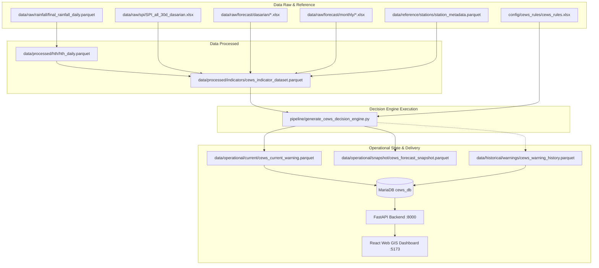

# CEWS DATA LINEAGE & TRACEABILITY MATRIX
**Climate Early Warning System (CEWS) BMKG Stasiun Klimatologi Kepulauan Riau**  
**Cycle Operasional**: Dasarian I Oktober 2026 (1–10 Oktober 2026)  
**Observation Cutoff**: 30 September 2026 (Dasarian III September 2026)  

---

## 1. Overview
Dokumen ini mendokumentasikan jalur aliran data (*data lineage*), berkas sumber kanonikal, frekuensi pembaruan, dan lokasi berkas aktif untuk seluruh indikator dan produk keluaran CEWS.

---

## 2. Active Indicator Lineage Matrix

| Indikator / Data | Lokasi Berkas Kanonikal Aktif | Sumber Data Asli / Primer | Frekuensi Pembaruan | Resolusi / Format | Peran dalam Decision Engine |
|---|---|---|---|---|---|
| **Rainfall Observation** | `data/raw/rainfall/final_rainfall_daily.parquet` | Stasiun Pengamatan & Pos Hujan Kerjasama BMKG KEPRI | Harian | Harian (mm/hari) | Dasar kalkulasi HTH operasional |
| **HTH (Hari Tanpa Hujan)** | `data/processed/hth/hth_daily.parquet` | Diturunkan dari `final_rainfall_daily.parquet` | Harian / Dasarian | Harian / Integer (hari) | Ranting PDKM: Konjungsi HTH $\ge 21/31/61$ |
| **SPI 30-Hari Dasarian** | `data/raw/spi/SPI_all_30d_dasarian.xlsx` (Sheet: `SPI`) | Subdit Analisis Iklim BMKG Pusat / Staklim KEPRI | Dasarian (tgl 1, 11, 21) | Indeks kontinu dasarian | Ranting PDKM: Pemicu independen $\le -1.00 / -1.50 / -2.00$ |
| **$P_{b20}$ (Probabilitas CH < 20 mm)** | `data/raw/forecast/dasarian/` | Model Ensemble ECMWF BMKG | Dasarian | Probabilitas (0–100%) | Ranting PDKM: Konjungsi $(\text{HTH} \ge X \ \text{AND} \ P_{b20} > 70)$ |
| **$P_{a150}$ (Probabilitas CH > 150 mm)** | `data/raw/forecast/dasarian/` | Model Ensemble ECMWF BMKG | Dasarian | Probabilitas (0–100%) | Ranting PDCHT: WASPADA Dasarian ($> 70\%$) |
| **$P_{a200}$ (Probabilitas CH > 200 mm)** | `data/raw/forecast/dasarian/` | Model Ensemble ECMWF BMKG | Dasarian | Probabilitas (0–100%) | Ranting PDCHT: SIAGA Dasarian ($> 70\%$) |
| **$P_{a300}$ (Probabilitas CH > 300 mm)** | `data/raw/forecast/dasarian/` | Model Ensemble ECMWF BMKG | Dasarian | Probabilitas (0–100%) | Ranting PDCHT: AWAS Dasarian ($> 70\%$) |
| **$P_{m300}$ (Probabilitas CH > 300 mm)** | `data/raw/forecast/monthly/` | Model Ensemble ECMWF BMKG | Bulanan | Probabilitas (0–100%) | Ranting PDCHT: WASPADA Bulanan ($> 70\%$) |
| **$P_{m400}$ (Probabilitas CH > 400 mm)** | `data/raw/forecast/monthly/` | Model Ensemble ECMWF BMKG | Bulanan | Probabilitas (0–100%) | Ranting PDCHT: SIAGA Bulanan ($> 70\%$) |
| **$P_{m500}$ (Probabilitas CH > 500 mm)** | `data/raw/forecast/monthly/` | Model Ensemble ECMWF BMKG | Bulanan | Probabilitas (0–100%) | Ranting PDCHT: AWAS Bulanan ($> 70\%$) |
| **Station Metadata** | `data/reference/stations/station_metadata.parquet` | Database Master Pos Hujan BMKG | Statis / Berkala | 57 baris stasiun KEPRI | Master data stasiun, koordinat, kabupaten |
| **Current Warning** | `data/operational/current/cews_current_warning.parquet` | Dihasilkan oleh `generate_cews_decision_engine.py` | Dasarian | 57 stasiun aktif | Status aktif operasional untuk Dashboard Web GIS |
| **Forecast Snapshot** | `data/operational/snapshot/cews_forecast_snapshot.parquet` | Dihasilkan oleh `generate_cews_decision_engine.py` | Dasarian | Snapshot numerik | Jejak provenance prakiraan yang digunakan |
| **Warning History** | `data/historical/warnings/cews_warning_history.parquet` | Dihasilkan oleh mode Backtest Decision Engine | Statis (Immutable) | 2.052 dasarian 2025 | Ledger analitis historis & time series chart |

---

## 3. Data Processing Architecture Flow

---

## 4. Operational Integrity Guarantees
1. **Pemisahan Sumber dan Olahan**: Seluruh data mentah diletakkan secara terisolasi di `data/raw/` dan tidak pernah ditimpa oleh proses kalkulasi.
2. **Kanonisitas State Aktif**: State operasional terkini hanya disimpan di `data/operational/current/cews_current_warning.parquet` sebagai *single source of truth*.
3. **Pemberian Jalur Melalui Central Resolver**: Seluruh skrip Python mengakses lokasi data menggunakan fungsi `resolve_path()` pada [config/paths.py](file:///f:/TNJ/paper/DATA_ANALISIS_PRAKIRAAN/CEWS/MAS_HAYU/ASLI/config/paths.py).
